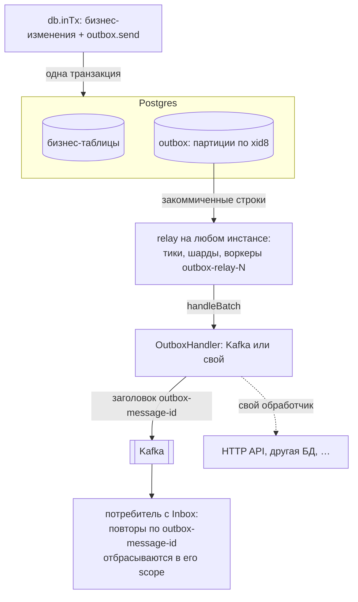
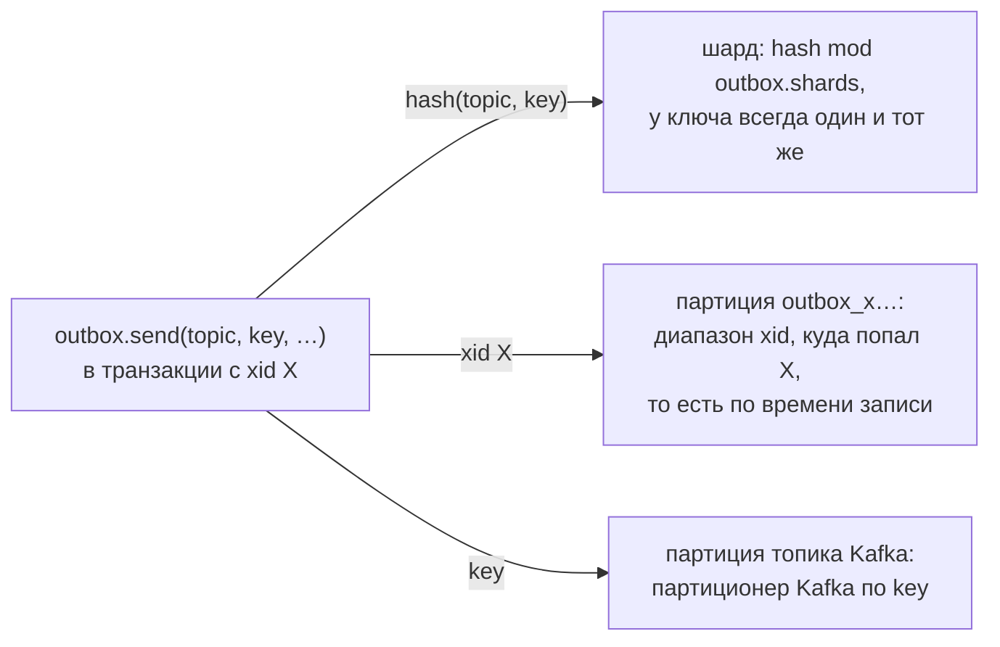
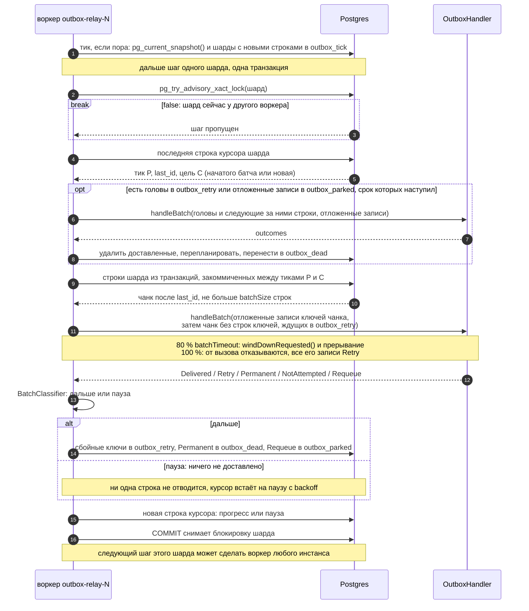
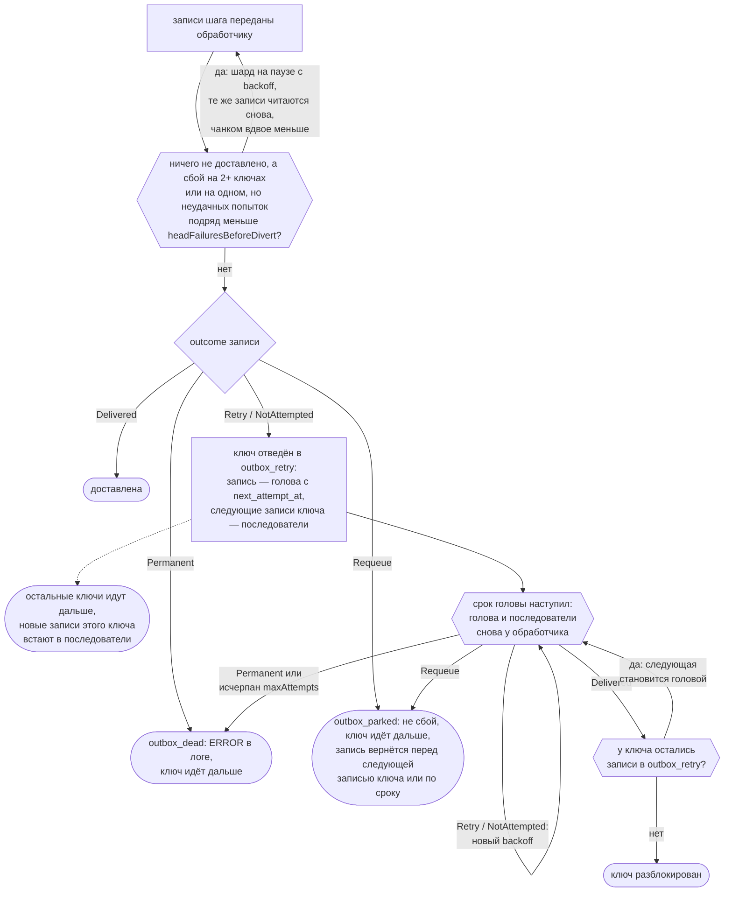
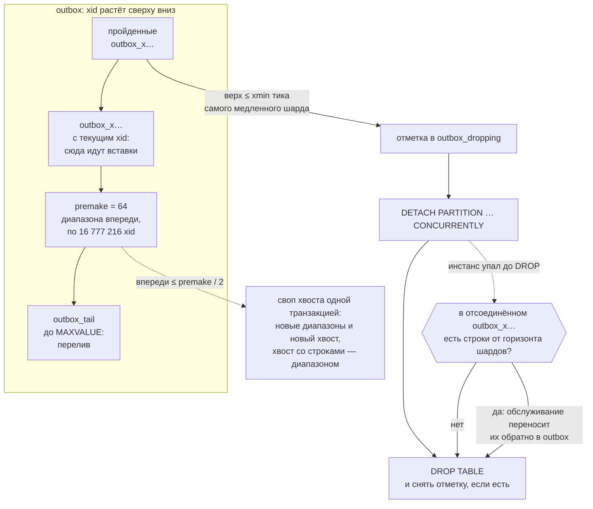
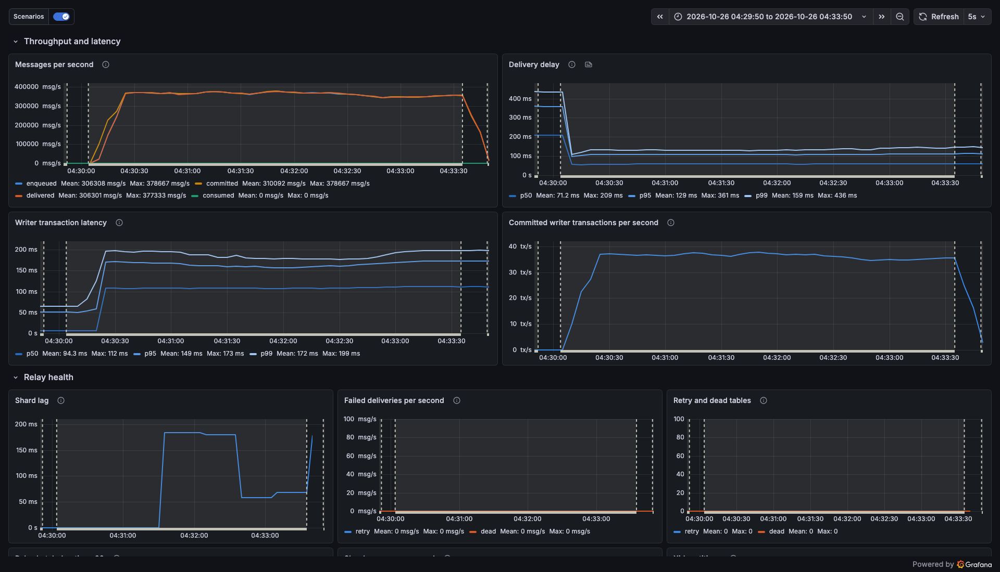
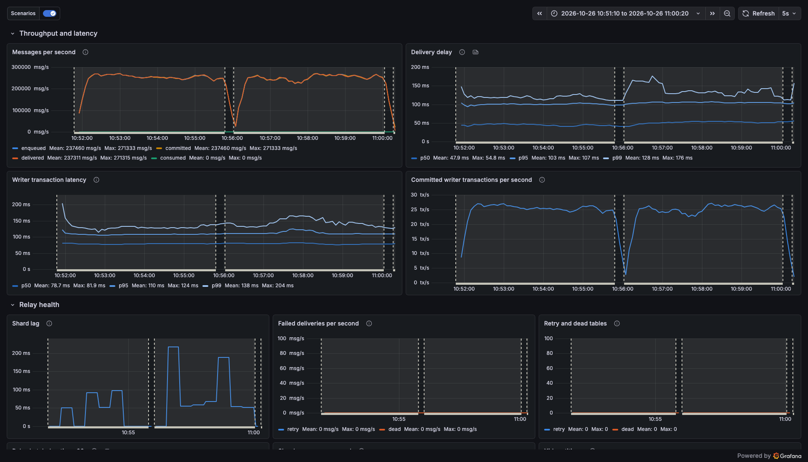
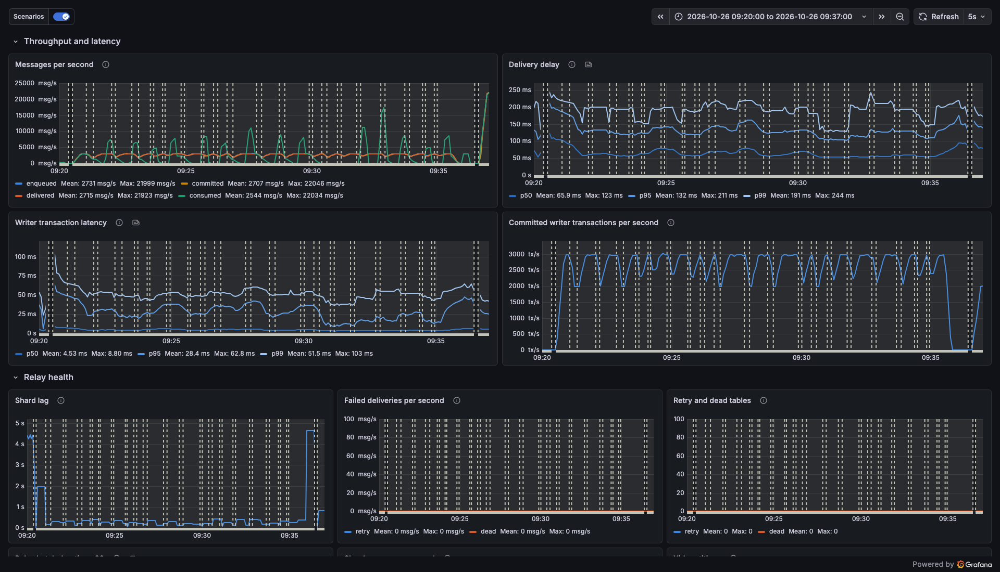
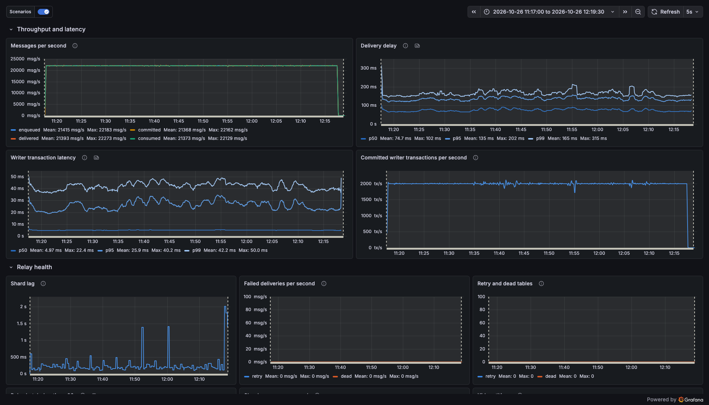

# kora-outbox

Transactional outbox для сервисов на [Kora](https://github.com/Tinkoff/kora) 1.x с Postgres. Вы записываете сообщение
в той же транзакции базы данных, что и бизнес-данные; relay внутри вашего сервиса доставляет его после коммита — в Kafka
или в ваш собственный обработчик. Сообщение больше не теряется, если между коммитом и отправкой сервис упал, Kafka была
недоступна или шёл передеплой, а откаченная транзакция не отправляет ничего.

> **Доставка at-least-once: каждый получатель обязан быть идемпотентным по id сообщения.** Одно и то же сообщение
> может прийти больше одного раза (падение между отправкой и коммитом relay, таймаут, повтор). Exactly-once из outbox
> в Kafka не даёт ни одна реализация: коммит в Postgres и запись в Kafka не атомарны. Effectively-once получается на
> стороне получателя: у каждого сообщения стабильный UUIDv7, в Kafka это заголовок `outbox-message-id` (потребитель на
> Kora отсеивает повторы через [inbox](#потребление-через-inbox)), для HTTP передавайте его как `Idempotency-Key`.

> **Требуется Kora 1.2.23 или новее.** Библиотека объявляет `api(platform("ru.tinkoff.kora:kora-parent:1.2.23"))`.
> В сборке Gradle её подключение поднимает все модули Kora в вашем runtime classpath до 1.2.23, а через
> `database-jdbc` — и HikariCP до 7.1.0. Выставьте свою платформу `kora-parent` и annotation processors
> (`annotation-processors` или `symbol-processors` для KSP) тоже на 1.2.23, чтобы сгенерированный код и runtime
> совпадали.

- Артефакты: `io.github.dsudomoin:kora-outbox`, `io.github.dsudomoin:kora-outbox-kafka` и
  `io.github.dsudomoin:kora-outbox-admin`, `0.1.0-SNAPSHOT` (пока только через `mavenLocal()`).
- Байткод Java 17; работает из Java и Kotlin. Блокирующий API: `send` выполняется внутри `JdbcConnectionFactory.inTx`.

Общая схема: сообщение записывается одной транзакцией с бизнес-данными, relay на любом инстансе сервиса после коммита
передаёт его обработчику, а потребитель отбрасывает повторы через inbox.



## Содержание

- [Гарантии](#гарантии)
- [Требования](#требования)
- [Установка](#установка)
- [Быстрый старт](#быстрый-старт): подключение, настройка, отправка, Kafka, свои обработчики, inbox
- [Как работает relay](#как-работает-relay)
- [Обработка сбоев](#обработка-сбоев)
- [Справочник по конфигурации](#справочник-по-конфигурации)
- [Требования к Kafka](#требования-к-kafka)
- [Эксплуатация](#эксплуатация): таблицы, партиции, админ-API и HTTP, dead letters, восстановление, деплои
- [Наблюдаемость](#наблюдаемость)
- [Тестирование вашего сервиса](#тестирование-вашего-сервиса)
- [Бенчмарки](#бенчмарки)
- [Заметки о дизайне](#заметки-о-дизайне)
- [Известные ограничения](#известные-ограничения)
- [Скиллы для AI-агентов](#скиллы-для-ai-агентов)

## Гарантии

### Гарантируется

- **Доставка at-least-once.** Каждое сообщение, чья транзакция закоммичена, передаётся обработчику, пока тот не
  сообщит о доставке, либо переносится в dead-таблицу с записью уровня ERROR в логе и метрикой
  `outbox.messages.failed{outcome="dead"}`. Это выполняется при падениях приложения, зависших воркерах, недоступности
  цели любой длительности, рестартах Postgres и передеплоях.
- **Судьбу dead letter решает хук или человек.** Письмо лежит в dead-таблице, пока о нём не закоммичено решение
  `OutboxDeadLetterHandler` (тоже at-least-once) или вызов админ-API. Без хука оно остаётся людям. Удаляют письма
  только решение `discard` (его же принимает хук Kafka DLQ для опубликованных писем), переотправка (решение хука или
  вызов админ-API: dead-строка удаляется той же транзакцией, что возвращает сообщение в outbox), удаление вызовом
  админ-API и `outbox.deadLetters.retention` для оставленных, если он задан ([Dead letters](#dead-letters)).
- **Откаченные сообщения никогда не доставляются.** Строка сообщения — часть вашей транзакции. `send` вне транзакции
  бросает `IllegalStateException`; в режиме autocommit он не выполняется никогда.
- **Доставка в порядке коммитов для каждой пары (topic, key).** Для двух сообщений с одним и тем же топиком и одним и
  тем же ненулевым ключом (сравнение побайтовое): если транзакция T1 закоммичена до того, как транзакция T2 отправила
  своё сообщение, обработчик получит сообщение T1 первым и не получит сообщение T2, пока сообщение T1 не доставлено.
  Сообщения одного ключа внутри одной транзакции сохраняют порядок вызовов `send` и `sendAll`. Исключений два:
  сообщение, перенесённое в dead-таблицу, больше не удерживает свой ключ, и ключ продолжает со следующего сообщения;
  сообщение, отложенное через [`Outcome.requeue()`](#свой-обработчик), доставляется после тех сообщений своего ключа,
  которые были доставлены, пока оно было отложено.
- **Стабильный id сообщения.** Каждое сообщение при отправке получает id в формате UUIDv7. `send` возвращает его, relay
  передаёт его при каждой попытке, а обработчик Kafka добавляет его в заголовок `outbox-message-id`. Потребители
  дедуплицируют по нему через [inbox](#потребление-через-inbox).
- **Длинные транзакции не задерживают доставку.** Транзакция, открытая минутами, задерживает только собственные
  сообщения (и писателей тех же ключей, которые ждут её блокировок по ключам). Сообщения, закоммиченные за это время,
  доставляются вовремя (см. [Заметки о дизайне](#заметки-о-дизайне)).
- **Изоляция.** Сбойная пара (topic, key) блокирует только себя. Недоступная цель приостанавливает доставку и ничего не
  теряет. Одно плохое сообщение не может застопорить шард: его изолируют и откладывают в сторону.

### Не гарантируется

- **Exactly-once.** Сообщение может быть доставлено больше одного раза: после падения между отправкой и коммитом relay,
  после таймаута Kafka для записи, которая на самом деле записалась, или после вызова обработчика, прерванного по
  дедлайну. Для effectively-once обработки используйте inbox; его дедупликация работает в пределах scope потребителя и
  ограничена его временным окном.
- **Порядок между ключами.** У разных пар (topic, key), разных топиков и сообщений без ключа нет взаимного порядка.
  Сообщения без ключа не упорядочены и между собой.
- **Порядок вокруг dead letter.** Когда сообщение ушло в dead letters, следующие сообщения его ключа идут дальше.
  Переотправленный dead letter (решением хука или вызовом админ-API) или строка, возвращённая из осиротевшей партиции, —
  это новое сообщение, и оно идёт после них.
- **То, что теряет или переупорядочивает сама Kafka.** `acks=all` надёжен ровно настолько, насколько надёжен топик, а
  добавление партиций переносит ключи; см. [Требования к Kafka](#требования-к-kafka).
- **Асинхронная репликация.** После failover на реплику, где нет части коммитов, сообщения этих коммитов могут быть уже
  доставлены (фантомы). Их бизнес-данные тоже потеряны. Если это важно, используйте синхронную репликацию.
- **Верхняя граница задержки.** Когда цель здорова, доставка быстрая (десятки миллисекунд), но во время сбоев, backoff
  (`relay.retry.maxDelay`) или долгих вызовов обработчика верхней границы нет.
- **Базы с несколькими пишущими узлами.** Блокировки шардов, тики и курсоры живут в primary той же базы, что и
  бизнес-данные; это и есть точка синхронизации всех инстансов, в каком бы ЦОДе они ни работали. Мульти-мастер и
  распределённые SQL-базы, где одну таблицу пишут несколько узлов, не поддерживаются, а split-brain двух primary ломает
  и бизнес-данные, и outbox. Данные, разнесённые по независимым кластерам Postgres (шардирование по базам), — это
  независимый outbox в каждой базе; порядок ключа сохраняется, если все его данные пишутся в одну базу.
- **Несколько независимых relay для одной таблицы.** У одной таблицы outbox один набор курсоров и один обработчик на
  граф приложения. Маршрутизируйте по топику внутри обработчика ([`byTopic`](#свой-обработчик)).

Куда попадает сообщение: шард зависит только от пары (topic, key) и для ключа не меняется, физическая партиция outbox —
только от xid транзакции-писателя (то есть от времени записи), а партицию Kafka по ключу выбирает партиционер Kafka.
Сообщение без ключа попадает в случайный шард.



## Требования

- **Java 17** или новее.
- **Kora 1.2.23** или новее (см. примечание в начале).
- **Postgres 16** или новее. Тесты и бенчмарки запускаются на Postgres 16.
- **Один primary.** Outbox лежит в той же базе, что и бизнес-данные, а relay подключается к тому же primary, что и
  писатели (на read-only реплике шаг не закоммитится). Привязывать инстансы к шардам или к ЦОДу не нужно: инстанс в
  дальнем ЦОДе платит сетевую задержку на каждом запросе шага, но не корректностью.
- Клиент **Kafka** 3.9.2 (эту версию использует Kora 1.2.23) для `kora-outbox-kafka`. Настройки брокера — в разделе
  [Требования к Kafka](#требования-к-kafka).

### Роль в базе и привилегии

Библиотека сама создаёт и поддерживает свои таблицы (миграции в комплект не входят). Запускайте её под ролью, которая:

- имеет `CREATE` на схеме таблиц. Bootstrap выполняется на каждом инстансе, использует `CREATE TABLE IF NOT EXISTS`
  и требует этого права, даже когда таблицы уже существуют;
- владеет таблицами (или входит в роль-владельца). Обслуживание партиций выполняет `CREATE TABLE`,
  `ALTER TABLE ... ATTACH/DETACH PARTITION` и `DROP TABLE`, а для них нужно владение. Если таблицы создаёт роль
  миграций, сделайте роль приложения членом этой роли;
- может делать `SELECT` из identity-последовательности `<base>_id_seq` (владелец может). Каждый тик читает её последнее
  значение;
- входит в `pg_read_all_stats` (или `pg_monitor`): рекомендуется. Без этого Postgres скрывает, как долго идут
  транзакции сессий, вошедших под другими ролями. Тогда перед свопом хвоста партиций обслуживание дважды, с интервалом
  20 с, проверяет их блокировки на outbox. Если членства нет, bootstrap пишет WARN. Это касается и сессий вашего
  собственного приложения, если они переключают роль (`SET ROLE`, отдельные учётные данные на инстанс).

Не задавайте роли `statement_timeout` в несколько секунд. DDL партиций и bootstrap выставляют собственные таймауты, но
шаги очистки при обслуживании выполняются с настройкой роли по умолчанию и повторяются на каждом запуске, если она их
обрывает. Оставьте `track_activities` включённым (так по умолчанию); сессии без него считаются скрытыми, как описано
выше.

Библиотека берёт двухаргументные advisory-блокировки (`pg_advisory_xact_lock(ns, key)`) в двух пространствах имён,
производных от имени таблицы. Ваши собственные двухаргументные advisory-блокировки могут с ними совпасть; блокировки с
одним аргументом `bigint` — никогда.

### Соединения: без transaction pooling

**Bootstrap и обслуживанию нужно прямое соединение или пулер в сессионном режиме.** Они держат сессионные
advisory-блокировки и выставляют сессионные настройки вокруг DDL в режиме autocommit. За прокси с transaction pooling
(pgbouncer или Odyssey в режиме transaction) всё это утекало бы в сессии других клиентов.

- Библиотека проверяет соединение: три последовательных запроса должны выполниться в одной серверной сессии
  (`pg_backend_pid()`). Если это не так, bootstrap валит старт. Обслуживание вместо этого пропускает запуск, пишет ERROR
  не чаще раза в минуту и выставляет gauge `outbox.maintenance.transaction_pooling` (или
  `outbox.inbox.maintenance.transaction_pooling`) в 1.
- Проверка — best effort. pgbouncer переиспользует серверные соединения в порядке LIFO, поэтому спокойный пул часто
  проходит проверку при старте, а проблема проявляется в обслуживании под нагрузкой. Не рассчитывайте на то, что старт
  упадёт.
- `send` и relay используют только состояние уровня транзакции (`SET LOCAL`, транзакционные advisory-блокировки). Но
  библиотека использует для всего единственную `JdbcConnectionFactory` вашего приложения, поэтому сервис, чей
  DataSource обязан ходить через transaction pooler, сегодня не может её использовать.

### Размер пула соединений

Прибавьте `relay.workers + 3` к `db.maxPoolSize`, плюс 1 на время работы `OutboxRelay.drain()`: каждый relay-воркер
держит соединение, пока работает, обслуживание outbox и обслуживание inbox берут по одному на каждый запуск, а поток
`outbox-dead-letters` держит одно на весь свой проход, включая вызов `OutboxDeadLetterHandler` (до
`deadLetters.timeout`). `drain()` держит одно соединение за раз. Писатели используют соединение вашей собственной
транзакции. Сверх этого поток `outbox-heartbeat` раз в `maintenanceInterval` берёт соединение на один короткий
запрос, а после обновления разовое построение индекса `<base>_dead_due` (поток `outbox-dead-index`,
[Таблицы](#таблицы)) держит одно, пока идёт.

### `max_locks_per_transaction` для массовой отправки

Сообщение с ключом берёт транзакционную advisory-блокировку на свою пару (topic, key) и держит её до коммита. Именно
эта блокировка делает порядок по ключу равным порядку коммитов. Поэтому `sendAll` с N различными ключами держит
одновременно N блокировок — как и транзакция, которая вызывает `send` для N различных ключей.

Advisory-блокировки живут в общей таблице блокировок, которая вмещает
`max_locks_per_transaction × (max_connections + max_prepared_transactions)` блокировок на все сессии вместе.
Рассчитайте её на блокировки, которые ваши параллельные массовые транзакции держат в пике, плюс обычные блокировки
всего остального. Иначе транзакции падают с `out of shared memory` (SQLState 53200, hint: increase
`max_locks_per_transaction`).

Пример: два писателя, каждый из которых коммитит батчи `sendAll` по 10 000 различных ключей, держат до 20 000
блокировок. Значения по умолчанию дают 64 × (100 + 0) = 6 400 слотов, этого мало. Бенчмарки запускаются с
`max_locks_per_transaction = 256` и `max_connections = 300`: 76 800 слотов. Настройка требует рестарта, а у hot
standby значение должно быть не меньше, чем у его primary.

## Установка

Соберите и опубликуйте библиотеку в локальный Maven-репозиторий из этого репозитория (сборка использует toolchain
Java 17, он должен быть установлен локально):

```bash
./gradlew publishToMavenLocal
```

Затем в вашем сервисе (Gradle Kotlin DSL):

```kotlin
repositories {
    mavenLocal()
    mavenCentral()
}

dependencies {
    implementation("io.github.dsudomoin:kora-outbox:0.1.0-SNAPSHOT")
    implementation("io.github.dsudomoin:kora-outbox-kafka:0.1.0-SNAPSHOT") // обработчик Kafka; без Kafka не нужен
    implementation("io.github.dsudomoin:kora-outbox-admin:0.1.0-SNAPSHOT") // админ-API по HTTP; без него — из кода
}
```

`kora-outbox` приносит `database-jdbc`, `config-common`, `opentelemetry-common` и `micrometer-core` (1.12.13).
`kora-outbox-kafka` добавляет `kafka-clients` 3.9.2. `kora-outbox-admin` добавляет `http-server-common` и
`json-common`; HTTP-сервер (`http-server-undertow`) и JSON-модуль (`json-module`) подключает сервис
([Админ-API и HTTP](#админ-api-и-http)).

Двум опциональным модулям нужна зависимость, которую библиотека не приносит (она только компилируется с ней). Без неё
`@KoraApp`, включающий такой модуль, не скомпилируется или не стартует (`NoClassDefFoundError`).

| Модуль | Что нужно в вашем classpath |
|---|---|
| `io.github.dsudomoin.kora.outbox.json.OutboxJsonModule` | `ru.tinkoff.kora:json-common` (его приносит любой JSON-модуль Kora, например `json-module`) |
| `io.github.dsudomoin.kora.outbox.protobuf.OutboxProtobufModule` | `com.google.protobuf:protobuf-java` 3.x или новее (его приносят классы, сгенерированные protobuf) |

## Быстрый старт

### Подключение модулей

```java
@KoraApp
public interface App extends HoconConfigModule, JdbcDatabaseModule, JsonModule,
        OutboxModule,       // Outbox, TypedOutbox<T>, relay
        OutboxJsonModule,   // TypedOutbox<T> для классов с @Json
        KafkaOutboxModule,  // обработчик по умолчанию: relay в Kafka
        InboxModule {}      // Inbox для дедупликации на стороне потребителя
```

```kotlin
@KoraApp
interface App : HoconConfigModule, JdbcDatabaseModule, JsonModule,
    OutboxModule, OutboxJsonModule, KafkaOutboxModule, InboxModule
```

- `OutboxModule` требует ровно один `OutboxHandler` в графе. `KafkaOutboxModule` даёт обработчик по умолчанию; ваш
  собственный `OutboxHandler` его заменяет ([Свой обработчик](#свой-обработчик)).
- `InboxModule` без `OutboxModule` даёт сервису, который только потребляет, `Inbox` без обработчика и relay.
- Метрики включаются, когда в графе есть Micrometer `MeterRegistry` (`MetricsModule` из Kora). Трассировка включается,
  когда в нём есть OpenTelemetry `Tracer` (`OpentelemetryTracingModule` из Kora).
- Как всегда в Kora, компонент, от которого не зависит ни один root, не попадает в граф. Relay сам является root.

### Настройка

```hocon
db {
  jdbcUrl = "jdbc:postgresql://localhost:5432/app"
  username = "app"
  password = ${DB_PASSWORD}
  poolName = "app"
  maxPoolSize = 24 # ваша собственная нагрузка + outbox.relay.workers + 3
}

outbox {
  table = "app.outbox" # необязательно (по умолчанию "outbox"); указывайте схему, см. «Rolling-деплои»
  kafka.driverProperties {
    "bootstrap.servers" = "kafka-1:9092,kafka-2:9092,kafka-3:9092"
  }
}
```

У всех остальных ключей есть значения по умолчанию ([Справочник по конфигурации](#справочник-по-конфигурации)). При
первом старте библиотека создаёт свои таблицы, заранее создаёт партиции и запускает relay.

### Отправка в транзакции

`Outbox.send` должен выполняться внутри `JdbcConnectionFactory.inTx(...)`, в той же транзакции, что и ваши
бизнес-записи. Он возвращает id сообщения.

```java
@Component
public final class Orders {

    private final JdbcConnectionFactory db;
    private final OrderRepository repository;
    private final Outbox outbox;

    public Orders(JdbcConnectionFactory db, OrderRepository repository, Outbox outbox) {
        this.db = db;
        this.repository = repository;
        this.outbox = outbox;
    }

    public void create(Order order, byte[] event) {
        db.inTx(() -> {
            repository.insert(order);
            outbox.send(OutboxMessage.of("orders", order.userId(), event)); // ключ = id пользователя
        });
    }
}
```

```kotlin
@Component
class Orders(
    private val db: JdbcConnectionFactory,
    private val repository: OrderRepository,
    private val outbox: Outbox,
) {
    fun create(order: Order, event: ByteArray) = db.inTx<Unit> { _: Connection ->
        repository.insert(order)
        outbox.send(OutboxMessage.of("orders", order.userId, event))
    }
}
```

В Kotlin передавайте `inTx` аргумент типа и параметр `Connection`, как выше: у `JdbcConnectionFactory.inTx` четыре
перегрузки.

`OutboxMessage`:

- `OutboxMessage.of(topic, key, payload)`: `key` — это `String` (кодируется в UTF-8) или `byte[]`. Это ключ порядка
  и, для Kafka, ключ записи. Не больше 1024 байт.
- `OutboxMessage.of(topic, payload)`: сообщение без ключа. Сообщения без ключа распределяются по шардам случайно и не
  упорядочены. `of(topic, null, payload)` не компилируется (перегрузки для `String` и `byte[]` неоднозначны);
  используйте эту.
- `payload` может быть `null` — это tombstone в Kafka. `topic` обязателен, не длиннее 249 символов.
- `message.withHeader(name, value)` добавляет заголовок; заголовки сохраняют порядок и могут повторяться, как в Kafka.
- `new OutboxMessage(topic, key, payload, headers)` — полная форма.

Другие способы отправки:

- **`sendAll(List<OutboxMessage>)`**: два запроса при любом размере, id возвращаются в порядке входного списка. Он
  блокирует все свои ключи разом, в фиксированном порядке, поэтому параллельные транзакции `sendAll` никогда не
  попадают на них в deadlock. **Безопасное правило:** отправляйте все сообщения с ключом одной транзакции одним
  `sendAll`, без других `send` в этой транзакции. Транзакция, которая уже держит блокировки ключей от предыдущего
  `send` или `sendAll`, может попасть в deadlock с другой; тогда Postgres прерывает одну из них (SQLState 40P01), и вы
  её повторяете.
- **`send(Connection, OutboxMessage)`** — для кода, который сам управляет соединением. Оно должно быть в транзакции
  (autocommit выключен). Сразу после коммита relay будит только текущее соединение `inTx` из Kora; с любым другим
  соединением доставка ждёт idle-опроса relay (`relay.idlePollInterval`).
- **Контекст трассировки.** `send` сохраняет текущую трассу (`traceparent`, `tracestate`) в заголовках сообщения, если
  сообщение ещё не несёт `traceparent`.

`inTx` возвращает то, что возвращает лямбда:

```java
UUID id = db.inTx(connection -> {
    repository.insert(order);
    return outbox.send(OutboxMessage.of("orders", order.userId(), event));
});
```

#### Типизированные сообщения: `TypedOutbox<T>`

`OutboxModule` предоставляет `TypedOutbox<T>` для каждого `T`, у которого есть компонент `OutboxSerializer<T>`.
`OutboxJsonModule` выводит такой сериализатор для каждого класса с `JsonWriter` из Kora (классы с `@Json`).

```java
@Json
public record OrderCreated(long id, String userId) {}

@Component
public final class Orders {

    private final JdbcConnectionFactory db;
    private final TypedOutbox<OrderCreated> events;

    public Orders(JdbcConnectionFactory db, TypedOutbox<OrderCreated> events) {
        this.db = db;
        this.events = events;
    }

    public void create(Order order) {
        db.inTx(() -> {
            // вставка заказа ...
            events.send("orders", order.userId(), new OrderCreated(order.id(), order.userId()));
        });
    }
}
```

```kotlin
@Json
data class OrderCreated(val id: Long, val userId: String)

@Component
class Orders(private val db: JdbcConnectionFactory, private val events: TypedOutbox<OrderCreated>) {
    fun create(order: Order) = db.inTx<Unit> { _: Connection ->
        // вставка заказа ...
        events.send("orders", order.userId, OrderCreated(order.id, order.userId))
    }
}
```

- **Явный сериализатор важнее JSON-шаблона.** Ваш собственный компонент `OutboxSerializer<T>` используется для своего
  `T`, даже если `T` помечен `@Json` и подключён `OutboxJsonModule`:

  ```java
  default OutboxSerializer<OrderCreated> orderCreatedSerializer() {
      return (topic, value) -> Avro.encode(value); // любой формат: Avro, CSV, ...
  }
  ```

- **Четырёхаргументному `send` без ключа нужно приведение типа:** `send(topic, key, value, headers)` существует для
  ключа `String` и для ключа `byte[]`, поэтому одиночный `null` неоднозначен:

  ```java
  events.send("orders", (String) null, value, List.of(new OutboxHeader("source", sourceBytes)));
  ```

- Значение `null` отправляется как payload `null` (tombstone). Сериализатор не должен возвращать `null`: в этом случае
  `TypedOutbox` бросает `OutboxSerializationException`, а не отправляет случайный tombstone, который удалил бы ключ в
  compacted-топике. Сериализатор, бросивший исключение, приводит к тому же исключению. В обоих случаях ничего не
  записывается, и что делать дальше, решает ваша транзакция.

#### Protobuf: `ProtobufOutbox`

Добавьте `OutboxProtobufModule` в `@KoraApp`. Один компонент `ProtobufOutbox` отправляет любое protobuf-сообщение в его
бинарной кодировке (`OrderEvent` здесь — класс, сгенерированный protobuf):

```java
db.inTx(() -> {
    // вставка заказа ...
    protobufOutbox.send("orders", order.userId(), OrderEvent.newBuilder().setId(order.id()).build());
});
```

Сообщение `null` — это tombstone, как и в `TypedOutbox`.

### Доставка в Kafka

С `KafkaOutboxModule` и заданным `outbox.kafka.driverProperties."bootstrap.servers"` relay отправляет каждое сообщение
в топик Kafka, имя которого указано в его `topic`:

| Запись Kafka | Значение |
|---|---|
| topic | `topic` сообщения |
| key | `key` сообщения (`null` для сообщений без ключа) |
| value | `payload` (`null` — это tombstone) |
| headers | заголовки сообщения по порядку (включая `traceparent` и `tracestate`), затем `outbox-message-id` (UUID строкой в UTF-8) |
| partition | партиционер Kafka по умолчанию (записи с ключом — по хешу ключа). Пока партиция топика остывает после сбоев, отправитель на каждый вызов выбирает для записей этого топика без ключа одну здоровую партицию |
| timestamp | на усмотрение Kafka (время отправки) |

Продюсер идемпотентный, с `acks=all`, и закрывается при первой неудачной отправке, чтобы ни одна более поздняя запись
сбойного ключа не могла её обогнать. В разделе [Требования к Kafka](#требования-к-kafka) перечислены настройки
продюсера, которые библиотека навязывает, отвергает и задаёт по умолчанию, и настройки топиков, от которых зависят
гарантии.

`KafkaOutboxPublisher<K, V>` отправляет в один топик через `Serializer`-ы Kafka (включая `@Json`-сериализаторы Kora).
Ключ порядка — сериализованный ключ Kafka:

```java
var publisher = new KafkaOutboxPublisher<>(outbox, "orders", keySerializer, valueSerializer);
db.inTx(() -> {
    publisher.send(order.userId(), event);
});
```

Он отвергает некорректное имя топика при создании, а также сериализатор, который возвращает `null` для ненулевого
ключа или значения.

### Свой обработчик

Обработчик доставляет записи куда-то ещё: в HTTP API, в другую базу, в несколько целей. Реализуйте `OutboxHandler`:

```java
public interface OutboxHandler {
    void handle(OutboxRecord record) throws Exception;          // одна запись
    default List<Outcome> handleBatch(List<OutboxRecord> records); // по одному Outcome на запись, в том же порядке
    static boolean windDownRequested();
    static OutboxHandler byTopic(Map<String, OutboxHandler> routes, OutboxHandler fallback);
}
```

`OutboxRecord` несёт `id`, `messageId`, `topic`, `key`, `payload`, `headers`, `createdAt`, `attempts` (число
предыдущих неудачных попыток) и `requeues` (сколько раз запись уже откладывали через `Outcome.requeue()`).

**`handle`: простая форма.** Доставьте одну запись и верните управление. Для записи, которая никогда не сможет пройти,
бросьте `OutboxPermanentException`: она переносится в dead-таблицу, а её ключ продолжает со следующего сообщения.
Любое другое исключение, включая `Error`, означает «повторить позже». `handleBatch` по умолчанию вызывает `handle` для
каждой записи по порядку:

- после сбоя пара (topic, key) этой записи пропускается до конца вызова (`NotAttempted`); записи без ключа никогда не
  блокируют друг друга;
- пока ничего не доставлено, он останавливается после сбоев на 3 различных ключах, так как цель, похоже, недоступна, и
  возвращает `NotAttempted` для остальных;
- перед каждой записью он проверяет `OutboxHandler.windDownRequested()` и останавливается, если сворачивание запрошено
  (см. дедлайны ниже);
- каждый вызов `handle` выполняется в контексте Kora, несущем трассу записи, поэтому клиенты Kora, вызванные из него,
  продолжают эту трассу.

HTTP-цель с `@HttpClient` из Kora:

```java
@HttpClient(configPath = "httpClient.audit")
public interface AuditClient {
    @HttpRoute(method = HttpMethod.POST, path = "/events")
    void post(@Header("Idempotency-Key") String messageId, byte[] body);
}

@Component
public final class AuditHandler implements OutboxHandler {

    private final AuditClient client;

    public AuditHandler(AuditClient client) {
        this.client = client;
    }

    @Override
    public void handle(OutboxRecord record) {
        try {
            client.post(record.messageId().toString(), record.payload());
        } catch (HttpClientResponseException e) {
            if (e.getCode() >= 400 && e.getCode() < 500 && e.getCode() != 408 && e.getCode() != 429) {
                throw new OutboxPermanentException("audit rejected " + record.messageId(), e);
            }
            throw e; // 5xx, 408, 429: повтор с backoff
        }
    }
}
```

```hocon
httpClient.audit {
  url = "https://audit.internal"
  requestTimeout = 5s # таймаут чтения в Kora по умолчанию 2 мин: намного больше outbox.relay.batchTimeout
}
```

**`handleBatch`: быстрая форма.** Переопределите его, чтобы доставлять много записей за один round trip, как это
делает обработчик Kafka. Контракт:

- Верните по одному `Outcome` на запись, в том же порядке: `Outcome.delivered()`, `Outcome.retry(error)`,
  `Outcome.retry(error, notBefore)`, `Outcome.permanent(error)`, `Outcome.notAttempted()`,
  `Outcome.notAttempted(notBefore)`, `Outcome.requeue()` или `Outcome.requeue(notBefore)` (см. ниже). `notBefore`
  ограничен 24 ч. `NotAttempted` не тратит попытку записи.
- Никогда не доставляйте запись, чья пара (topic, key) уже дала сбой раньше в этом же вызове.
- Один вызов может нести записи нескольких шардов: relay выполняет шаги шардов группами
  ([Заметки о дизайне](#заметки-о-дизайне)), записи идут шард за шардом, внутри шарда в порядке id. Ключ всегда в
  одном шарде, поэтому правила по ключу те же; а предел `handleBatch` по умолчанию «3 различных ключа» считает ключи
  всего вызова.
- **Сообщайте о сбоях через outcome, а не исключениями.** Вызов, который бросил исключение (включая `Error`) или
  вернул некорректный список (null, неверный размер, элемент null), проваливает все свои записи как `Retry`, в том
  числе уже доставленные, и они доставляются повторно. Затем relay приостанавливает шард и уменьшает вдвое число
  записей, передаваемых за вызов, пока сбойная запись не останется одна, и отводит её. В dead letters запись попадает
  только из вызова с одной этой записью, который бросил `OutboxPermanentException`. Исключения и некорректные списки
  пишутся в лог с уровнем ERROR.

**Отложить запись: `Outcome.requeue()`.** Нужен обработчику, который ведёт по ключу очередь задач (ключ — id счёта),
когда запись пока нельзя обработать: идёт другой процесс того же счёта, и он закончится сам. `Outcome.retry` тут не
подходит: он блокирует ключ, и остальные события счёта ждут за этой записью. `requeue` значит «не сейчас: пропусти
дальше остальные записи моего ключа и верни меня позже»:

- В той же транзакции, что и шаг relay, запись переносится в `<base>_parked` с тем же `message_id`, топиком, ключом,
  payload, заголовками и `created_at`. Откаченный шаг ничего не переносит, и запись приходит снова: ни потери, ни
  лишней копии.
- Отложенная запись не блокирует ключ: пока она ждёт, следующие записи ключа доставляются.
- Обработчик снова получает её при первом из двух событий. Первое — следующая новая запись её ключа: отложенные
  записи ключа идут в том же вызове перед ней, в исходном порядке. Второе — наступил её срок: через
  `outbox.relay.requeue.delay` (по умолчанию 1 с), для `requeue(notBefore)` — в `max(now + delay, notBefore)`. Запись
  без ключа возвращается только по сроку; запись, чей ключ ждёт в retry-таблице, — тоже, пока он там.
- Это не сбой: попытка не тратится, шард не встаёт на паузу, backoff и число записей на вызов не меняются. Каждый
  `requeue` прибавляет 1 к `record.requeues()`, и ответ `requeue` на запись, подмешанную перед новой записью ключа,
  тоже. `requeue` сверх `outbox.relay.requeue.maxRequeues` (по умолчанию 0 — без предела) переносит запись в
  dead-таблицу с ошибкой «requeue limit reached».
- Outcome вернувшейся записи: `Delivered` убирает её из `<base>_parked`; `Requeue` и `NotAttempted` оставляют там
  (срок не раньше `now + delay`); `Permanent` переносит в dead-таблицу; `Retry` делает её головой ключа в
  retry-таблице, как любую сбойную запись (и `maxAttempts` действует так же): с этого момента ключ заблокирован, а
  более поздние отложенные записи ключа встают за ней.
- Вызов с чанком несёт сверх него до лимита чанка (не больше `batchSize`) отложенных записей ключей чанка, самые
  старые первыми: всего до `2 × batchSize` записей. Пока шард в режиме пробы, отложенные записи не подмешиваются:
  вызов пробы несёт одну головную строку, и она может уйти раньше отложенных записей своего ключа.
- `requeue` головы из retry-таблицы переносит её в `<base>_parked`, и ключ продолжает со следующей записи. `requeue`
  записи, чей ключ уже дал сбой раньше в этом вызове, не откладывает её: она встаёт в retry-таблицу за сбойной
  записью. Вызов, после которого шард встаёт на паузу, ничего не откладывает: эти записи придут снова.
- `handleBatch` по умолчанию никогда не возвращает `requeue`: обработчик, которому он нужен, переопределяет
  `handleBatch`. `byTopic` передаёт `requeue` маршрута дальше, как любой outcome.

```java
@Component
public final class AccountJobsHandler implements OutboxHandler {

    // столько раз отложена — дальше в dead letters; предел по времени вместо числа:
    // Duration.between(record.createdAt(), Instant.now()) больше порога → Outcome.permanent
    private static final int GIVE_UP_AFTER = 1000;

    private final AccountProcesses processes; // какие процессы счетов идут сейчас
    private final AccountJobs jobs;

    public AccountJobsHandler(AccountProcesses processes, AccountJobs jobs) {
        this.processes = processes;
        this.jobs = jobs;
    }

    @Override
    public void handle(OutboxRecord record) throws Exception {
        jobs.start(record);
    }

    @Override
    public List<Outcome> handleBatch(List<OutboxRecord> records) { // один топик, ключ = id счёта
        var outcomes = new ArrayList<Outcome>(records.size());
        var failedKeys = new HashSet<ByteBuffer>();
        var heldTypes = new HashMap<ByteBuffer, Set<String>>(); // по ключу: типы задач, придержанные в этом вызове
        for (var record : records) {
            // запись без ключа: её сбой не держит другие
            var key = record.key() == null ? null : ByteBuffer.wrap(record.key());
            if (key != null && failedKeys.contains(key) || OutboxHandler.windDownRequested()) {
                outcomes.add(Outcome.notAttempted());
            } else if (key != null && heldTypes.getOrDefault(key, Set.of()).contains(jobs.type(record))
                    || processes.blocks(record)) { // идёт процесс того же счёта, который мешает этому событию
                outcomes.add(record.requeues() < GIVE_UP_AFTER
                        ? Outcome.requeue()
                        : Outcome.permanent(new IllegalStateException("blocked " + record.requeues() + " times")));
                if (key != null) { // более поздняя задача счёта того же типа в этом вызове тоже ждёт
                    heldTypes.computeIfAbsent(key, k -> new HashSet<>()).add(jobs.type(record));
                }
            } else {
                try {
                    handle(record);
                    outcomes.add(Outcome.delivered());
                } catch (Exception e) {
                    if (e instanceof InterruptedException) {
                        Thread.currentThread().interrupt();
                    }
                    outcomes.add(Outcome.retry(e));
                    if (key != null) {
                        failedKeys.add(key);
                    }
                }
            }
        }
        return outcomes;
    }
}
```

Тот же предел без кода — `outbox.relay.requeue.maxRequeues`; в обоих случаях запись уходит в dead letters.

Отложив запись ключа, откладывайте и более поздние записи этого ключа того же типа в том же вызове, иначе
FEE_RELEASE#2 обгонит отложенную FEE_RELEASE#1, если блокирующий процесс закончится посреди вызова; записи других
типов идут дальше (отложенная SYNCHRONIZE#2 не держит FEE_RELEASE).

**Дедлайны.** Каждый вызов выполняется на потоке обработчика relay и ограничен `outbox.relay.batchTimeout` (по
умолчанию 30 с):

- На 80 % от него (24 с) relay просит вызов свернуться: `OutboxHandler.windDownRequested()` становится true, а поток
  прерывается. С этого момента не начинайте новые записи и верните `NotAttempted` для остальных, как делает реализация
  по умолчанию. Relay сохраняет фактические outcome и перечитывает непопробованные записи на следующем шаге. Вызов,
  который только отложил (или не попробовал) подмешанные отложенные записи и не попробовал ни одной новой,
  проваливается целиком, как вызов, где не попробовано ничего: пауза шарда, вдвое меньший чанк, проба, отвод ключа.
- Проверяйте `windDownRequested()`, а не только флаг прерывания: некоторые клиенты сбрасывают флаг (блокирующий
  HTTP-клиент Kora на транспорте JDK оборачивает `InterruptedException`, не восстанавливая флаг).
- От вызова, который всё ещё выполняется по истечении `batchTimeout`, relay отказывается, и все его записи
  повторяются, включая доставленные.
- Поэтому держите таймауты на одну запись (таймауты HTTP-запросов, собственные таймауты каждого маршрута `byTopic`)
  заметно ниже `batchTimeout`, а `batchSize ×` время на запись — тоже ниже него (если обработчик откладывает записи,
  вызов несёт до `2 × batchSize`).
- Вызов, который игнорирует прерывания и переживает `batchTimeout`, удерживает свой поток. У каждого инстанса
  `max(4, 2 × workers)` потоков обработчика. Когда заняты все потоки инстанса, этот инстанс пропускает свои шарды с
  растущим backoff, пока эти вызовы не вернутся; другие инстансы забирают шарды через `relay.retry.initialDelay`.

**Несколько целей: `byTopic`.** Один обработчик на граф; маршрутизируйте внутри него. С `KafkaOutboxModule` фабрика,
объявленная ровно как `OutboxHandler`, заменяет обработчик Kafka по умолчанию:

```java
@KoraApp
public interface App extends HoconConfigModule, JdbcDatabaseModule, JdkHttpClientModule, OutboxModule,
        KafkaOutboxModule {

    default OutboxHandler outboxHandler(KafkaOutboxSender kafka, AuditClient audit) {
        return OutboxHandler.byTopic(Map.of("audit", new AuditHandler(audit)), kafka.handler());
    }
}
```

- `byTopic` передаёт каждому маршруту его записи в исходном порядке и расставляет outcome обратно по местам. Маршрут,
  который бросил исключение или вернул некорректный список, получает `Retry` только для своих записей; `Error` проваливает
  весь вызов. Маршруты выполняются один за другим, поэтому маршрут, игнорирующий сворачивание, держит весь вызов до
  `batchTimeout`.
- Пусть это будет единственный компонент `OutboxHandler` без тега. Создавайте вложенные обработчики внутри фабрики, как
  выше (тогда `AuditHandler` сам не должен быть `@Component`), или помечайте их тегом (`@Tag(Audit.class)`); иначе
  Kora 1.x валит сборку с «More than one component matches dependency type: OutboxHandler». Внедряйте
  `KafkaOutboxSender`, а не `KafkaOutboxHandler`.
- Класс с `@Component`, реализующий `OutboxHandler`, тоже заменяет обработчик по умолчанию.
- Декоратор вокруг `kafka.handler()` (логирование, метрики) должен делегировать не только `handle`, но и
  `handleBatch`. Иначе `handleBatch` по умолчанию отправляет по одной записи за round trip и превращает `NotAttempted`
  от cooldown в `Retry`, который тратит попытки.

### Потребление через inbox

Kafka доставляет at-least-once, как и outbox. `Inbox` записывает id сообщений в собственной транзакции потребителя,
поэтому потребитель обрабатывает каждое сообщение один раз:

```java
@Component
public final class OrdersListener {

    private final JdbcConnectionFactory db;
    private final Inbox inbox;

    public OrdersListener(JdbcConnectionFactory db, Inbox inbox) {
        this.db = db;
        this.inbox = inbox.scope("orders-projection"); // один scope на каждого независимого потребителя
    }

    @KafkaListener("kafka.consumer.orders")
    public void process(ConsumerRecords<String, byte[]> records) {
        db.inTx(() -> {
            var ids = new ArrayList<UUID>();
            for (var record : records) {
                var id = KafkaOutboxHeaders.messageId(record);
                if (id != null) {
                    ids.add(id);
                }
            }
            var fresh = new HashSet<>(inbox.tryAcceptAll(ids)); // один запрос на poll
            for (var record : records) {
                var id = KafkaOutboxHeaders.messageId(record);
                if (id == null || fresh.remove(id)) { // каждый впервые увиденный id — один раз
                    apply(record); // ваши записи, в той же транзакции
                }
            }
        });
    }
}
```

```kotlin
@KafkaListener("kafka.consumer.orders")
fun process(records: ConsumerRecords<String, ByteArray>) = db.inTx<Unit> { _: Connection ->
    val ids = records.map { KafkaOutboxHeaders.messageId(it) }
    val fresh = inbox.tryAcceptAll(ids.filterNotNull()).toHashSet()
    for ((i, record) in records.withIndex()) {
        val id = ids[i]
        if (id == null || fresh.remove(id)) apply(record)
    }
}
```

- `tryAccept(id)` возвращает true, когда scope видит id впервые (сообщение нужно обработать), и false для дубликата
  (его нужно пропустить). `tryAcceptAll(ids)` делает то же для целого poll одним запросом и возвращает id, увиденные
  впервые; id, повторённый во входном списке, возвращается не больше одного раза. Оба метода должны выполняться внутри
  `inTx`; откаченная транзакция ничего не записывает. Есть перегрузки с явным `Connection`.
- **Дедупликация работает в пределах scope потребителя.** Id, принятый в одном scope, остаётся новым для любого
  другого. Каждому независимому потребителю одних и тех же сообщений нужен свой scope: двум листенерам в разных
  consumer group на одном топике или двум сервисам с общей таблицей inbox, например `inbox.scope("orders-projection")`
  и `inbox.scope("mailer")`. Потребители с общим scope делят и его id: второй пропускает каждое сообщение, принятое
  первым. `Inbox` без scope — это scope `""`. Имя scope — от 1 до 64 символов из `A-Z a-z 0-9 _ . : -`; не меняйте его
  между деплоями, потому что под новым именем каждое сообщение окажется новым.
- **Принимайте каждый poll одним вызовом на транзакцию.** Id записываются в фиксированном порядке, поэтому
  параллельные потребители пересекающихся poll ждут друг друга, а не попадают в deadlock. Несколько вызовов accept в
  одной транзакции могут попасть в deadlock с параллельным потребителем (SQLState 40P01); тогда poll повторяется, как
  любая неудавшаяся транзакция.
- **Окно дедупликации.** Id дедуплицируется, пока его время UUIDv7 лежит в окне: id возрастом до
  `outbox.inbox.retention − outbox.inbox.partitionInterval` (по умолчанию 23 ч) дедуплицируются всегда. Id вне окна или
  не в формате UUIDv7 принимается без дедупликации (`true`, ничего не записывается, WARN не чаще раза в минуту и
  счётчик `outbox.inbox.outside_window`); транзакцию это никогда не валит. Задайте `retention` больше самого большого
  лага потребителя или повторного чтения (replay), которое нужно покрыть.

## Как работает relay

Каждый relay-воркер (`outbox-relay-N`, `relay.workers` на инстанс) делает тик, когда пора, и выполняет шаги шардов, где
есть работа; курсоры всех шардов воркеры инстанса читают одним запросом на тик и делят между собой. Работа есть, если в
шард пришли строки после тика его курсора (каждый тик записывает, в каких шардах они появились), у головы в
retry-таблице или у отложенной записи наступил срок или батч шарда начат и не закончен. Шард без работы не получает шага
и сам ничего не пишет: его эффективный тик сдвигает контрольная точка обслуживания (`<base>_checkpoint`, раз в
`maintenanceInterval`), и по эффективным тикам идут очистка тиков и удаление партиций ([Таблицы](#таблицы)). Шаги шардов
с работой воркер выполняет группами: шаг группы — одна транзакция с общими запросами и одним вызовом обработчика
([Заметки о дизайне](#заметки-о-дизайне)). Ниже шаг одного шарда (имена таблиц для базового имени `outbox`):



Почему батч между тиками P и C содержит ровно транзакции, закоммиченные между ними, — в
[Заметках о дизайне](#заметки-о-дизайне).

## Обработка сбоев

Путь записи после вызова обработчика (`headFailuresBeforeDivert` по умолчанию 3; `maxAttempts` по умолчанию 0, то
есть без предела попыток):



Что relay делает с outcome — чтобы вы могли читать логи и метрики:

- **Часть записей доставлена, часть нет** (`Retry` или `NotAttempted`): пара (topic, key) каждой сбойной записи
  переходит в retry-таблицу `<base>_retry`. Сбойная запись становится головой ключа и повторяется с backoff
  (`initialDelay`, удваиваемый с каждой попыткой до `maxDelay`) или позже, если `notBefore` от обработчика позже
  (ограничено 24 ч); последующие записи этого ключа по порядку следуют за ней туда же.
  Остальные ключи идут дальше. WARN «streams diverted to retry», счётчик `outbox.messages.failed{outcome="retry"}`.
- **Ничего не доставлено, сбой на двух и более ключах:** цель, похоже, недоступна. Шард приостанавливается с тем же
  backoff, и ничего не записывается (WARN «paused», счётчик `outbox.shard.paused`); тики продолжают накапливаться, и
  шард продолжает с того места, где остановился.
- **Ничего не доставлено, сбоит один ключ** (ядовитое или медленное сообщение в голове либо шард с одним активным
  ключом): шард приостанавливается, а после `headFailuresBeforeDivert` (3) неудачных попыток подряд читает одну
  головную строку без отложенных записей (режим пробы) и отводит этот ключ, так что остальной шард идёт дальше. Каждая
  неудачная попытка также уменьшает вдвое число строк, которые следующий шаг передаёт за вызов, а каждая доставка
  снова его удваивает, поэтому запись, проваливающая весь свой вызов глубоко внутри чанка, изолируется после
  нескольких коротких пауз. Этот адаптивный лимит хранится в памяти каждого инстанса; при нескольких инстансах шард
  переходит между ними, поэтому изоляция занимает до нескольких раз больше пауз.
- **`Permanent`:** запись переносится в `<base>_dead` (ERROR, `outbox.messages.failed{outcome="dead"}`), а её ключ
  идёт дальше.
- **`Requeue`** — не сбой: запись переносится в `<base>_parked`, ключ идёт дальше, паузы и backoff нет, попытка не
  тратится. Запись вернётся перед следующей записью своего ключа или по сроку ([Свой обработчик](#свой-обработчик)).
  Счётчик `outbox.messages.requeued`.
- **Головы в retry-таблице** повторяются на последующих шагах шарда вместе со следующими за ними записями. Ключ, у
  которого в retry-таблице не осталось строк, разблокируется. При `relay.retry.maxAttempts = N > 0` запись, провалившая
  N попыток, переносится в dead-таблицу. При значении по умолчанию 0 временные сбои никогда не приводят в dead letters.
- **Зависшая запись** (её вызов обработчика не завершается до `batchTimeout`) при `maxAttempts = 0` заставляет свой ключ
  повторяться вечно, пока другие ключи идут. Каждый раз, когда подходит её срок (не чаще раза в `maxDelay`), она
  обходится шагу своего шарда примерно в 2 × `batchTimeout`. Задайте `maxAttempts` или исправьте обработчик.

## Справочник по конфигурации

Все ключи необязательны. Длительности в HOCON: `50ms`, `30s`, `5m`, `1h`. Значения проверяются при старте; некорректное
значение валит старт до выполнения любого DDL.

### `outbox`

| Ключ | По умолчанию | Значение |
|---|---|---|
| `table` | `"outbox"` | Базовое имя всех таблиц outbox. `[schema.]name`, каждая часть `[A-Za-z_][A-Za-z0-9_]{0,40}`, приводится к нижнему регистру, как Postgres приводит имена без кавычек. Имя без схемы означает таблицу в `current_schema()`. |
| `shards` | не задан: `256` для нового outbox | 1..32767. Единицы параллельной работы relay: каждый шард одновременно обрабатывается не больше чем одним воркером по всем инстансам, и каждый ключ остаётся в одном шарде. Шард без новых строк не обрабатывается; обслуживание пишет ему строку курсора раз в `relay.cursorAnchorInterval`. **Не задавайте его:** существующий outbox тогда берёт число шардов своих курсоров (INFO при старте), поэтому обновлению настройка не нужна. Заданное значение, отличное от числа шардов курсоров, — аварийный решардинг при старте, который проходит только на остановленном и полностью доставленном outbox ([Решардинг](#решардинг)). |

### `outbox.relay`

| Ключ | По умолчанию | Значение |
|---|---|---|
| `enabled` | `true` | `false`: этот инстанс не запускает relay-воркеров **и обслуживание партиций**; `OutboxRelay.drain()` и heartbeat инстанса по-прежнему работают. Держите хотя бы один инстанс с включённым relay ([Обслуживание работает там же, где relay](#обслуживание-работает-там-же-где-relay)). |
| `workers` | `4` | Число потоков relay на инстанс (`outbox-relay-N`), ≥ 1. Каждый держит соединение с БД, пока работает. |
| `batchSize` | `1000` | ≥ 1. Максимум строк на одно чтение чанка и на один вызов обработчика. Вызов с чанком несёт сверх него до текущего лимита чанка (не больше `batchSize`) отложенных записей ключей чанка, то есть всего до `2 × batchSize` записей. Новый батч охватывает около `batchSize × shards` id, а проход по retry-таблице передаёт не больше `batchSize` строк за шаг (головы со следующими за ними строками и отложенные записи, срок которых наступил). |
| `maxTicksPerBatch` | `100` | ≥ 1. Наибольшее число тиков, которое может охватить один батч. |
| `minTickInterval` | `50ms` | ≥ 0. Под нагрузкой тики идут не чаще, чем раз в этот интервал; коммит ждёт своего тика примерно до удвоенного интервала. |
| `idlePollInterval` | `200ms` | > 0. Частота idle-тиков (примерно один тик за интервал на весь кластер) и то, как быстро замечается коммит на инстансе без локального пробуждения. |
| `batchTimeout` | `30s` | > 0. Предел одного вызова обработчика: сворачивание на 80 %, отказ от вызова на 100 % с повтором всех его записей ([Дедлайны](#свой-обработчик)). `drain()` сдаётся, если прогресса нет 2 × (`batchTimeout` + 5 s): вдвое дольше, чем замена хвоста партиций ждёт идущие шаги relay (до `batchTimeout` + 5 s). С обработчиком Kafka должен быть не меньше `delivery.timeout.ms + 5 s + max.block.ms`. |
| `shutdownTimeout` | `30s` | ≥ 0. При остановке незавершённым батчам даётся столько времени, затем их воркеры прерываются, а батчи позже доставляются повторно. Столько же получает выполняющийся запуск обслуживания inbox. |
| `headFailuresBeforeDivert` | `3` | ≥ 1. Число неудачных попыток подряд, после которого шард читает одну головную строку и отводит единственный сбойный ключ. |
| `cursorAnchorInterval` | `1h` | > 0 и ≥ `outbox.partitions.maintenanceInterval`. Раз в столько обслуживание дописывает простаивающему шарду строку курсора на его эффективном тике ([Таблицы](#таблицы)). Тики хранятся начиная с самого старого тика последних строк курсоров (с него начинает шаг предыдущий релиз при откате), то есть примерно этот интервал, но не больше примерно 10 000 тиков: шард, отставший на столько, получает якорь раньше; простаивающий relay пишет одну строку на шард за интервал. |

### `outbox.relay.retry`

| Ключ | По умолчанию | Значение |
|---|---|---|
| `initialDelay` | `1s` | > 0. Первый backoff для головы в retry-таблице и для паузы шарда; удваивается с каждым сбоем. |
| `maxDelay` | `5m` | ≥ `initialDelay`. Потолок backoff. |
| `maxAttempts` | `0` | ≥ 0. Запись, провалившая столько попыток, переносится в dead-таблицу; `0` — повторять вечно. `NotAttempted` не считается. |

### `outbox.relay.requeue`

Записи, отложенные обработчиком через `Outcome.requeue()` ([Свой обработчик](#свой-обработчик)).

| Ключ | По умолчанию | Значение |
|---|---|---|
| `delay` | `1s` | > 0. Через сколько отложенная запись возвращается к обработчику, если раньше не придёт новая запись её ключа; с `requeue(notBefore)` — не раньше `notBefore` (не дальше 24 ч). Отложенная запись, которую обработчик не попробовал, тоже ждёт не меньше `delay`. |
| `maxRequeues` | `0` | ≥ 0. Сколько раз запись можно отложить: `requeue` сверх этого переносит её в dead-таблицу с ошибкой «requeue limit reached», `attempts` не меняется. Считается каждый ответ `requeue`, в том числе на запись, подмешанную в вызов перед новой записью ключа. `0` — без предела. |

### `outbox.partitions`

| Ключ | По умолчанию | Значение |
|---|---|---|
| `xidsPerPartition` | `16777216` | ≥ 1000. Размер одной партиции-диапазона по xid (2^24 xid, около 5.6 мин при 50 000 transaction id в секунду на весь кластер). |
| `premake` | `64` | ≥ 2. Сколько диапазонов поддерживается выше текущего xid. Обслуживание расширяет их, когда израсходована половина. Их должно хватить на самую долгую транзакцию с блокировкой на outbox ([Партиции](#партиции)). |
| `maintenanceInterval` | `30s` | > 0. Периодичность обслуживания outbox и обслуживания inbox, а также heartbeat каждого инстанса в `<base>_instance` ([Решардинг](#решардинг)). Также то, как часто шард, получающий шаги, заново полностью перепроверяет retry-таблицу и таблицу отложенных записей; недостающий срок этих таблиц любому шарду дописывает обслуживание (починка сроков). |
| `swapLockTimeout` | `0` | 0 или ≥ 1ms, целые миллисекунды. `0` — своп хвоста берёт `ACCESS EXCLUSIVE` на outbox только без ожидания (200 мс попыток с `NOWAIT`), писатели ждут лишь его удержание. Больше 0 — после попыток своп ещё столько ждёт в очереди блокировок, и писатели встают в очередь за ним: держите значение ниже собственных `lock_timeout` и `statement_timeout` писателей, иначе их запросы упадут ([Переполнение хвоста](#переполнение-хвоста-tail-overflow)). Столько же (200 мс при `0`) ждёт каждая блокировка, когда библиотека сама возвращает строки в outbox (сироты, dead letters). |
| `maxTailScan` | `16777216` | ≥ 0, байты (`pg_relation_size`, 16 MB). Хвост со строками не больше этого своп превращает в диапазон сам: Postgres сканирует его под блокировкой свопа, писатели ждут скан (замер: 15.8 MB — около 90 мс удержания вместе с 64 диапазонами). Хвост больше остаётся горячим (запись идёт в него) до окна `tailConversion`. |
| `tailConversion.window` | `"03:00-05:00"` | `HH:mm-HH:mm` по локальному времени приложения (часовой пояс JVM по умолчанию), может переходить через полночь (`"23:00-01:00"`); пустая строка — никогда. Проверяется при старте. В этом окне обслуживание превращает в диапазон и хвост больше `maxTailScan` ([Переполнение хвоста](#переполнение-хвоста-tail-overflow)). |
| `tailConversion.maxStall` | `1s` | ≥ 1ms. `statement_timeout` скана такого хвоста в окне, то есть примерно столько писатели ждут удержание. Ночная пауза до `maxStall` безопасна, только если `lock_timeout` и `statement_timeout` сервисов, пишущих в outbox, больше неё (у Postgres по умолчанию `lock_timeout` = 0, без предела); иначе уменьшите `maxStall`. Скан, не уложившийся в него, откатывается целиком; следующий запуск в окне пробует снова. |
| `restoreOrphans` | `true` | Строки диапазона, который библиотека отсоединила как пройденный, на горизонте самого медленного шарда и выше обслуживание переносит обратно в outbox; `false` — только ERROR ([Осиротевшие партиции](#осиротевшие-партиции)). |

### `outbox.inbox` (`InboxModule`)

| Ключ | По умолчанию | Значение |
|---|---|---|
| `table` | `"inbox"` | Имя таблицы inbox, правила те же, что для `outbox.table`. Создаётся, только когда какой-то компонент использует `Inbox`. |
| `partitionInterval` | `1h` | ≥ 1m. Длина одного диапазона inbox по времени UUIDv7. |
| `premake` | `24h` | ≥ 2 × `partitionInterval`, и `premake − partitionInterval` должно превышать `outbox.partitions.maintenanceInterval`. Диапазоны поддерживаются до `now + premake`. |
| `retention` | `24h` | ≥ 2 × `partitionInterval`. Диапазоны удаляются, когда становятся старше этого значения. Id возрастом до `retention − partitionInterval` дедуплицируются всегда. `(retention + premake) / partitionInterval` ≤ 1000. |
| `attachOrphans` | `true` | Диапазон, отсоединённый внутри окна дедупликации, обслуживание inbox присоединяет обратно по границам из его имени; `false` — только ERROR ([Осиротевшие партиции](#осиротевшие-партиции)). |

Inbox также читает `outbox.partitions.maintenanceInterval` (расписание своего обслуживания) и
`outbox.relay.shutdownTimeout` (сколько времени при остановке даётся выполняющемуся запуску обслуживания inbox).
Сервис только с inbox (один `InboxModule`) задаёт их в тех же местах.

### `outbox.recovery`

Что делать, когда счётчик xid оказался ниже xmax тика ([Восстановление после регрессии
xid](#восстановление-после-регрессии-xid-xid-regression-recovery)).

| Ключ | По умолчанию | Значение |
|---|---|---|
| `xidRegression` | `"auto"` | `auto` или `halt`. `auto`: инстанс, держащий блокировку обслуживания, восстанавливает сам, если переотправить нужно не больше `maxRows` строк. `halt`: никогда сам; relay стоит до вызова `recoverXidRegression`. |
| `maxRows` | `1000000` | ≥ 0. Сколько строк автоматическое восстановление переотправит, пока писатели его ждут; при большем числе relay остаётся остановленным. |
| `clockMargin` | `10m` | ≥ 0. Переотправляются строки, записанные с момента самого нового тика до регрессии минус этот запас на расхождение часов старого и нового сервера. Порядок переотправки — по `created_at, id`, поэтому при логической миграции часы нового сервера, отстающие от старого, могут поставить новое сообщение ключа перед его старым недоставленным: порядок внутри ключа держится, только пока расхождение часов меньше промежутка между этими сообщениями. |
| `timeout` | `10m` | > 0. Срок всей транзакции восстановления, пока писатели её ждут; каждый запрос получает остаток. Тот же `statement_timeout` у подсчёта строк перед ней. Автоматическое восстановление, упавшее после блокировки outbox, само больше не пробует. |

### `outbox.deadLetters`

Хук dead letters и хранение мёртвых строк ([Dead letters](#dead-letters)).

| Ключ | По умолчанию | Значение |
|---|---|---|
| `batchSize` | `100` | 1..1000. Писем на один вызов хука; столько же ключей держит одна транзакция переотправки. |
| `timeout` | `30s` | > 0. Предел одного вызова хука; оборванный вызов оставляет свои письма ждать, с backoff `relay.retry.initialDelay`, удваиваемым до `relay.retry.maxDelay`. С Kafka DLQ должен быть не меньше `delivery.timeout.ms + 5 s + max.block.ms`, иначе WARN при старте. |
| `retention` | `0` | 0..3650 дней. Оставленные (`kept`) письма старше этого (по `failed_at`) удаляет обслуживание; `0` — хранить вечно. Письма `pending` и `scheduled` не удаляются. |
| `redriveHistory` | `30d` | > 0, не больше 3650 дней. Сколько помнится число переотправок сообщения (`<base>_redriven`), чтобы снова умершее письмо несло его в `redrives`. |

### `outbox.kafka` (`KafkaOutboxModule`)

| Ключ | По умолчанию | Значение |
|---|---|---|
| `driverProperties` | — | Свойства продюсера Kafka. `bootstrap.servers` обязателен. Навязываемые, отвергаемые и задаваемые по умолчанию настройки: [Требования к Kafka](#требования-к-kafka). |
| `deadLetterTopic` | — (выключено) | Шаблон топика для dead letters, `{topic}` — топик письма, например `"{topic}.dlq"`. Без ключа хук Kafka не активен, и письма остаются в dead-таблице. Проверяется при старте: имя топика Kafka (до 249 символов `[a-zA-Z0-9._-]`), не `{topic}` само по себе ([Kafka DLQ](#kafka-dlq)). |

### Обслуживание работает там же, где relay

Обслуживание партиций (расширение, удаление пройденных relay партиций, очистка тиков и курсоров, gauges) планирует
relay: на инстансе с `relay.enabled = false` оно не выполняется. В деплое, где relay выключен на всех инстансах, запись
продолжает работать, но заранее созданные партиции заканчиваются (строки тогда идут в хвост: «tail overflow»), тики
копятся, а gauges остаются NaN. Поток dead letters тоже не запускается: хук получает письма только из прохода в конце
`drain()`. Держите хотя бы один инстанс с включённым relay. Деплой, который только вызывает
drain, может сам вызывать `Maintenance.runOnce()` каждые `maintenanceInterval` (компонент `Maintenance` есть в графе;
он лежит в пакете `internal`, поэтому стабильным API не является). Обслуживание inbox от этого не зависит: оно
работает на каждом инстансе, который использует `Inbox`.

## Требования к Kafka

**Топики.** Продюсер идемпотентный, с `acks=all`, но `acks=all` надёжен ровно настолько, насколько надёжен топик:

- replication factor ≥ 3, `min.insync.replicas` ≥ 2 и `unclean.leader.election.enable=false`. При
  `min.insync.replicas=1` (значение брокера по умолчанию) подтверждённая запись может потеряться при отказе её лидера,
  и тогда идемпотентный продюсер пишет последующие записи ключа дальше, через образовавшийся пропуск;
- добавление партиций в топик переносит ключи в другие партиции, поэтому потребители видят записи ключа до и после
  изменения в разных партициях, не по порядку. Создавайте топики сразу с итоговым числом партиций;
- создавайте топики и выдавайте ACL **до** деплоя писателей. Отсутствующий, недоступный по правам или некорректный
  топик не стопорит другие топики: его записи повторяются, а топик уходит на cooldown (1 с, удваиваясь до 30 с, одна
  проба по истечении каждого), но каждая проба отсутствующего топика блокирует воркер на время до `max.block.ms`. С
  включённым на брокере auto-create опечатка молча создаёт топик. Некорректное имя топика (`InvalidTopicException`) —
  постоянный сбой.

**Настройки продюсера** (`outbox.kafka.driverProperties`), проверяются при старте:

| | Настройки |
|---|---|
| Навязываются | `enable.idempotence=true`, `acks=all`, сериализаторы ключа и значения в byte array |
| Отвергаются | `transactional.id`; `partitioner.class` (порядку и cooldown нужно хеширование ключей Kafka); `partitioner.ignore.keys=true`; `acks`, отличный от `all`/`-1`; `enable.idempotence=false`; `max.in.flight.requests.per.connection` > 5; `delivery.timeout.ms` < `linger.ms + request.timeout.ms`; всё, что отвергает собственный `ProducerConfig` Kafka (например, `retries=0` вместе с идемпотентностью) |
| По умолчанию, если не заданы | `delivery.timeout.ms=20000`; затем, если `delivery.timeout.ms` тоже не был задан, `request.timeout.ms=15000`; `max.block.ms=5000`; `enable.metrics.push=false` |

- Не добавляйте интерцепторы продюсера (`interceptor.classes`), которые меняют ключ или партицию записи: от них
  зависит порядок по ключу.
- **Бюджет относительно `batchTimeout`.** Один вызов обработчика ждёт ack до `delivery.timeout.ms + 5 s` от своего
  начала, и сверху может добавиться не больше одного ожидания метаданных (`max.block.ms`): 20 + 5 + 5 = 30 с при
  значениях по умолчанию, ровно `outbox.relay.batchTimeout` по умолчанию. Держите
  `batchTimeout ≥ delivery.timeout.ms + 5 s + max.block.ms`; иначе модуль пишет WARN при старте. Relay сворачивает
  вызов на 80 % от `batchTimeout`: отправитель тогда сразу останавливается и возвращает подтверждённые записи как
  доставленные, неподтверждённые — как `Retry` (возможны дубликаты), а остальные — как `NotAttempted`. Так медленный
  кластер превращается в повторы, а не в застрявшие шарды.
- **Outcome.** `RecordTooLargeException`, `InvalidRecordException` и `InvalidTopicException` — постоянные сбои
  (dead-таблица); ключ null в compacted-топике даёт `InvalidRecordException`. Всё остальное, включая ошибки
  авторизации, повторяется.
- **Частичные сбои.** Партиция (или топик), отправки в которую сбоят сами по себе, уходит на cooldown на 1 с,
  удваиваясь до 30 с, а успешная отправка его сбрасывает. Записи с ключом для неё получают `NotAttempted` с этим
  `notBefore`, поэтому их ключи ждут в retry-таблице, пока остальной топик идёт. Когда cooldown заканчивается, один
  вызов её пробует. После таймаута метаданных остаток этого вызова пропускает топики, метаданные которых его продюсер
  ещё не получил: не больше одного ожидания метаданных на вызов.
- **Метрики.** Продюсеры библиотеки не привязаны к Micrometer: клиентские метрики Kafka видны только через JMX.
- Пул держит примерно по одному продюсеру на relay-воркер; каждый вызов берёт один из них.

## Эксплуатация

### Таблицы

Bootstrap создаёт эти таблицы, если их нет (показано для базового имени по умолчанию `outbox` и inbox с именем
`inbox`). Просмотрите их перед первым деплоем.

```sql
-- горячая таблица: только вставки, партиционирование по диапазонам xid пишущей транзакции
create table outbox (
  id          bigint generated always as identity,  -- последовательность outbox_id_seq
  shard       smallint    not null,
  xid         xid8        not null default pg_current_xact_id(),
  created_at  timestamptz not null default clock_timestamp(),
  message_id  uuid        not null,
  topic       text        not null,
  key         bytea,
  payload     bytea,
  headers     bytea
) partition by range (xid);
create index outbox_shard_xid on outbox (shard, xid);
-- диапазоны: outbox_x<lower>  for values from ('<lower>') to ('<lower + xidsPerPartition>')
--            (бывший хвост со строками: outbox_x<H> from ('<H>') to ('<U>'), шире одного диапазона)
-- хвост:     outbox_tail      for values from ('<верх самого высокого диапазона>') to (maxvalue)
-- outbox_tail_next: следующий хвост; создаётся отдельной таблицей перед свопом и в нём становится outbox_tail
-- outbox_o<цифры>:  диапазон, отложенный восстановлением после регрессии xid; не партиция

create table outbox_tick (     -- журнал снапшотов
  id         bigint generated always as identity primary key,
  snapshot   pg_snapshot not null,
  created_at timestamptz not null default clock_timestamp(),
  max_id     bigint,           -- верхняя отметка outbox_id_seq на момент тика
  dirty      bit varying,      -- бит на шард: получил строки с предыдущего тика; null = все
  shards     smallint[]        -- для предыдущего релиза (5fc60dd): эта версия пишет null = все шарды
);
create index outbox_tick_xmax on outbox_tick ((pg_snapshot_xmax(snapshot)));
-- у таблицы тиков старой версии bootstrap один раз добавляет недостающие dirty и shards; тики без dirty = все шарды

create table outbox_checkpoint (  -- контрольная точка обслуживания: одна строка, заменяется каждым запуском
  seq          bigint generated always as identity primary key,
  tick_id      bigint not null,       -- последний тик L чтения обслуживания
  busy         bit varying not null,  -- бит на шард: на L батч не закончен или шард отстаёт
  busy_tick_id bigint not null,       -- самый низкий эффективный тик занятых шардов (L, если таких нет)
  created_at   timestamptz not null default clock_timestamp()
);

create table outbox_cursor (   -- прогресс по шардам, журнал только со вставками
  shard          smallint not null,
  seq            bigint generated always as identity,
  tick_id        bigint not null,
  target_tick_id bigint,
  last_id        bigint not null default 0,
  paused_until   timestamptz,
  failures       int not null default 0,
  retry_due_at   timestamptz,
  parked_due_at  timestamptz,
  primary key (shard, seq)
);

create table outbox_retry (    -- заблокированные потоки (topic, key): голова (с заданным next_attempt_at) и следующие за ней строки
  id bigint primary key, shard smallint not null, message_id uuid not null, topic text not null,
  key bytea, payload bytea, headers bytea, created_at timestamptz not null,
  attempts int not null default 0, next_attempt_at timestamptz, last_error text, requeues int not null default 0
);
create index outbox_retry_key on outbox_retry (shard, topic, key, id);
create index outbox_retry_due on outbox_retry (shard, next_attempt_at) where next_attempt_at is not null;

create table outbox_parked (   -- отложенные через Outcome.requeue: ключ не блокируют, ждут новой записи ключа или срока
  id bigint primary key, shard smallint not null, message_id uuid not null, topic text not null,
  key bytea, payload bytea, headers bytea, created_at timestamptz not null,
  attempts int not null default 0, requeues int not null default 0, due_at timestamptz not null
);
create index outbox_parked_key on outbox_parked (shard, topic, key, id);
create index outbox_parked_due on outbox_parked (shard, due_at);

create table outbox_dead (     -- dead letters
  id bigint primary key, shard smallint not null, message_id uuid not null, topic text not null,
  key bytea, payload bytea, headers bytea, created_at timestamptz not null,
  attempts int not null, failed_at timestamptz not null default now(), error text,
  status             text not null default 'kept'  -- pending: ждёт хука; kept: оставлено людям;
                     check (status in ('pending', 'kept', 'scheduled')),  -- scheduled: переотправится в due_at
  due_at             timestamptz,                  -- следующий вызов хука (pending) или переотправка (scheduled)
  handler_attempts   int not null default 0,       -- неудачные вызовы хука
  last_handler_error text,
  redrives           int not null default 0        -- сколько раз сообщение переотправляли до этой смерти
);
create index outbox_dead_due on outbox_dead (due_at) where due_at is not null;
-- у dead-таблицы старой версии bootstrap один раз добавляет эти столбцы одним ALTER (только метаданные, проверка
-- status not valid: строки не сканируются); её строки получают 'kept', хук видит только новые письма

create table outbox_redriven ( -- число переотправок по message_id, помнится outbox.deadLetters.redriveHistory
  message_id uuid primary key,
  redrives   int not null,
  at         timestamptz not null default now()
);

create table outbox_halt (     -- одна строка, пока relay остановлен после регрессии xid
  id int primary key default 1 check (id = 1),
  halted_at timestamptz not null default now(),
  max_tick_xmax xid8 not null,
  recovery_failed text         -- почему автоматическое восстановление больше не пробует само
);

create table outbox_maintenance (  -- одна строка: когда последний запуск обслуживания завершился на любом инстансе
  id int primary key default 1 check (id = 1),
  succeeded_at timestamptz not null
);

create table outbox_dropping (     -- диапазоны, которые удаляет обслуживание: с момента перед detach до drop
  table_name text primary key,
  at timestamptz not null default now()
);

create table outbox_instance (     -- heartbeat работающих инстансов: защита решардинга и /status
  instance_id text primary key,      -- <host>/<pid>/<8 hex>, новый при каждом старте
  shards      int not null,
  last_seen   timestamptz not null default now(),
  hook_active boolean not null default false,  -- relay здесь работает, и хук dead letters активен
  expires_at  timestamptz            -- last_seen + 3 × maintenanceInterval этого инстанса
);

-- inbox (InboxModule), создаётся, когда какой-то компонент использует Inbox
create table inbox (
  message_id  uuid        not null,
  consumer    text        not null default '',  -- scope
  received_at timestamptz not null default now(),
  primary key (message_id, consumer)
) partition by range (message_id);
-- диапазоны: inbox_t<yyyyMMddHH> (inbox_t<yyyyMMddHHmm>, если partitionInterval не кратен часу), по времени UUIDv7, UTC
```

- Таблицы `<base>_x<цифры>`, `<base>_o<цифры>`, `<base>_tail_next` и `<base>_recovery` (промежуточная таблица
  восстановления после регрессии xid, живёт только внутри его транзакции) в схеме outbox и `<inbox>_t<10 или 12 цифр>`
  в схеме inbox принадлежат библиотеке: она их создаёт, удаляет, присоединяет и переносит из них строки
  ([Осиротевшие партиции](#осиротевшие-партиции)). Не создавайте таблицы с такими именами. Таблицу, чьи цифры не
  помещаются в `bigint`, библиотека не трогает (WARN не чаще раза в минуту).
- Identity-последовательности `<base>.id`, `<base>_tick.id` и `<base>_cursor.seq` должны оставаться с `CACHE 1`:
  кешированные id назначаются не в порядке блокировок, и это ломает порядок по ключу. Старт падает, если у одной из
  них кеш больше.
- Bootstrap выполняет каждый запрос с `statement_timeout` 1 мин и ждёт любую блокировку не больше 5 с (блокировку схемы
  — до минуты, пока идёт bootstrap других инстансов). Запрос, которому нужно больше, например построение недостающего
  индекса на заполненной таблице, валит старт с SQLState 57014: создайте индекс вручную по определению выше, затем
  перезапустите сервис. На существующих таблицах bootstrap не берёт блокировок, за которыми ждали бы писатели, кроме
  двух случаев. Своп хвоста, если расширение назрело: он берёт блокировку без ожидания, писатели ждут только его
  удержание, а если блокировку взять не удалось, bootstrap оставляет расширение обслуживанию. Восстановление после
  регрессии xid: его `ACCESS EXCLUSIVE` на outbox писатели ждут всё время восстановления ([Восстановление после
  регрессии xid](#восстановление-после-регрессии-xid-xid-regression-recovery)).
- `ACCESS EXCLUSIVE` на родительскую таблицу outbox берут только своп хвоста
  ([Переполнение хвоста](#переполнение-хвоста-tail-overflow)) и восстановление после регрессии xid. Пройденные
  диапазоны отсоединяются через `DETACH ... CONCURRENTLY`.
- Ваша DDL с `ACCESS EXCLUSIVE` на любую партицию outbox (`ALTER TABLE`, `VACUUM FULL`, `CLUSTER`, `TRUNCATE`,
  `REINDEX` без `CONCURRENTLY`, pg_repack) останавливает доставку по всем шардам, пока держит или ждёт блокировку:
  запрос батча блокирует все партиции. Тики при этом идут, растёт `outbox.shard.lag`. Берите варианты с
  `CONCURRENTLY` и запускайте такое в спокойное время.
- Не удаляйте и не очищайте (truncate) таблицы библиотеки, пока работают инстансы. Например, без `<base>_maintenance`
  каждый запуск обслуживания падает, пока рестарт заново не создаст таблицу.

**Индекс `<base>_dead_due` при обновлении.** Bootstrap строит его сам, только пока в dead-таблице нет строк. Иначе (INFO
при старте) его строит обслуживание: запуск, заметивший, что индекса нет или он INVALID, стартует поток
`outbox-dead-index`. Строит один инстанс, взявший сессионную блокировку `pg_try_advisory_lock(internalNs,
LOCK_DEAD_INDEX)`; он удаляет INVALID-остаток через `DROP INDEX CONCURRENTLY` и строит `CREATE INDEX CONCURRENTLY` на
своём соединении, вне блокировки обслуживания. Вставки в dead-таблицу проходят мимо его `SHARE UPDATE EXCLUSIVE`. У
удаления `statement_timeout` 90 с, у построения его нет; каждое ожидание блокировки (и ожидание транзакций со старыми
снапшотами) — до 30 с. Сбой — WARN и следующая попытка через 1, 2, 4… `maintenanceInterval`, не дольше 24 ч; отсчёт
живёт в памяти, рестарт пробует на первом запуске. Остановка отменяет идущее построение, следующее удаляет оставленный
им INVALID-индекс. До конца построения хук и поиск ждущих писем работают и без индекса, только медленнее. Готовый
индекс — INFO «outbox built ... concurrently in N ms».

**Контрольная точка и эффективный тик.** Шард без новых строк сам не пишет строк курсора. Каждый запуск обслуживания
записывает в `<base>_checkpoint` последний тик L своего чтения и биты занятых шардов. Эффективный тик шарда —
`greatest(cursor.tick_id, checkpoint.tick_id)` для свободного шарда и `greatest(cursor.tick_id, busy_tick_id)` для
занятого; с него начинается шаг, по нему считаются `outbox.shard.lag`, очистка тиков и горизонт удаления партиций.
Контрольная точка не считается, если её тика нет или он сделан позже неё: это след другой истории (тики восстановлены
без контрольной точки). Такую обслуживание заменяет своей и пишет ERROR «outbox checkpoint of ... was on tick N, which
is gone or was made after the checkpoint» не чаще раза в минуту. Контрольная точка, чей тик удалён, а все последние
строки курсоров не ниже него, лишь устарела (так её оставляет очистка предыдущего релиза после отката) и заменяется
молча. Очистка тиков никогда не удаляет тик, на котором стоит последняя строка курсора какого-либо шарда: с него
начинает шаг предыдущий релиз. Поэтому раз в `outbox.relay.cursorAnchorInterval` (1 ч) обслуживание дописывает
простаивающему шарду строку курсора на его эффективном тике (якорь), а тики хранятся примерно этот интервал. Шарду,
чья строка курсора отстала больше чем на 10 000 тиков (под нагрузкой при перекошенных ключах), якорь пишет ближайший
запуск обслуживания, так что тиков хранится не больше примерно 10 000. В том же
шаге оно дописывает недостающие `retry_due_at` и `parked_due_at` любому шарду, у которого есть строки в retry- или
parked-таблице, а последняя строка курсора не несёт их срока (починка сроков). Если обслуживание не работает вовсе
(например, за transaction pooler), эффективные тики простаивающих шардов стоят, и растёт окно тиков, которое relay
читает для них; тики и партиции при этом тоже не удаляются. Это ловит алерт `since_success`.

#### Застрявшие шарды

Редкий случай (stranded): тик, с которого начинается шард, удалён вручную или потерян при восстановлении `<base>_tick`
без `<base>_cursor` и `<base>_checkpoint` (очистка сама не удаляет тик последней строки курсора). Что видно: ERROR
«outbox shards [N, …] of ... start from ticks [...] that no longer exist» не чаще раза в минуту, шаги этих шардов падают
с «its effective tick was deleted», `outbox.shard.lag` растёт (считается от самого старого оставшегося тика), а
`outbox.maintenance.since_success` остаётся малым. Обслуживание не удаляет партиции, не разбирает сирот и не чистит
тики, пока такие шарды есть: диск растёт. Строки шардов остаются в outbox, но сведения о том, какие из них прошли
relay, ушли вместе с тиком; само это не лечится.

Что делает человек (базовое имя `outbox`, шарды из ERROR; тестом не покрыто, прогоните на копии):

1. Остановите все инстансы.
2. Одной транзакцией сохраните все строки этих шардов, кроме лежащих в retry-, parked- и dead-таблицах, поставьте
   этим шардам курсор на последний тик и отправьте сохранённые строки заново (новые id и xid, те же message id).
   Копия берёт все строки шардов, что ещё лежат в outbox, в том числе доставленные давно, за пределами окна inbox:
   потребители получат их как новые, и такие повторы отсеивает только сам получатель.

   ```sql
   begin;
   create table outbox_unrelayed as
   select o.id, o.shard, o.created_at, o.message_id, o.topic, o.key, o.payload, o.headers
     from outbox o
    where o.shard = any('{3,7}')                                   -- шарды из ERROR
      and not exists (select 1 from outbox_retry r where r.id = o.id and r.message_id = o.message_id)
      and not exists (select 1 from outbox_parked p where p.id = o.id and p.message_id = o.message_id)
      and not exists (select 1 from outbox_dead d where d.id = o.id and d.message_id = o.message_id);
   insert into outbox_cursor (shard, tick_id, retry_due_at, parked_due_at)
   select s, (select max(id) from outbox_tick),
          (select min(next_attempt_at) from outbox_retry r where r.shard = s and r.next_attempt_at is not null),
          (select min(due_at) from outbox_parked p where p.shard = s)
     from unnest('{3,7}'::int[]) s;
   insert into outbox (shard, message_id, topic, key, payload, headers)
   select shard, message_id, topic, key, payload, headers from outbox_unrelayed order by created_at, id;
   drop table outbox_unrelayed;
   commit;
   ```

3. Запустите инстансы. ERROR пропадает, партиции и тики снова удаляются.

### Партиции

Таблица outbox партиционирована по xid пишущей транзакции, диапазонами по `xidsPerPartition`:

- **Создаются заранее.** Обслуживание держит `premake` диапазонов выше текущего xid и расширяет их, когда израсходована
  половина: создаёт новые диапазоны и `<base>_tail_next` отдельными таблицами, затем одной короткой транзакцией меняет
  на них хвост ([Переполнение хвоста](#переполнение-хвоста-tail-overflow)). На новой таблице их создаёт bootstrap.
- **Удаляются после relay.** Диапазон удаляется (`DETACH CONCURRENTLY`, затем `DROP TABLE`), когда его прошли все
  шарды: когда его верхняя граница не выше snapshot xmin тика самого медленного шарда. Никакого `DELETE`, никакого
  vacuum горячей таблицы и никакой зависимости от часов.
- **Хвост** `[верх самого высокого диапазона, MAXVALUE)` принимает строки, если обслуживание отстаёт («tail
  overflow»). Строки в нём проходят relay как обычно, а следующий своп превращает хвост вместе с ними в обычный
  диапазон (если хвост не больше `maxTailScan`, иначе в окне `tailConversion`). Ни на хвост, ни на другую партицию
  библиотека не ставит проверок (CHECK): её DDL не может отклонить вставку.
- DDL партиций выполняется с `lock_timeout` (2 с для create и attach, 30 с для detach; своп берёт блокировки без
  ожидания) и собственным `statement_timeout`; после таймаута операция повторяется на следующем запуске.

Жизнь диапазонов при базовом имени `outbox` и настройках по умолчанию: диапазоны `outbox_x<lower>` создаются заранее
впереди текущего xid, хвост `outbox_tail` принимает перелив, а пройденные диапазоны удаляются целиком, без `DELETE`.



**Длинные транзакции и `premake`.** Своп хвоста нуждается в моменте без блокировок на outbox, снапшоты ему не мешают.
Обслуживание откладывает его с WARN не чаще раза в минуту, пока на outbox держит блокировку транзакция, открытая дольше
20 с (долгий отчёт или пакетный job, читавший outbox; оставленная открытой транзакция с `send`), подготовленная
транзакция или pg_dump (любой длительности), либо кто-то ждёт блокировку на outbox. Шаги relay не в счёт: своп
дожидается их сам. Тем временем заранее созданные диапазоны расходуются. Если они кончатся раньше, строки пойдут в
присоединённый хвост (безопасная деградация, «tail overflow»), а не в ошибки, и своп превратит хвост в диапазон, когда
держатель закончит (хвост больше `maxTailScan` — в окне `tailConversion`). Утёкшую транзакцию, оставленную открытой
после `send`, завершает `idle_in_transaction_session_timeout` роли приложения, если он задан. Поэтому выбирайте
`premake` так, чтобы его хватило на самую долгую такую транзакцию:

```
premake / 2 × xidsPerPartition  ≥  пик xid в секунду (весь кластер) × самая долгая блокировка на outbox, в секундах
```

Пример: 4-часовой pg_dump, пока кластер расходует 20 000 xid/с, занимает 288 M xid — 17.2 диапазона размера по
умолчанию, поэтому `premake / 2` ≥ 18: `premake` ≥ 36. Значение по умолчанию 64 оставляет запас в 32 диапазона
(537 M xid).

**Транзакции, которые держат outbox после `send`.** Своп берёт `ACCESS EXCLUSIVE` на outbox без ожидания: 200 мс
пробует раз в миллисекунду с `NOWAIT`, и попытка удаётся в момент, когда ни одна транзакция не держит блокировку на
outbox. Писатели за ним в очередь не встают никогда (при `swapLockTimeout` = 0, по умолчанию). Бизнес-транзакции,
которые после `send` идут ещё 0.2–20 с (вызов внешнего сервиса внутри транзакции, пакет из тысяч строк, ожидание
блокировок строк) и всё время перекрываются, такого момента не оставляют. Отложить своп они не могут (они моложе
20 с), поэтому он не получает блокировку на каждом запуске, где расширение назрело; писатели при этом не ждут. Запаса
хватает надолго: `premake / 2` диапазонов, при значениях по умолчанию 537 M xid — около 6 дней при 1 000 xid/с,
1.2 дня при 5 000 и 7.5 ч при 20 000. Потом строки идут в хвост, запись не останавливается и ничего не теряется, а
хвост становится диапазоном при первом свопе, которому достался момент. Сигналы:

- каждая неудача — WARN «outbox maintenance step 'partition extension' on ... failed (SQLState 55P03)» с транзакциями,
  которые держат блокировку сразу после неё: pid, приложение и возраст транзакции;
- после 10 запусков подряд без свопа (неудача или «deferred») или когда впереди осталось меньше `premake / 2`
  диапазонов — ERROR «outbox partition tail swap of <base> has not run on N due runs in a row, M ranges ahead of the
  current xid: <причина>» не чаще раза в час; причина — держатель из «deferred» или та же строка, что в WARN.

Что делать: вызывайте `send` последним в транзакции; найдите держателей по pid из WARN; утёкшие закрывает
`idle_in_transaction_session_timeout`. Можно дать свопу ждать в очереди (`swapLockTimeout` > 0), но только меньше
собственных `lock_timeout` и `statement_timeout` писателей: столько же будут стоять они при каждой попытке, а писатель
с более коротким таймаутом упадёт. Отрепетировано: `TailSwapIT.writersHoldingTheLockPastTheSendGetTheSwapAnError`
(24 транзакции в секунду, каждая открыта 1 с после `send`: WARN и ERROR есть, ни одно сообщение не потеряно; успешный
своп при такой нагрузке не обещан), `XidPartitionsIT.aLeakedHolderNeverFailsAnInsertAndTheTailHealsAfterIt`
(транзакция, оставленная открытой после вставки на всё время теста: каждый своп отложен, диапазоны кончились, строки
ушли в хвост, ни одна вставка не упала и не ждала, ERROR называет держателя; после его конца хвост стал диапазоном).

Gauge `outbox.partitions.xids_left` не NaN, только если хвост отсоединили или удалили вручную: тогда ни одна партиция
не принимает строки выше самого высокого диапазона, и вставки начинают падать, когда текущий xid до него доходит.
Gauge показывает, сколько xid осталось, а обслуживание на каждом запуске пишет ERROR и присоединяет хвост обратно (со
строками) или заменяет новым (пустой), как только ему не мешает длинная транзакция.

Длинные транзакции не стопорят relay (см. [Заметки о дизайне](#заметки-о-дизайне)), но до своего окончания не дают
удалять пройденные партиции и замедляют все таблицы с интенсивными update, включая retry-таблицу.

### Алерты

**Будить.** Доставка стоит или скоро встанет, и само это не пройдёт:

| Сигнал | Значение |
|---|---|
| Цель недоступна или `outbox.shard.lag` растёт | Самый медленный шард отстаёт: цель недоступна, медленный обработчик, мало воркеров. Если при этом `since_success` остаётся малым, а в логе ERROR «outbox shards ... start from ticks ... that no longer exist» — [застрявшие шарды](#застрявшие-шарды). |
| `outbox.maintenance.since_success` > 5 × `maintenanceInterval` | Ни один запуск обслуживания не завершился ни на одном инстансе: партиции не расширяются и не удаляются. В логах также WARN; при `outbox.maintenance.transaction_pooling` = 1 причина — transaction pooler. |
| `outbox.partitions.xids_left` не NaN | Хвост не присоединён; вставки начнут падать, когда значение дойдёт до 0. Обслуживание чинит это само, как только ему не мешает длинная транзакция ([Партиции](#партиции)). |
| `outbox.dead.pending.oldest` > X, а `outbox.dead.hook.failures` растёт | Хук dead letters падает дольше X: письма ждут, ничего не теряется, но алерт из хука не уходит. X берите больше `relay.retry.maxDelay` (5 мин), потолка backoff хука. |
| ERROR «outbox xid regression detected» | Регрессия xid. С «recovered: N rows re-sent» библиотека восстановилась сама. С «relay halted» причина в конце строки: блокировку обслуживания держит другая сессия или восстановление упало — следующий запуск повторит сам; режим `halt` или строк больше `maxRows` — нужен один вызов ([Восстановление после регрессии xid](#восстановление-после-регрессии-xid-xid-regression-recovery)). |
| ERROR «... holds cursors for N shards, but this instance runs with outbox.shards = M ...» или `IllegalStateException` «outbox ... refuses this write ...» | После решардинга работает инстанс со старым числом шардов: его relay и обслуживание стоят, `send` и переотправки падают. Перезапустите его с новым значением или без `outbox.shards` ([Решардинг](#решардинг)). |

**Утром.** Само не теряет и не останавливает доставку, но ждёт человека:

| Сигнал | Значение |
|---|---|
| `outbox.dead.size` растёт, а `outbox.dead.pending` нет | Копятся оставленные (`kept`) письма: хука нет, он их оставил или Kafka DLQ их не принял. Разбор — [Dead letters](#dead-letters). |
| `outbox.partitions.orphaned` > 0, `outbox.inbox.partitions.orphaned` > 0 | Отсоединённый диапазон со строками, который библиотека не вернула сама ([Осиротевшие партиции](#осиротевшие-партиции)). |
| `outbox.partitions.overflow` = 1 дольше одного цикла расширения | Строки ушли в хвост, а своп не прошёл: держатель блокировки на outbox (WARN «deferred» и часовой ERROR «has not run on N due runs» называют его) или хвост больше `maxTailScan` (часовой ERROR «over outbox.partitions.maxTailScan»: его превратит окно `tailConversion`). Запись идёт, ничего не теряется ([Переполнение хвоста](#переполнение-хвоста-tail-overflow)). Одна выборка `overflow` = 1 — информация, а не авария. |
| `outbox.partitions.premade` < 2 | Расширение отстаёт, строки скоро пойдут в хвост. |
| `outbox.parked.size` не возвращается к обычному уровню или растёт | Записи откладываются снова и снова: блокирующий их процесс не заканчивается. `outbox.shard.lag` отложенных записей не видит. Предел задаёт обработчик или `relay.requeue.maxRequeues` ([Свой обработчик](#свой-обработчик)). |
| WARN «outbox tick made without its shard set» | Проба шардов при записи тика не прошла, чаще всего потому, что партицию держит ACCESS EXCLUSIVE (ALTER TABLE, VACUUM FULL, TRUNCATE, LOCK вручную). Тики идут дальше без набора шардов, и relay шагает по всем шардам; пока партиция заблокирована, шаги ждут её, и растёт `outbox.shard.lag`. Не чаще раза в минуту. |

### Админ-API и HTTP

То немногое, что требует решения человека, — один вызов, а не SQL вручную.

**`OutboxAdmin`** — компонент `OutboxModule` для любого кода сервиса: эндпоинта, джоба, теста. Каждый вызов сам
управляет своими транзакциями (внутри `inTx` он бросает `IllegalStateException`), и любой инстанс отвечает одинаково:
все работают с общей базой.

| Метод | Что делает |
|---|---|
| `status()` | Всё на одном экране: остановка relay, лаг, размеры retry и parked, dead letters по топику и статусу, сироты, хвост со строками, `premade`, `xidsLeft`, время с последнего обслуживания, шарды и `instances`: все строки heartbeat, истёкшие тоже (id, число шардов, `lastSeen`, активен ли хук dead letters). `lastSeen` старше 3 × `maintenanceInterval` — инстанс не работает; строка упавшего инстанса остаётся около часа после истечения, то есть 3 × `maintenanceInterval` + 1 ч после последнего heartbeat. |
| `findDeadLetters(filter, afterId, limit)`, `countDeadLetters(filter)` | Dead letters по `DeadLetterFilter` (топик, ключ, подстрока ошибки, `failedFrom` включительно, `failedTo` исключительно, статус), в порядке id, до 1 000 на страницу. |
| `redriveDeadLetters(ids)`, `redriveDeadLetters(filter)` | Обратно в outbox, как решение хука `redrive`: новое сообщение после более поздних сообщений своего ключа, с тем же message id. Возвращает число. |
| `discardDeadLetters(ids)`, `discardDeadLetters(filter)` | Удалить; возвращает число. |
| `restoreOrphan(table, fromXid)` | Вернуть строки сироты ([Осиротевшие партиции](#осиротевшие-партиции)). |
| `recoverXidRegression()` | Восстановление после регрессии xid сейчас ([Восстановление после регрессии xid](#восстановление-после-регрессии-xid-xid-regression-recovery)). |

- Массовые вызовы работают с письмами, мёртвыми на момент начала вызова, чанками по 1 000 в порядке id, по
  транзакции на чанк: не держат больше 1 000 блокировок ключей. Упавший чанк откатывается один; повторный вызов
  продолжает. Письма, которые держит идущий вызов хука, и (для redrive) письма, чей ключ сейчас отправляет открытая
  транзакция, пропускаются без ожидания и не считаются: вызовите ещё раз. Пустой фильтр отвергается.
- Каждый изменяющий вызов пишет одну строку INFO с аргументами и результатом.

**HTTP.** `OutboxAdminHttpModule` из `kora-outbox-admin` отдаёт те же операции на публичном HTTP-сервере сервиса под
`/kora-outbox/admin/v1`, рядом с его собственными маршрутами. Контракт — OpenAPI 3,
`openapi/kora-outbox-admin.yaml` в jar. Нужны HTTP-сервер Kora, JSON-модуль и ровно один компонент
`OutboxAdminAuthorizer`: без него сервис не собирается, открытого по умолчанию доступа нет. Схем безопасности контракт
не объявляет: кто может звать, решает только `OutboxAdminAuthorizer`, который выполняется перед каждой операцией.
API-ключ с двумя уровнями доступа:

```java
@KoraApp
public interface App extends HoconConfigModule, JdbcDatabaseModule, JsonModule, UndertowHttpServerModule,
        OutboxModule, KafkaOutboxModule, OutboxAdminHttpModule {

    default OutboxAdminAuthorizer outboxAdminAuthorizer(Config config) {
        return new ApiKeyAuthorizer(config.get("outboxAdmin.adminKey").asString(),
                config.get("outboxAdmin.readerKey").asString());
    }
}

public final class ApiKeyAuthorizer implements OutboxAdminAuthorizer {

    private final byte[] adminKey;  // всё
    private final byte[] readerKey; // только GET

    public ApiKeyAuthorizer(String adminKey, String readerKey) {
        if (adminKey.isBlank() || readerKey.isBlank()) {
            throw new IllegalArgumentException("outbox admin keys must not be blank");
        }
        this.adminKey = adminKey.getBytes(UTF_8);
        this.readerKey = readerKey.getBytes(UTF_8);
    }

    @Override
    public Decision authorize(HttpServerRequest request) {
        var header = request.headers().getFirst("X-Api-Key");
        var key = header == null ? new byte[0] : header.getBytes(UTF_8);
        if (MessageDigest.isEqual(key, adminKey)) {
            return OutboxAdminAuthorizer.allow("admin-key"); // имя вызывающего для аудит-строки
        }
        if (MessageDigest.isEqual(key, readerKey)) {
            return request.method().equals("GET") ? OutboxAdminAuthorizer.allow("reader-key")
                    : OutboxAdminAuthorizer.forbidden("the reader key only reads");   // 403
        }
        return OutboxAdminAuthorizer.unauthorized("X-Api-Key required");             // 401
    }
}
```

- Отказывайте через `Deny` (`unauthorized` — 401, `forbidden` — 403), никогда исключением: любое исключение из
  `authorize`, даже `HttpServerResponseException` 401, даёт 500 «authorization failed», а само исключение уходит в
  WARN, не вызывающему. `authorize` выполняется на блокирующем пуле сервера, не на I/O-потоке: ему можно ходить в базу
  или во внешний сервис.
- Каждый вызов оставляет строку INFO: `outbox admin POST "/kora-outbox/admin/v1/..." by "admin-key": 200` или
  `... denied: 401`.
- Открывайте админ-API только во внутренней сети или за TLS: ключ в заголовке без TLS читается по дороге, а
  ответы несут dead letters с payload.

**Глобальный интерцептор сервиса.** `HttpServerInterceptor` с `@Tag(HttpServerModule.class)` работает и на маршрутах
админ-API, причём снаружи: Kora оборачивает им маршрут, а `OutboxAdminAuthorizer` вызывается внутри маршрута.
Если такой интерцептор аутентифицирует каждый маршрут:

- чтобы доступ решал только `OutboxAdminAuthorizer`, пропускайте префикс в начале интерцептора:

  ```java
  var route = request.route(); // шаблон найденного маршрута, null — если маршрут не найден
  if (route != null && route.startsWith("/kora-outbox/admin/v1/")) {
      return chain.process(context, request); // дальше решает OutboxAdminAuthorizer
  }
  ```

  Сравнивайте `route()`, а не `path()`: так проверку минует только найденный маршрут админ-API, а не любой путь с
  этим префиксом.

- чтобы админ-API оставался за вашей проверкой, ничего не меняйте: до `OutboxAdminAuthorizer` дойдут только
  пропущенные интерцептором запросы, и ему остаётся решить остальное (например, кому можно POST) и назвать вызывающего.

Схемы безопасности из контракта самого сервиса (`securitySchemes`, `HttpServerPrincipalExtractor`) действуют только на
его операциях и с админ-API не пересекаются.

**OpenApiManagement.** Добавьте контракт в список файлов, и он появится в Swagger UI рядом с вашим:

```hocon
openapi.management {
  enabled = true
  file = ["openapi/my-service.yaml", "openapi/kora-outbox-admin.yaml"]
  swaggerui.enabled = true
}
```

> **Внимание: URL вашей спецификации поменяется.** Kora 1.2.23 отдаёт единственный файл по `endpoint` (по умолчанию
> `/openapi`), а несколько — по `endpoint/{имя файла без расширения}`. Добавив второй файл, вы переносите свою
> спецификацию с `/openapi` на `/openapi/my-service` (админ-API — `/openapi/kora-outbox-admin`); обновите всех, кто её
> скачивает (gateway, генерацию клиентов в CI).

**Вызовы.** Любой инстанс, публичный порт сервиса (`httpServer.publicApiHttpPort`, по умолчанию 8080):

```bash
API=http://app:8080/kora-outbox/admin/v1
KEY="X-Api-Key: $OUTBOX_ADMIN_KEY"
JSON="Content-Type: application/json"

curl -s -H "$KEY" $API/status                                                  # первым делом утром
curl -s -H "$KEY" "$API/dead-letters?topic=orders&status=kept&limit=100"       # страница; дальше &afterId=<nextAfterId>
curl -s -H "$KEY" "$API/dead-letters/count?topic=orders&error=timeout"
curl -s -H "$KEY" -H "$JSON" -d '{"ids":[1001,1002]}' $API/dead-letters/redrive
curl -s -H "$KEY" -H "$JSON" -d '{"filter":{"topic":"orders","error":"timeout"}}' $API/dead-letters/redrive
curl -s -H "$KEY" -H "$JSON" -d '{"ids":[1003]}' $API/dead-letters/discard
curl -s -X POST -H "$KEY" "$API/orphans/outbox_x83886080/restore?fromXid=83900000"
curl -s -X POST -H "$KEY" $API/recovery/xid-regression
```

- Ответы: 200 с JSON (изменяющие вызовы — `{"count": N}`); 400 — отвергнутый ввод (в том числе поле, которого нет в
  контракте, больше 1 000 `ids`, пустой фильтр, не сирота); 401 и 403 — от `OutboxAdminAuthorizer`; 409 — нельзя в
  текущем состоянии (идёт обслуживание: повторите; нет регрессии xid); 500 — прочее. Тело любой ошибки, 500
  тоже, — `{"message": "..."}`. У 500 в `message` текст исключения, в том числе текст ошибки SQL, а у 4xx, который
  Kora отдаёт до операции (некорректный параметр или тело), — её собственный текст: их видят только вызывающие,
  которых пропустил `OutboxAdminAuthorizer`. Сбой самого `OutboxAdminAuthorizer` — всегда «authorization
  failed».
- Чтения (`/status`, поиск и подсчёт писем) ждут блокировку не дольше 5 с, а каждый запрос — не дольше 60 с. Пока идёт
  восстановление после регрессии xid, оно держит свои таблицы, и `/status` через 5 с отвечает 500 (55P03): повторите
  после восстановления.
- Тело — ровно одно из `ids` (до 1 000) и `filter`. `status` — `pending`, `kept` или `scheduled`. Ключ в фильтре —
  строка в UTF-8, поэтому двоичный ключ по HTTP не отфильтровать: берите `ids` или `OutboxAdmin` из кода.
- Время в ответах — с точностью до миллисекунд, а Postgres хранит микросекунды: `failedAt`, скопированный в
  `failedFrom`/`failedTo`, может промахнуться мимо своего письма. Для точного набора берите `ids`.

Отрепетировано на Postgres 16 под 8 параллельными писателями (`send` по 200 ключам, работающий relay, обслуживание
раз в 50 мс, бизнес-транзакция держит один ключ открытым): `OperationsUnderLoadIT.adminRedriveByFilterUnderLoad` —
`redriveDeadLetters(filter)` для 200 писем, по одному на ключ: вызовы пропускают удерживаемые ключи без ожидания, письмо
удерживаемого ключа остаётся и уходит следующим вызовом после коммита держателя; каждое закоммиченное сообщение
доставлено, а каждое переотправленное — после сообщений своего ключа, закоммиченных до начала вызова. Вызов
`restoreOrphan` под той же нагрузкой — в [Осиротевших партициях](#осиротевшие-партиции). HTTP-слой проверен без
параллельной записи: `AdminHttpIT` (каждая операция по HTTP против настоящего `OutboxAdmin`) и `AdminCoexistenceIT`
(приложение со своим contract-first API и схемой безопасности, глобальным интерцептором и OpenApiManagement с обеими
спецификациями: маршруты не конфликтуют, каждый маршрут админ-API отвечает 401 и 403 и не доходит до операции, обе
спецификации отдаются и видны в Swagger UI).

### Dead letters

Запись переносится в `<base>_dead`, когда сбоит постоянно (`OutboxPermanentException`, `Outcome.permanent`,
`RecordTooLargeException` из Kafka и подобные), исчерпывает `maxAttempts` или откладывается сверх
`relay.requeue.maxRequeues` (ошибка «requeue limit reached»). Каждый перенос пишет ERROR с id сообщения и считается в
`outbox.messages.failed{outcome="dead"}`; ключ письма идёт дальше.

**Что делает библиотека сама.** Без хука письмо записывается со статусом `kept` и ждёт человека. С хуком —
компонентом `OutboxDeadLetterHandler` в графе приложения — письмо записывается `pending`, и хук решает его судьбу:

```java
public interface OutboxDeadLetterHandler {
    List<DeadLetterDecision> handle(List<DeadLetter> letters) throws Exception; // решение на письмо
    default boolean active() { return true; }
}
```

`DeadLetter` несёт всё из строки dead-таблицы: `id`, `messageId`, `topic`, `key`, `payload`, `headers`, `createdAt`,
`attempts`, `failedAt`, `error`, `status`, `redrives`, `handlerAttempts`, `dueAt`.

| Решение | Что происходит |
|---|---|
| `keep()` | Письмо остаётся людям (`kept`), хук его больше не получает. |
| `discard()` | Письмо удаляется. |
| `redrive()` | Сразу после коммита решения — обратно в outbox: новое сообщение после более поздних сообщений своего ключа, с теми же message id, топиком, ключом, payload и заголовками, `attempts` с нуля, шард пересчитан для текущего `outbox.shards`; dead-строка удаляется той же транзакцией. Пока открыта транзакция, отправляющая его ключ, письмо ждёт `scheduled` и пробуется снова через `relay.retry.initialDelay`. |
| `redriveAt(at)` | Письмо ждёт `scheduled` и переотправляется, как `redrive()`, когда наступит `at`, без нового вызова хука. `at` ограничен отрезком [now, now + 7 дней]. |

- **At-least-once.** Письмо остаётся `pending`, пока решение о нём не закоммичено. Вызов, который бросил исключение
  (`Error` тоже), вернул некорректный список (null, неверный размер, элемент null) или не уложился в
  `outbox.deadLetters.timeout` (его прерывают и бросают), оставляет `pending` все свои письма: хук получит их снова
  после backoff (`relay.retry.initialDelay`, удваиваемый до `maxDelay`) с `handlerAttempts` на 1 больше. Падение
  между вызовом и коммитом тоже приводит к повторному вызову. Поэтому алерт из хука не теряется, но может уйти дважды:
  дедуплицируйте по `messageId`. Остановка прерывает идущий вызов сразу; его письма откатываются без потраченной
  попытки и придут снова (другому инстансу или после рестарта): хук с внешним эффектом может его повторить.
- **Хук должен отвечать на прерывание** (`Thread.interrupt()`): прерываемые вызовы или собственные таймауты клиента.
  Поток хука один: вызов, который игнорирует прерывание и продолжает идти после `timeout`, держит его, и до его
  возврата (или рестарта) этот инстанс не решает ни одного письма; каждый проход ждёт `timeout` и считает неудачный
  вызов. Об этом один ERROR «hook ignores interrupts» (снова — только после вызова, вернувшегося вовремя).
- **Изоляция.** Хук работает на потоке `outbox-dead-letter-hook`, а не на потоке или в транзакции relay: медленный или
  падающий хук не задерживает доставку. Поток `outbox-dead-letters` запускает проход сразу после старта, после каждого
  шага, перенёсшего строку в dead-таблицу, к сроку ближайшего письма и не реже раза в `maintenanceInterval`. Проход
  берёт до `deadLetters.batchSize` писем `for update skip locked` и держит их, пока идёт вызов: два инстанса никогда не
  передают хуку одно письмо одновременно. Порядок между письмами не гарантируется. `drain()` заканчивается одним
  проходом. Поток держит одно соединение весь проход, включая вызов хука ([Размер пула](#размер-пула-соединений)).
- **Петли переотправки.** `DeadLetter.redrives()` — сколько раз сообщение переотправляли до этой смерти. Число
  помнится в `<base>_redriven` по message id `outbox.deadLetters.redriveHistory` (30 дней); его увеличивают и
  переотправки хуком, и вызовы админ-API.
- **`active()`.** `false` значит «хук оставил бы всё»: письма сразу пишутся `kept`, и хук не вызывается. Читается
  один раз при старте. `OutboxDeadLetterHandler.NONE` — то же без своего класса.
- **Хранение.** `outbox.deadLetters.retention` (по умолчанию 0 — вечно, не больше 3650 дней): обслуживание удаляет
  оставленные письма старше него по `failed_at`; `pending` и `scheduled` — никогда. Письма, лежавшие в dead-таблице до
  обновления, получают `kept`: хук видит только новые.

Хук с пределом переотправок:

```java
@Component
public final class DeadLetterHook implements OutboxDeadLetterHandler {

    private final Alerts alerts; // ваш канал алертов, идемпотентный по messageId

    public DeadLetterHook(Alerts alerts) {
        this.alerts = alerts;
    }

    @Override
    public List<DeadLetterDecision> handle(List<DeadLetter> letters) throws Exception {
        var decisions = new ArrayList<DeadLetterDecision>(letters.size());
        for (var letter : letters) {
            if (letter.redrives() < 3) { // цель могла ожить: ещё раз через 10 минут
                decisions.add(DeadLetterDecision.redriveAt(Instant.now().plus(Duration.ofMinutes(10))));
            } else {
                alerts.send(letter.messageId(), letter.topic(), letter.error()); // исключение: весь вызов повторится
                decisions.add(DeadLetterDecision.keep());
            }
        }
        return decisions;
    }
}
```

**Инстансы с хуком и без.** Держите хук на всех инстансах одинаковым. Проход инстанса без активного хука переводит
письма `pending` в `kept`, только пока ни один инстанс с активным хуком и включённым relay не жив (его heartbeat в
`<base>_instance` не истёк): в rolling-деплое, который добавляет хук, письма ждут новые инстансы.

Хук — один компонент типа `OutboxDeadLetterHandler` (или его подтипа) на граф. С `KafkaOutboxModule` он заменяет хук
Kafka, задан `deadLetterTopic` или нет. Класс с `@Component` Kora 1.x кладёт в каждый `@KoraApp` своего модуля сборки
(source set): если в модуле несколько приложений (например, тестовых), объявите хук фабрикой в интерфейсе нужного
приложения.

#### Kafka DLQ

Выключен по умолчанию: без `outbox.kafka.deadLetterTopic` хук Kafka не активен, не вызывается, и письма остаются в
dead-таблице (`kept`). С ключом `KafkaOutboxModule` публикует каждое письмо через продюсеры relay в топик по шаблону,
`{topic}` — топик письма:

```hocon
outbox.kafka.deadLetterTopic = "{topic}.dlq"
```

- Запись несёт ключ, payload и заголовки письма, затем `outbox-dead-topic` (исходный топик), `outbox-dead-error` (текст
  последней ошибки, без значения, если его нет), `outbox-dead-attempts` (число неудачных доставок, десятичное),
  `outbox-dead-failed-at` (ISO-8601, UTC) и `outbox-message-id`.
- Подтверждённое Kafka письмо удаляется (`discard`). Оставляются (`kept`) три вида писем: письма, чей DLQ-топик
  получается некорректным именем (длиннее 249 символов); письма, чей DLQ-топик совпадает с исходным; письма, которые
  Kafka отвергла навсегда (слишком большие). По каждому виду — WARN не чаще раза в минуту. Отказы Kafka хук помнит по
  message id (последние 10 000) до рестарта: такое письмо, переданное снова, сразу оставляется, без отправки.
- **Дубликаты.** Любой другой сбой (нет подтверждения вовремя, топик на cooldown или отсутствует) проваливает весь
  вызов, и хук получает все его письма снова: уже подтверждённые повторяются в DLQ-топике по разу на каждый
  проваленный вызов, пока сбоит соседнее письмо. Отказ брокера после записи в буфер закрывает продюсер: соседи по
  вызову, которые ещё были в полёте, отправляются снова в том же вызове и могут попасть в топик дважды. Потребитель
  DLQ дедуплицирует по `outbox-message-id`.
- Создайте DLQ-топики заранее, если брокер не создаёт их сам: до тех пор их письма ждут `pending`.
- `outbox.deadLetters.timeout` должен быть не меньше `delivery.timeout.ms + 5 s + max.block.ms` (30 с при значениях по
  умолчанию), иначе модуль пишет WARN при старте: оборванный вызов повторяет и подтверждённые письма.

**Что делает человек** (переменные `API`, `KEY` и `JSON` — из [Админ-API и HTTP](#админ-api-и-http)). Утром — `/status`:
dead letters по топику и статусу. Затем просмотр, переотправка или удаление одним вызовом, без SQL:

```bash
curl -s -H "$KEY" "$API/dead-letters?status=kept&topic=orders&limit=100"     # страница; дальше &afterId=<nextAfterId>
curl -s -H "$KEY" "$API/dead-letters/count?status=kept&error=timeout"
curl -s -H "$KEY" -H "$JSON" -d '{"filter":{"topic":"orders","status":"kept"}}' $API/dead-letters/redrive
curl -s -H "$KEY" -H "$JSON" -d '{"ids":[1003]}' $API/dead-letters/discard
```

- Переотправка вызовом — то же, что решение `redrive` хука: новое сообщение с тем же message id после более поздних
  сообщений своего ключа; потребители дедуплицируют его, пока id в окне их inbox (`retention − partitionInterval`, по
  умолчанию 23 ч). Письма, чей ключ сейчас отправляет открытая транзакция, и письма в идущем вызове хука пропускаются
  без ожидания и не считаются: вызовите ещё раз и сверьтесь с `/dead-letters/count` по тому же фильтру.
- Не вставляйте строки в `<base>_retry` и `<base>_parked`, не удаляйте их оттуда и не меняйте их порядок вручную.
  Шард, получающий шаги, полностью перечитывает эти таблицы только раз в `maintenanceInterval`, а недостающий
  срок любому шарду дописывает починка сроков обслуживания; до этого relay может доставить более поздние строки такого
  ключа первыми или создать для него вторую голову.

Отрепетировано на Postgres 16 под параллельной записью: `TortureIT` (8 писателей, три инстанса relay, хук решает
случайно: keep, discard, redrive, redriveAt) и `OperationsUnderLoadIT.adminRedriveByFilterUnderLoad` (переотправка
по фильтру под 8 писателями, [Админ-API и HTTP](#админ-api-и-http)). Без нагрузки: `DeadLetterPassIT` (каждое решение;
брошенное исключение, некорректный ответ, зависший и прерванный при остановке хук; падение между вызовом и коммитом;
удерживаемый ключ ждёт `scheduled` и не держит другие; два прохода не берут одно письмо; неактивный хук не
вызывается), `OutboxRelayIT` (хук получает письма relay, backoff потока), `MaintenanceIT` (хранение,
`redriveHistory`, gauges), `KafkaDeadLetterIT` (письмо в DLQ-топике с пятью заголовками удаляется).

### Переполнение хвоста (tail overflow)

**Что делает библиотека сама.** Когда израсходована половина заранее созданных диапазонов (при значениях по умолчанию
раз в 537 M xid, около 7.5 ч при 20 000 xid/с), обслуживание (или bootstrap, если это пришлось на старт) меняет
хвост:

1. Без блокировок, за которыми ждут писатели, создаёт новые диапазоны и `<base>_tail_next` отдельными таблицами.
2. Ждёт до `relay.batchTimeout` + 5 с (bootstrap — до 5 с), пока закончатся идущие шаги relay. Новые шаги в это время
   пропускаются: доставка по всем шардам стоит, запись идёт. Если какой-то шаг длится дольше, ожидание обрывается,
   доставка продолжается, а своп повторяется на следующем запуске. Шаг может занять несколько `batchTimeout`: вызов,
   провалившийся целиком, тот же шаг повторяет по частям (каждый шард или каждый ключ из retry-таблицы отдельно,
   затем одна запись), и каждый такой вызов ограничен `batchTimeout`.
3. Одной транзакцией берёт без ожидания (`NOWAIT`) `ACCESS EXCLUSIVE` на каждую таблицу, которую присоединит (новые
   диапазоны и `<base>_tail_next`), затем 200 мс пробует взять его на `<base>`, тоже с `NOWAIT`. Попытка никогда не
   стоит в очереди блокировок, поэтому писатели за ней не ждут; при `swapLockTimeout` > 0 после попыток своп ещё ждёт
   в очереди не дольше него. Держа `<base>`, отсоединяет хвост без `CONCURRENTLY`, а любую другую блокировку ждёт не
   дольше 10 мс. Пустой хвост удаляется; хвост со строками становится диапазоном `<base>_x<H>` = `[H, U)` вместе со
   строками, U — на два диапазона выше диапазона текущего xid. Затем присоединяются новые диапазоны и
   `<base>_tail_next` — новым хвостом.

Хвост никогда не остаётся «detach pending». Ни на хвост, ни на другую партицию библиотека не ставит проверок (CHECK):
хвост со строками присоединяется как диапазон через собственный скан Postgres внутри свопа, под его блокировкой
(`PgFactsIT`: обойти скан может только проверенная проверка, а она отклоняла бы вставки выше своей границы). Поэтому
скан ограничен размером:

- хвост не больше `outbox.partitions.maxTailScan` (16 MB) лечится первым же свопом, который получил блокировку;
- хвост больше остаётся горячим: запись идёт в него, ничего не теряется, растёт только диск; ERROR «outbox partition
  tail ... holds N MB, over outbox.partitions.maxTailScan» не чаще раза в час называет окно и `maxStall`;
- в окне `outbox.partitions.tailConversion.window` (по умолчанию 03:00–05:00 по времени приложения) обслуживание
  превращает в диапазон и такой хвост, тем же свопом, но скан ограничен `statement_timeout` =
  `tailConversion.maxStall` (1 с): писатели ждут удержание примерно не дольше `maxStall`. Не уложившийся скан
  откатывает своп целиком, хвост остаётся присоединённым и горячим, WARN «did not fit
  outbox.partitions.tailConversion.maxStall» называет размер и `maxStall`; следующий запуск в окне (или следующая ночь)
  пробует снова, не больше одной попытки за запуск. Если такие WARN повторяются, поднимите `maxStall`.

**Условие для ночного окна.** Пауза до `maxStall` безопасна, только если `lock_timeout` и `statement_timeout` сервисов,
которые пишут в outbox (роль, база, параметры JDBC, `SET LOCAL` в транзакциях), больше неё. У Postgres по умолчанию
`lock_timeout` = 0, то есть без предела. Если у сервиса таймаут короче, уменьшите `maxStall` ниже него (тогда большой
хвост может не уложиться и останется горячим) или отключите окно (`window = ""`).

Gauge `outbox.partitions.overflow` = 1 — информация («строки ушли в хвост»), а не авария; WARN «outbox rows went to the
partition tail» пишется не чаще раза в минуту. Хвост со строками bootstrap оставляет обслуживанию.

**Цена для писателей.** Писатель outbox ждёт свопа только пока своп держит блокировку (при `swapLockTimeout` = 0).
Замеры на ноутбуке (Postgres 16 в Docker на macOS, рядом шла другая нагрузка): пустой хвост при размерах по умолчанию —
45–55 мс (присоединяются 32 диапазона и хвост); хвост 15.8 MB со строками — 87–102 мс (скан, бывший хвост и 64 пустых
диапазона); под 8 писателями без пауз при диапазонах по 2 000 xid — 8–10 мс удержания после 16–116 мс попыток
(`TailSwapIT`). Писатели с собственным `lock_timeout` = 50 мс при этом не падают
(`TailSwapIT.writersWithAShortLockTimeoutNeverFailDuringSwaps`). Сессия, которая держит блокировку на присоединяемой
таблице (pg_dump, запрос вручную), или на хвосте напрямую, мимо родителя, обрывает своп до (или в течение 10 мс после)
захвата `<base>`: SQLState 55P03, всё остаётся как было, следующий запуск повторяет. Своп откладывается, пока на
outbox держит блокировку долгая транзакция ([Длинные транзакции и `premake`](#партиции)); WARN «outbox partition
extension of ... deferred to the next run» не чаще раза в минуту называет держателя.

**Настройки.** `outbox.partitions.swapLockTimeout` (0): ожидание в очереди после попыток без ожидания, только по
желанию и только меньше таймаутов писателей. `maxTailScan` (16 MB) и `tailConversion` (окно и `maxStall`) — сколько
писатели могут ждать скан днём и ночью. Переключателя на прежний путь с `DETACH CONCURRENTLY` нет.

**Что делает человек.** Ничего. Если WARN «deferred» повторяется часами, дождитесь, пока закончится названный в нём
держатель, или завершите его, если он не нужен (`select pg_terminate_backend(<pid>)`). Если держатель — подготовленная
транзакция («a prepared transaction»), завершите её по `gid` из `pg_prepared_xacts`: `COMMIT PREPARED '<gid>'` или
`ROLLBACK PREPARED '<gid>'`. Gauge
`outbox.partitions.xids_left` не NaN — хвост отсоединили или удалили вручную; обслуживание чинит это само
([Партиции](#партиции)).

Отрепетировано: `TailSwapIT` на Postgres 16, 8 писателей с `send` в каждой транзакции и работающий relay: пустой хвост
и хвост со строками под нагрузкой, писатели с `lock_timeout` 50 мс рядом с транзакцией, открытой 150 мс после `send`,
своп за 3-секундным вызовом обработчика (писатели коммитят, пока своп ждёт) и своп при размерах по умолчанию. Ни одна
транзакция писателя не упала и не шла дольше 500 мс, `xids_left` был NaN в каждой выборке раз в 10 мс, каждое
закоммиченное сообщение доставлено. `XidPartitionsIT`: ни один путь расширения не оставляет проверку на партиции
(вставки идут, пока xid уходит на 10 диапазонов вперёд при неудачных свопах); хвост больше `maxTailScan` остаётся
горячим без единой блокировки; вне окна он не трогается, в окне становится диапазоном; скан длиннее `maxStall`
откатывается чисто, и каждая вставка во время попытки проходит.

### Осиротевшие партиции

Диапазон, оставленный отсоединённым, но не удалённым, лежит вне outbox: relay не видит его строк. Обслуживание
разбирается с такими таблицами на каждом запуске (`<base>_x<цифры>` на нижней границе хвоста и выше — не сироты, а
диапазоны, созданные для следующего свопа):

- **Отсоединённый самой библиотекой как пройденный** (падение между detach и drop; отметка в `<base>_dropping`). Нет
  строк на горизонте самого медленного шарда или выше — удаляется. Есть — обслуживание само переносит эти строки
  обратно в outbox и удаляет таблицу (`outbox.partitions.restoreOrphans`, по умолчанию `true`; INFO «moved N rows at
  or above xid»). Строки ниже горизонта relay уже прошёл, они уходят вместе с таблицей. При `restoreOrphans = false`
  остаётся ERROR «... detached as relayed, yet it holds rows at or above xid N»: перенесите строки вызовом
  `restoreOrphan` с `fromXid` = N, а не SQL из того же ERROR — вызов берёт блокировки ключей, как `send`.
- **Отсоединённый кем-то другим** и **отложенный восстановлением после регрессии xid** (`<base>_o<цифры>`): пустой
  удаляется, непустой остаётся с ERROR на каждом запуске и учитывается в `outbox.partitions.orphaned`. Сам он не
  возвращается: какие из его строк уже доставлены, покажет только сравнение с потребителями.

Возвращённые строки — новые сообщения: новые id и xid, те же message id и заголовки, шард пересчитан для текущего
`outbox.shards`. Они берут те же блокировки ключей, что и `send`, и доставляются после более поздних сообщений своих
ключей. Перенос идёт чанками по 1 000 строк, каждый — одна транзакция с `ACCESS EXCLUSIVE` только на сироте, не на
outbox. Блокировки ключей он сначала только пробует: строки ключа, который держит открытая транзакция с `send`, остаются
в сироте (и в следующих чанках тоже, чтобы ключ вернулся по порядку, после этого `send`), остальные идут дальше, а
запуск (или вызов) затем ждёт первые 8 таких ключей по одному, каждый не дольше `swapLockTimeout` (200 мс при 0) и в
своей транзакции (пока он ждёт, стоят только писатели этого ключа), и переносит их строки: так проходит и ключ, который
занят почти всё время. Если строки ещё остались, запуск (или вызов) сдаётся с 55P03. Прочие блокировки он ждёт столько
же. Оборванный или сдавшийся перенос ничего не теряет и не повторяет: следующий запуск (или вызов) продолжает.

**Что делает человек** (сирота `foreign` или `set_aside` в `/status`):

1. Сравните её строки с тем, что получили потребители:
   `select xid, message_id, topic, created_at from outbox_x83886080 order by xid`.
2. Один вызов: строки с xid от `fromXid` и выше возвращаются в outbox, остальные удаляются вместе с таблицей.
   `fromXid=0` возвращает все, а уже доставленные потребители отбросят в пределах окна inbox.

   ```bash
   curl -s -X POST -H "$KEY" "$API/orphans/outbox_x83886080/restore?fromXid=83900000"   # {"count": N}
   ```

   Таблице, которой нет среди сирот в `/status`, вызов отказывает (400). Идущий запуск обслуживания он ждёт до 60 с,
   затем отвечает 409 «maintenance is running, retry». Из кода — `OutboxAdmin.restoreOrphan(table, fromXid)`.
   Вызов держит блокировку обслуживания весь перенос: долгий перенос (миллионы строк) пропускает запуски
   обслуживания, `outbox.maintenance.since_success` растёт, а если кончатся заранее созданные диапазоны, строки пойдут
   в хвост. Ничего не теряется; после вызова обслуживание продолжает само.

**Никогда не отсоединяйте партиции outbox вручную.** Диапазон, отсоединённый до того, как до него дошёл relay, прячет
от relay свои строки.

**Диапазоны inbox.** Истёкший диапазон, оставленный отсоединённым, удаляется. Диапазон, отсоединённый внутри окна
дедупликации, обслуживание inbox присоединяет обратно по границам из его имени (`outbox.inbox.attachOrphans`, по
умолчанию `true`; ATTACH берёт `SHARE UPDATE EXCLUSIVE`, писатели его не ждут), если он лежит среди присоединённых
диапазонов или рядом с ними: дальний открыл бы в окне дыру из отсутствующих диапазонов, и вставки их id падали бы.
Дальний диапазон, как и тот, чей attach не прошёл (пересечение, строка вне границ, таймаут), остаётся с ERROR и в
`outbox.inbox.partitions.orphaned`; ERROR говорит, что делать. Пока диапазон не присоединён, id из его временного
диапазона не дедуплицируются, а если у inbox есть диапазоны по обе стороны от него, вставка такого id падает (SQLState
23514) и валит транзакцию потребителя.

Отрепетировано: `OperationsUnderLoadIT` на Postgres 16, 8 параллельных писателей всё время теста (outbox: `send` по
200 ключам, общим с возвращаемыми строками, работающий relay и обслуживание раз в 50 мс; бизнес-транзакция держит один
ключ открытым дольше `swapLockTimeout`, в тесте 200 мс):

- `oursOrphanIsRestoredUnderLoad`: своя сирота на 2 500 строк (три чанка) возвращается обслуживанием само. Запуск
  переносит всё, кроме строк удерживаемых ключей, и сдаётся с 55P03; следующие доносят строки ключей писателей, строки
  удерживаемого ключа ждут его коммита; после коммита держателя сирота возвращена, каждая строка в outbox ровно один
  раз, отметка в `<base>_dropping` снята, `outbox.partitions.orphaned` снова 0, строка ниже горизонта ушла с таблицей;
- `foreignOrphanIsRestoredByTheAdminUnderLoad`: то же для чужой сироты через `restoreOrphan(table, fromXid)`: каждый
  вызов переносит всё, кроме строк удерживаемых ключей, и сдаётся с 55P03, повторные доносят остальное, строка ниже
  среза не возвращается;
- `inboxOrphanIsAttachedBackUnderLoad`: 8 писателей `tryAccept` (новые id и повторы); диапазон inbox, отсоединённый
  внутри окна, обслуживание присоединяет обратно. Пока он отсоединён, вставки его id падают с 23514 (как описано
  выше), других сбоев нет, и после присоединения ни один записанный id не принимается снова.

В обоих outbox-тестах ни одна транзакция писателя не шла дольше 200 мс + 500 мс, каждое закоммиченное
сообщение доставлено, по каждому ключу в порядке id, а возвращённые строки — после сообщений своего ключа, закоммиченных
до начала переноса (строки удерживаемого ключа — после сообщения держателя). Кроме того, на Postgres 16 без нагрузки:
`MaintenanceIT` (`restoreOrphans = false`, чужая сирота с ERROR, называющим вызов), `OutboxAdminIT` и `AdminHttpIT`
(отказ не сироте, ожидание обслуживания), `XidRecoveryIT` (отложенная `_o` и её возврат), `PgInboxIT` (дальний и
пересекающийся диапазоны остаются с ERROR; `attachOrphans = false`). `restoreOrphan` для сироты, которую отсоединила
сама библиотека (совет для `restoreOrphans = false`), тестом не покрыт.

### Восстановление после регрессии xid (xid regression recovery)

Relay находит новые сообщения, сравнивая идентификаторы транзакций со снапшотами в `<base>_tick`. Если счётчик xid
базы опускается ниже xmax сохранённого тика, новые строки выглядят уже пройденными и пропускаются. Это случается после
**логического** восстановления или миграции: pg_dump/pg_restore в другой кластер или логическая репликация в новый
кластер. Физический бэкап, PITR или failover на streaming-реплику переносят счётчик вместе с данными, поэтому к этому
не приводят (к чему они приводят, см. в разделе [Репликация, failover и PITR](#репликация-failover-и-pitr)).

**Что делает библиотека сама.** Bootstrap и каждый запуск обслуживания сравнивают счётчик с xmax тиков, а каждый тик —
свой снапшот с самым новым тиком: тик с меньшим xmax не пишется. Найдя регрессию, они записывают остановку в
`<base>_halt`: ни один relay-воркер ни на одном инстансе не берёт шарды,
`drain()` бросает исключение, остановка переживает рестарты. При `outbox.recovery.xidRegression = auto` (по
умолчанию) инстанс, держащий блокировку обслуживания (bootstrap — до старта relay, иначе обслуживание), сразу
восстанавливает outbox одной транзакцией с `ACCESS EXCLUSIVE` на outbox; писатели её ждут, а не падают:

1. сохраняет строки, которые relay мог не доставить: по каждому шарду — те, которых не видит тик его курсора, плюс все,
   записанные начиная с T = `created_at` самого нового тика до регрессии минус `outbox.recovery.clockMargin`. Строки в
   retry-, parked- и dead-таблицах остаются там;
2. отдельно стоящие диапазоны (и неприсоединённый хвост) со строками откладывает как `<base>_o<цифры>` с WARN, пустые
   удаляет;
3. ставит последовательность id выше всех id outbox, retry-, parked- и dead-таблиц;
4. удаляет все партиции, тики, курсоры, отметки удаления и остановку, затем создаёт диапазоны выше текущего xid, хвост,
   тик и по курсору на шард;
5. вставляет сохранённые строки в порядке `created_at, id`.

Переотправленные строки — новые сообщения с новыми id и xid и теми же message id: уже доставленные потребители отбросят
в пределах окна inbox. Писатели ждут около 2.5–3 с на миллион переотправляемых строк (`XidRegressionDumpRestoreIT`,
`recoveryPausePerMillionRows`: payload 300 байт, короткий ключ, ноутбук, данные в кеше сразу после восстановления). Вся
транзакция восстановления идёт примерно в один срок `outbox.recovery.timeout` (10 мин): каждый её запрос получает его
остаток (`transaction_timeout` нет). Выйти за срок может только DDL новых диапазонов: каждый такой запрос идёт под
собственным `statement_timeout` (его `lock_timeout` + 60 с), обычно за миллисекунды. Свои блокировки оно ждёт до 5 с
каждую, писатели стоят в очереди за ним. ERROR «outbox xid regression detected on ..., recovered: N rows re-sent».
Восстановивший инстанс продолжает доставку сразу, остальные — на своём следующем запуске обслуживания. Пока оно идёт,
проверка остановки и heartbeat уже работающих инстансов ждут его таблиц не дольше 100 мс, и остаётся их последний ответ.
Инстанс, который стартует в это время, падает в bootstrap с 55P03 через 5 с (`lock_timeout` bootstrap) и
перезапускается, пока восстановление не закончится. До восстановления запись в outbox падает с SQLState 23514, пока
счётчик ниже самого нижнего диапазона xid; выше него проходит, и такие строки покрывает правило T.

**Когда relay остаётся остановленным:** режим `halt`; строк больше `outbox.recovery.maxRows`; блокировку обслуживания
держит другая сессия (восстановит следующий запуск); восстановление упало и откатилось, не начав копировать строки под
блокировкой outbox (следующий запуск повторяет; если причина — изменённый `outbox.shards`, верните прежнее значение).
Восстановление, упавшее уже за копированием (например, вышел `outbox.recovery.timeout` на крупных строках или холодном
кеше), продержало писателей весь свой ход, и каждая новая попытка держала бы их снова. Поэтому его причина записывается
в `<base>_halt.recovery_failed`, и само оно больше не пробует ни на одном инстансе, в том числе после рестарта: нужен
вызов ниже. Пока строк больше `maxRows`, обслуживание в режиме `auto` считает их одним сканом outbox не чаще раза в 5
минут на инстанс; подсчёт идёт с `statement_timeout` = `outbox.recovery.timeout`, а не с настройкой роли. Причину
называет ERROR не чаще раза в минуту: «outbox xid regression detected on ...: relay halted, ...: <причина>.
OutboxAdmin.recoverXidRegression() or POST /kora-outbox/admin/v1/recovery/xid-regression runs the recovery».

**Что делает человек.** Один вызов с любого инстанса. Это то же восстановление, в любом режиме и при любом `maxRows`;
писатели ждут его так же, около 2.5–3 с на миллион строк (при превышении `maxRows` их число есть в ERROR). На большом
outbox или после ERROR «failed after it locked the outbox» сначала поднимите `outbox.recovery.timeout` на инстансе,
с которого зовёте (по оценке выше с запасом; крупные payload копируются дольше), и перезапустите его:

```bash
curl -s -X POST -H "$KEY" $API/recovery/xid-regression    # {"count": N}: переотправлено строк
```

409 — регрессии нет, обслуживание держит блокировку дольше 60 с (повторите) или `outbox.shards` изменился с тех пор,
как созданы курсоры (верните прежнее значение). Упавшее восстановление откатывается целиком. Затем верните строки
отложенных таблиц `<base>_o<цифры>`, если они есть ([Осиротевшие партиции](#осиротевшие-партиции)). Из кода —
`OutboxAdmin.recoverXidRegression()`.

Не удаляйте строку `<base>_halt` вручную: курсоры остались бы на тиках до регрессии и пропустили бы всё, что записано с
тех пор. Настройки — [`outbox.recovery`](#outboxrecovery). Inbox это не затрагивает: он партиционирован по времени
сообщения, а не по xid.

Отрепетировано: `XidRegressionDumpRestoreIT` (настоящий `pg_dump -Fc` и `pg_restore` во второй контейнер Postgres 16,
два писателя пишут до и после восстановления; доставлено всё недоставленное и всё записанное, а доставленное до дампа
— снова не больше одного раза) и `XidRecoveryIT` (восстановление обслуживанием и при bootstrap; четыре писателя ждут,
но не падают; `maxRows` и `halt` оставляют relay остановленным; восстановление, вышедшее за `timeout` с блокировкой
outbox, не повторяется ни следующим запуском, ни рестартом; вызов админ-API во всех трёх случаях; отложенные `_o`).

### Репликация, failover и PITR

- **Асинхронная репликация.** После failover у нового primary может не оказаться коммитов, чьи сообщения relay уже
  доставил: потребители видели события, данных которых больше нет (фантомы). Где это важно, используйте синхронную
  репликацию.
- **PITR или восстановление физического бэкапа на более раннюю точку.** Коммиты после этой точки пропадают вместе со
  своими сообщениями; уже доставленные из них — фантомы. Курсоры возвращаются туда, где были в этой точке, поэтому
  сообщения, прошедшие relay после неё, доставляются снова: это дубликаты, которые inbox отбрасывает в пределах своего
  окна.

### Решардинг

**Число шардов менять не нужно.** Не задавайте `outbox.shards`: новый outbox получает 256 шардов, существующий — число
шардов своих курсоров (INFO при старте), так что ни обновлению, ни новым инстансам настройка не нужна. Почему 256:

- **Потолок параллелизма.** Шард одновременно обрабатывает один воркер по всем инстансам, поэтому relay работает не
  больше чем в min(шарды, инстансы × `relay.workers`) потоков. 256 шардов хватает примерно на 60 инстансов по 4
  воркера.
- **Разброс ключей.** Пока сбойный ключ ещё не отведён в retry-таблицу, стоит весь его шард, то есть около 1/N трафика
  при N шардах; чем больше шардов, тем меньше задевает один плохой ключ.
- **Простаивающие шарды ничего не стоят.** Шард без новых строк не получает шага и не пишет строк курсора, тик помечает
  только шарды с новыми строками, а якорь — одна строка курсора на шард раз в `relay.cursorAnchorInterval`
  ([Стоимость простоя](#стоимость-простоя)).
- **Меньше** — только для крошечных установок. **Больше 256** нужно редко: 1024 работает, но на насыщении доставляет
  меньше — bulk 261 тыс. сообщ./с при p50 1,6 с против 288–289 тыс. и 0,40 с у 256 (RESULTS «Под нагрузкой после
  исправлений ревью (fix round 1)», настройки по умолчанию).

**Аварийный решардинг.** Заданное `outbox.shards`, отличное от числа шардов курсоров, bootstrap выполняет как
решардинг, а если не выполнено любое из условий ниже, старт падает с названием каждого. Процедура:

1. Остановите писателей и дождитесь, пока relay доставит всё: `outbox.shard.lag` = 0, retry- и parked-таблицы пусты
   (`retrySize`, `parkedSize` в `/status`; отложенные записи возвращаются по сроку, пока обработчик не перестанет их
   откладывать), сирот нет.
2. Остановите все инстансы, включая инстансы предыдущего релиза (см. ниже).
3. Запустите один инстанс с новым значением и дождитесь его INFO «outbox resharded ... from N to M shards». Только
   затем запускайте остальные, с тем же значением или без `outbox.shards`. Инстанс без значения, взявший блокировку
   схемы первым, взял бы старое число, и его живой heartbeat отказал бы решардингу; а инстансы, ждущие блокировку
   схемы за ожиданием тиков решардинга, падают в bootstrap через 12 × 5 с.

Что проверяет bootstrap, под блокировкой схемы (решардинг идёт один за раз):

- **Нет живого инстанса с другим числом шардов.** Каждый инстанс пишет свою строку в `<base>_instance` ещё в bootstrap,
  под той же блокировкой схемы, затем раз в `maintenanceInterval` из потока `outbox-heartbeat`, в том числе при
  `relay.enabled = false`. Строка жива до `expires_at` (3 × `maintenanceInterval` этого инстанса) и удаляется при
  остановке. Живая строка с другим числом — отказ со списком: id, число шардов, сколько секунд назад замечен.
- **Ни один relay не делает тиков.** Самый новый тик должен быть старше наибольшего из: 2 × max(`idlePollInterval`,
  `minTickInterval`) + 5 с; 3 × наибольший промежуток между последними 20 тиками, но не больше 2 мин; 1 мин. Этого
  bootstrap ждёт до 2 мин (INFO «outbox reshard of ... waits ... for the latest tick»), затем отказывает. Так видны и
  relay релизов без heartbeat.
- **Ничего не проскочит между проверками и переключением.** Одна транзакция берёт advisory-блокировки обслуживания,
  свопа хвоста и тиков (`LOCK_MAINTENANCE`, `LOCK_SWAP`, `LOCK_TICK`, в этом порядке), затем `SHARE` на outbox: ни
  запуск обслуживания, ни шаг relay, ни тик, ни запись не проходят (писатели ждут и продолжают после коммита). Каждое
  ожидание — до 5 с; по таймауту старт падает, и сообщение называет процедуру. Под блокировками тик проверяется ещё раз.
- **Outbox доставлен.** Retry- и parked-таблицы пусты, начатых батчей нет, нет ни одной закоммиченной строки, которую
  не прошёл эффективный тик её шарда, нет отдельно стоящих диапазонов (сначала верните сирот,
  [Осиротевшие партиции](#осиротевшие-партиции)) и регрессии xid (сначала стартуйте с прежним числом, чтобы
  восстановление прошло). Отказ называет каждую не прошедшую проверку с числом. Если старт падает с таймаутом запроса
  (SQLState 57014) на этой проверке, запустите инстансы со старым числом, дайте обслуживанию удалить доставленные
  диапазоны и повторите.

Всё прошло: курсоры и контрольные точки заменяются одним курсором на каждый новый шард на новом тике, INFO «outbox
resharded ... from N to M shards». Dead letters сохраняют старый шард; переотправка считает его заново.

**Инстанс со старым числом шардов** (не остановленный перед решардингом или с устаревшим конфигом). Его обслуживание
замечает, что у курсоров другое число шардов, и пишет ERROR «... holds cursors for N shards, but this instance runs with
outbox.shards = M ...» не чаще раза в минуту. Пока числа не совпадут, его relay не берёт шардов, обслуживание не делает
шагов, `drain()` бросает исключение, а `send` и переотправки (dead letters, сироты) начиная со следующего heartbeat
бросают `IllegalStateException` «... refuses this write ...»: упавшая бизнес-транзакция лучше сообщения, которое
застрянет в шарде без курсора или обгонит более ранние сообщения своего ключа. Перезапустите инстанс с новым значением
или без `outbox.shards`. Обе защиты держатся на heartbeat: инстанс, чей heartbeat не проходит (WARN «outbox heartbeat of
instance ... failed»), не виден проверке живых инстансов и сам не узнаёт, что его запись надо отклонять. Поэтому перед
решардингом останавливайте все инстансы.

**Предыдущий релиз (5fc60dd) heartbeat не пишет.** Его relay защита видит по тикам, а инстанс с выключенным relay не
видит вовсе: его писатели продолжат писать по старому числу шардов. Перед явным решардингом остановите все инстансы
предыдущего релиза.

Отрепетировано на Postgres 16 тестом `ReshardIT`: доставленный outbox решардится при bootstrap; недоставленный
отказывает, называя каждую проверку; живой инстанс с другим числом, работающий relay и удерживаемая блокировка дают
отказ с процедурой; защита по тикам дожидается остановившегося relay, а старая долгая пауза среди тиков не держит её
дольше 2 мин; писатели ждут проверок и продолжают; незаданное число берёт существующее; инстанс со старым числом
останавливается, а его запись получает отказ в пределах одного heartbeat. На стенде под нагрузкой процедура не
прогонялась: прогоните её на копии (staging) перед продакшеном.

### Rolling-деплои

- **Держите `outbox.table` (и `outbox.inbox.table`) одинаковым и одинаково записанным на всех инстансах.** Новое имя —
  это новый outbox: сообщения, оставшиеся в старой таблице, обрабатывают только инстансы, которые всё ещё настроены на
  неё. Указывайте схему (`app.outbox`): имя без схемы означает таблицу в `current_schema()` каждого соединения
  (`db.schema` в Kora его меняет), и инстансы с разными search path использовали бы разные таблицы. Варианты записи,
  которые указывают на одну таблицу (`outbox`, `public.outbox`, `Outbox`), разделяют все блокировки. Старт падает, если
  имя без схемы указывает не на ту таблицу, которую он создал бы (таблица есть только в более поздней схеме
  search_path или её затеняет временная таблица).
- **`outbox.shards`:** не задавайте его, и новые инстансы возьмут число шардов курсоров. Новый инстанс с другим
  заданным значением, пока работают остальные, не стартует; см. [Решардинг](#решардинг).
- **Уменьшение `retention` или изменение `partitionInterval` у inbox:** выкатывайте на все инстансы разом. Пока старые
  и новые инстансы работают бок о бок, старый может вставить id в диапазон, который новый только что удалил, и это
  валит транзакцию этого потребителя (SQLState 23514).
- **Переход на версию с `Outcome.requeue`.** Первый новый инстанс создаёт `<base>_parked` и один раз добавляет столбцы
  `<base>_cursor.parked_due_at` и `<base>_retry.requeues` (только метаданные; `ALTER` ждёт идущих шагов relay не больше
  5 с, иначе старт падает, и его можно повторить). Пока рядом работают инстансы прежней версии, их строки курсора не
  несут `parked_due_at`, поэтому отложенная запись может ждать возвращения до `maintenanceInterval`; недостающий срок
  дописывает починка сроков обслуживания ([Таблицы](#таблицы)). В это время не действует и
  правило «перед следующей записью своего ключа»: новые записи ключа уходят без отложенных. После отката на версию без
  requeue отложенные записи лежат в `<base>_parked` недоставленными, пока снова не запустится версия с ним.
- **Обновление с предыдущего релиза (5fc60dd), смешанный парк и откат.** Эта версия оставляет всё, что нужно
  предыдущему релизу, поэтому в окне rolling-деплоя оба доставляют рядом, а откат на 5fc60dd продолжает с места:
  - предыдущий релиз читает и пишет `<base>_tick.shards`; эта версия его сохраняет и пишет в новых тиках null, поэтому
    relay предыдущего релиза на этих тиках шагает по всем шардам (дороже, но верно);
  - предыдущий релиз начинает шаг с последней строки курсора шарда. Очистка тиков этой версии не удаляет её тик, а
    простаивающему шарду раз в `outbox.relay.cursorAnchorInterval` дописывает якорь, так что после отката шаги
    продолжают с якорей ([Таблицы](#таблицы));
  - очистка предыдущего релиза оставляет устаревшую контрольную точку; после повторного обновления она заменяется молча;
  - шаги предыдущего релиза не берут `LOCK_SWAP`, поэтому своп хвоста их не дожидается. Шаг, чья транзакция открыта
    дольше 20 с с блокировкой на outbox, своп считает держателем: расширение откладывается с WARN «deferred»
    ([Длинные транзакции и `premake`](#партиции)). Более короткие своп пережидает попытками без ожидания: писатели не
    ждут, а если момента не нашлось (55P03), своп повторяется на следующем запуске.
    Обслуживание предыдущего релиза расширяет по-старому, `DETACH ... CONCURRENTLY` пустого хвоста, хвост со строками
    не трогает; обслуживание обеих версий берёт одну блокировку обслуживания и не идёт одновременно. Запаса
    `premake / 2` диапазонов хватает надолго (при значениях по умолчанию 537 M xid, около 7.5 ч при 20 000 xid/с);
    если он кончится, строки уходят в хвост до первого свопа после обновления всех инстансов;
  - эта версия не ставит проверок (CHECK) ни на одну партицию, поэтому откат возможен в любом состоянии хвоста без
    шагов человека: пустой хвост 5fc60dd расширяет по-старому; горячий (после неудачного свопа или больше
    `maxTailScan`) он не трогает, и строки идут в него, вставки не падают. После повторного обновления обслуживание
    этой версии само превращает горячий хвост в диапазон (больший `maxTailScan` — в окне `tailConversion`). Проверяет
    `RollbackCompatibilityIT.aRollbackInEveryTailStateKeepsInsertsWorkingAndTheUpgradeHealsIt`;
  - предыдущий релиз не знает хука dead letters: его dead-строки пишутся `kept` (значения по умолчанию новых
    столбцов), и хук их не получит. После деплоя проверьте письма за окно деплоя:
    `curl -s -H "$KEY" "$API/dead-letters?status=kept&failedFrom=<начало>&failedTo=<конец>"`;
  - предыдущий релиз не пишет heartbeat: в `instances` его нет, а защита решардинга видит его только по тикам его
    relay ([Решардинг](#решардинг));
  - 5fc60dd не стартует, если его `outbox.shards` (по умолчанию 32) отличается от числа шардов курсоров, поэтому для
    отката после решардинга, а также для outbox, созданного этой версией (по умолчанию 256 шардов), задайте в конфиге
    предыдущего релиза `outbox.shards = <число шардов курсоров>` (например, 256).

  Отрепетировано: `bench/scenarios/rollback.sh` (RESULTS «chaos: rollback»: 2 инстанса, 32 шарда, режим заказов, 1000
  сообщ./с на нагруженный инстанс, `cursorAnchorInterval` 120 с; новая версия под нагрузкой и 210 с простоя, затем
  5fc60dd рядом с новой 30 с, 5fc60dd одна 120 с, новая рядом с ней 30 с, новая одна). Закоммичено 448 510 заказов:
  потеряно 0, фантомов 0, нарушений порядка 0, дубликатов 0; у 5fc60dd ни одного «step failed», ни одного ERROR в логах
  обеих версий. Чтение предыдущим релизом ниже горизонта удаления партиций проверяет `RollbackCompatibilityIT` (его
  запросы скопированы из 5fc60dd). Своп хвоста в смешанном парке прогоном не проверялся: за 10 минут расширение не
  наступило.
- **Переход на версию с хуком dead letters.** Bootstrap один раз добавляет столбцы dead-таблицы (только метаданные),
  старые письма становятся `kept`. Индекс `<base>_dead_due` строится отдельно ([Таблицы](#таблицы)).
- **Остановка** мягкая: воркеры перестают брать шарды, выполняющиеся вызовы обработчика получают
  `relay.shutdownTimeout`, затем прерываются, а их незакоммиченные батчи позже доставляются снова — другим инстансом
  или после рестарта (дубликаты, а не потери).

### Стоимость простоя

<!-- 7.1c: idle-cost numbers after Task 5.8 -->
Простаивающий relay пишет примерно один idle-тик за `idlePollInterval` на весь кластер при любом числе инстансов и
запуск обслуживания раз в `maintenanceInterval` (контрольная точка, очистка тиков, отметка успеха). Шарды без новых
строк сами ничего не пишут; обслуживание дописывает каждому якорь, одну строку курсора раз в
`relay.cursorAnchorInterval` (1 ч). Простаивающие воркеры также опрашивают базу двумя небольшими read-only запросами
(последний тик, курсоры) примерно раз в `idlePollInterval` каждый. Под нагрузкой шаг получают только шарды, в которые с
предыдущего тика пришли строки. Удаление партиций идёт по контрольной точке и отстаёт до `maintenanceInterval`, а тики
хранятся примерно `cursorAnchorInterval`, но не больше примерно 10 000 ([Таблицы](#таблицы)). Увеличьте
`idlePollInterval`, чтобы простаивающий кластер обходился дешевле, ценой более медленного подхвата коммитов, сделанных
на других инстансах.

### Gauges после горячей перезагрузки конфигурации

Gauges регистрируются один раз на имя, и побеждает первая регистрация. Если ваше приложение перезагружает конфигурацию
на лету и Kora пересобирает компоненты outbox, gauges продолжают читать компоненты, созданные первыми, и замирают на
последних значениях. Счётчиков и таймеров это не касается. После изменения `outbox.*` перезапускайте приложение.

## Наблюдаемость

### Метрики

Метры Micrometer, активны, когда в графе есть `MeterRegistry`. В Prometheus к именам добавляются `_total`, `_seconds` и
т. д. (`outbox_messages_delivered_total`, `outbox_delivery_delay_seconds_bucket`).

| Метр | Тип | Теги | Значение |
|---|---|---|---|
| `outbox.messages.enqueued` | counter | `topic` | Отправленные сообщения, считаются в `send`, включая отправки, чья транзакция откатилась. Не вычисляйте отставание как enqueued − delivered; используйте `outbox.shard.lag`. |
| `outbox.messages.delivered` | counter | `topic` | Записи, о доставке которых сообщил обработчик. |
| `outbox.messages.failed` | counter | `topic`, `outcome` = `retry` / `dead` | Записи, отведённые в retry-таблицу (или снова не прошедшие в ней), и записи, ушедшие в dead letters. |
| `outbox.messages.requeued` | counter | `topic` | Записи, отложенные через `Outcome.requeue()`: каждый раз, включая повторные. `requeue` сверх `maxRequeues` считается в `failed{outcome="dead"}`. |
| `outbox.delivery.delay` | timer, percentile histogram | `topic` | От вставки строки до outcome «доставлено». Бакеты от 1 мс до 6 ч, чтобы сбои оставались видны в p99; около 110 серий бакетов на топик. |
| `outbox.batch.duration` | timer, percentile histogram | — | Один шаг шарда, записавший строку курсора (прогресс или пауза). |
| `outbox.shard.paused` | counter | — | Паузы шардов (цель недоступна, сбойная голова, нет свободного потока обработчика). |
| `outbox.shard.lag` | gauge, с | — | Насколько тик самого медленного шарда отстаёт от последнего тика. |
| `outbox.retry.size`, `outbox.parked.size`, `outbox.dead.size` | gauges | — | Число строк в retry-таблице, среди отложенных записей (`<base>_parked`) и в dead-таблице (все статусы). |
| `outbox.dead.pending` | gauge | — | Письма, ждущие решения хука (`pending`). Без активного хука 0. |
| `outbox.dead.pending.oldest` | gauge, с | — | Сколько прошло с `failed_at` самого старого письма `pending`; 0, если таких нет. |
| `outbox.dead.decisions` | counter | `decision` = `keep` / `discard` / `redrive` / `redrive_at` | Закоммиченные решения хука. Вызовы админ-API здесь не считаются. |
| `outbox.dead.hook.failures` | counter | — | Проваленные вызовы хука (исключение, некорректный ответ, `deadLetters.timeout`): по одному на вызов, не на письмо. |
| `outbox.partitions.premade` | gauge | — | Диапазоны выше текущего xid. |
| `outbox.partitions.overflow` | gauge | — | 1, пока используется хвост («tail overflow»). |
| `outbox.partitions.xids_left` | gauge | — | Сколько xid осталось до того, как вставки начнут падать, пока хвост не присоединён; NaN, пока присоединён. |
| `outbox.partitions.orphaned` | gauge | — | Отсоединённые диапазоны, сохранённые, потому что в них есть строки. |
| `outbox.maintenance.transaction_pooling` | gauge | — | 1, если последний запуск обнаружил transaction pooler. |
| `outbox.maintenance.since_success` | gauge, с | — | Время с последнего завершённого запуска обслуживания на любом инстансе (по часам базы). |
| `outbox.inbox.outside_window` | counter | — | Id, принятые без дедупликации (вне окна или не UUIDv7). |
| `outbox.inbox.maintenance.transaction_pooling`, `outbox.inbox.partitions.orphaned` | gauges | — | То же для inbox. |

Отложенные через `Outcome.requeue()` записи видны в `outbox.messages.requeued` и `outbox.parked.size`; других метров
у requeue нет. Gauges outbox обновляет обслуживание каждые `maintenanceInterval` на инстансе, который его выполняет;
инстанс, чей запуск обнаружил, что блокировку обслуживания держит другой, сохраняет прежние значения (NaN до своего
первого запуска). `since_success` читает каждый инстанс.

Логи (SLF4J, `io.github.dsudomoin.kora.outbox`): INFO — старт, остановка и DDL партиций; WARN — отведённые ключи, паузы
шардов, отложенные расширения, tail overflow, устаревшее обслуживание, сбои хука dead letters и оставленные Kafka DLQ
письма; ERROR — dead letters, ошибки в обработчиках, застрявшие шарды, регрессия xid, `premade < 2`, отсоединённый
хвост, сироты и transaction pooling. Повторяющиеся сообщения ограничены по частоте.

### Трассировка

С `Tracer` в графе:

1. `send` сохраняет трассу писателя (`traceparent`, `tracestate`) в заголовках сообщения.
2. Relay начинает один span на каждую попытку доставки, **`outbox deliver <topic>`**, kind `PRODUCER`, дочерний к
   трассе писателя, с атрибутами `messaging.destination.name`, `outbox.message_id`, `outbox.attempt`,
   `outbox.delay_ms` и `outbox.outcome` (`delivered`, `retry`, `permanent`, `not_attempted`, `requeued`); сбои
   записываются в него.
3. Обработчик получает запись, в которой заголовки трассы заменены на заголовки этого span. Обработчик Kafka пересылает
   их, поэтому Kafka-потребитель на Kora продолжает ту же трассу; `handleBatch` по умолчанию выполняет `handle` в
   контексте Kora, несущем этот span, поэтому клиенты Kora, вызванные из него, тоже продолжают трассу.

С parent-based сэмплером (по умолчанию в OpenTelemetry) span-ы доставки сэмплируются, если была сэмплирована трасса
писателя. Несэмплированные span-ы всё равно создаются на каждую запись — небольшая цена на потоке relay.

### Локальный стенд

В `observability/` лежит локальный стенд для бенчмарк-приложения: Postgres 16 (2 CPU, 4 ГБ), Kafka, Prometheus,
Grafana, Tempo и postgres-exporter.

```bash
docker compose -f observability/docker-compose.yml up -d
```

Grafana на http://localhost:3000 открывает дашборд **Outbox** (uid `outbox`): пропускная способность, задержка
доставки, лаг шардов, сбои, retry- и dead-таблицы, партиции, панели Postgres и потребителя. Трассы — в Explore → Tempo
(http://localhost:3200, OTLP gRPC на `localhost:4317`); Prometheus на http://localhost:9090 собирает метрики
бенчмарк-приложения с `host.docker.internal:8085`. Чтобы использовать дашборд со своим сервисом, импортируйте
`observability/grafana/dashboards/outbox.json`. Подробности: `observability/README.md`.

## Тестирование вашего сервиса

- **Юнит-тесты.** `Outbox` и `Inbox` — интерфейсы: мокайте их. `TypedOutbox` принимает в конструкторе `Outbox` и
  `OutboxSerializer`.
- **Интеграционные тесты** запускают настоящий модуль на Postgres 16 (Testcontainers). Выключите фоновый relay и
  доставляйте синхронно через `OutboxRelay.drain()`: он делает тик, затем обрабатывает каждый шард, пока все шарды не
  дойдут до этого тика и не останется голов в retry-таблице и отложенных записей, срок которых наступил, и возвращает
  число доставленных сообщений. Он работает независимо от того, запущен ли relay. Он бросает
  `IllegalStateException`, если ни один шард не продвинулся за 2 × (`batchTimeout` + 5 s), хотя работа осталась
  (например, шард приостановлен из-за сбойного обработчика), или пока relay остановлен.

```java
@KoraAppTest(App.class)
class OrdersTest implements KoraAppTestConfigModifier {

    // Testcontainers 2.x (org.testcontainers.postgresql / .kafka); в 1.x те же контейнеры лежат в других пакетах
    static final PostgreSQLContainer PG = new PostgreSQLContainer("postgres:16-alpine");
    static final KafkaContainer KAFKA = new KafkaContainer("apache/kafka:3.9.1");

    static {
        PG.start();
        KAFKA.start();
    }

    @TestComponent
    private Orders orders;

    @TestComponent
    private OutboxRelay relay;

    @Override
    public KoraConfigModification config() {
        return KoraConfigModification.ofString("""
                db { jdbcUrl = "%s", username = "%s", password = "%s", poolName = "test" }
                outbox {
                  relay.enabled = false
                  partitions { xidsPerPartition = 1000000, premake = 4 }
                  kafka.driverProperties { "bootstrap.servers" = "%s" }
                }
                """.formatted(PG.getJdbcUrl(), PG.getUsername(), PG.getPassword(), KAFKA.getBootstrapServers()));
    }

    @Test
    void createSendsOneMessage() {
        orders.create(new Order(1, "u1"));

        assertThat(relay.drain()).isEqualTo(1); // подтверждено Kafka
        // затем прочитайте топик "orders" через KafkaConsumer и проверьте запись и её outbox-message-id
    }
}
```

- `drain()` останавливается, когда не осталось голов в retry-таблице и отложенных записей, срок которых наступил:
  запись, чья отправка упала и которая ждёт своего backoff, ещё не доставлена; запись, отложенная через `requeue` до
  своего срока, — тоже.
  Создайте топик до теста и дополнительно проверяйте, что `select count(*) from outbox_retry` = 0 (а с обработчиком,
  который откладывает записи, — и `outbox_parked`). С меньшим `batchTimeout` `drain()` быстрее сдаётся при тестовом
  обработчике, запоминающем записи; с Kafka значение должно оставаться ≥ `delivery.timeout.ms + 5 s + max.block.ms`.
- `partitions { xidsPerPartition = 1000000, premake = 4 }` ускоряет bootstrap новой таблицы (6 партиций вместо 66).
- Чтобы проверять доставленное без Kafka, дайте тестовому графу собственный обработчик: тестовый `@KoraApp`, фабрика
  `OutboxHandler` которого возвращает обработчик, запоминающий записи, заменяет обработчик Kafka по умолчанию (с
  `KafkaOutboxModule` действует правило из раздела [Свой обработчик](#свой-обработчик)).
- С `relay.enabled = true` доставка асинхронная (вскоре после коммита); опрашивайте результат, а не ждите через sleep.
- Массовым тестам с множеством различных ключей нужен увеличенный `max_locks_per_transaction` в тестовом контейнере
  (`withCommand("postgres", "-c", "max_locks_per_transaction=256")`).
- Используйте уникальный `outbox.table` для каждого тестового класса, если тесты делят одну базу и не должны видеть
  сообщения друг друга.

## Бенчмарки

Полные результаты с методикой, всеми окнами измерений и оговорками: [`bench/RESULTS.md`](bench/RESULTS.md).
Бенчмарк-приложение и его сценарии: [`bench/README.md`](bench/README.md).

**Стенд.** Apple M5 Pro, 18 ядер (6 + 12), 48 ГБ RAM, macOS 27.0.1. ВМ Docker Desktop с 18 CPU и 7.7 ГБ. Postgres
16.15 в контейнере, ограниченном **2 CPU и 4 ГБ** без swap (`cpus: 2`, `mem_limit` = `memswap_limit` = 4g),
`shared_buffers = 1GB`, `max_connections = 300`, `max_locks_per_transaction = 256`, с надёжной записью
(`synchronous_commit`, `fsync` и `full_page_writes` включены). Kafka 3.9.1, один брокер KRaft. Приложение — на JVM
хоста (Temurin 21, Kora 1.2.23).

**Основная нагрузка:** 2 потока-писателя × 10 000 сообщений на транзакцию (`sendAll`, у каждого сообщения случайный
ключ), payload 100 байт, 4 relay-воркера, `batchSize = 20000`, `idlePollInterval = 100ms`.

| шарды | обработчик | доставлено, сообщ./с | задержка p50 / p99 |
|---|---|---|---|
| 1 | noop | 273 427 | 0.078 / 0.389 с |
| 2 | noop | 279 656 | 0.049 / 0.112 с |
| 4 | noop | 259 663 | 0.036 / 0.110 с |
| 2 | Kafka | 273 143 | 0.065 / 0.150 с |
| 4 | Kafka | 263 829 | 0.051 / 0.122 с |
| 4 | noop, relay с настройками библиотеки по умолчанию | 271 259 | 0.086 / 0.219 с |
| 1 | Kafka | 202 685 (записано 279 770) | 47.9 / 67.8 с: режим не установился |

**Об оборудовании.** Числа сняты на ядрах Apple M5 Pro, база получает квоту Docker в 2 CPU; ядро M5 Pro вполне может
быть быстрее облачного, и на облачной ВМ с её диском результаты будут другими. Брокер Kafka — один узел с replication
factor 1, поэтому `acks=all` не ждёт ни одного follower. Один шард с relay в Kafka не успевает за этой нагрузкой
(шард обрабатывается одним воркером последовательно); используйте 2 шарда или больше.

Другие результаты на том же стенде:

- **Длинная транзакция:** при 120 000 сообщ./с (bulk, без бизнес-таблиц) и транзакции, открытой 300 с, на всём
  протяжении доставлено = записано, а p99 вырос с 0.053 с до 0.067 с. Relay, который читает только ниже snapshot
  xmin, по построению простоял бы все 300 с (не измерялось). В режиме заказов (4 000 сообщ./с на базе, уже
  загруженной на 200 % CPU, транзакция открыта 600 с) тоже ничего не встало, но p99 вырос с 0.22 с до 0.61 с: в
  бизнес-таблицах накопились мёртвые версии строк, и замедлилась вся база, включая запросы outbox.
- **Одно сообщение на транзакцию:** база с 2 CPU коммитит около 6 800 транзакций заказа в секунду (вставка заказа,
  обновление счётчика пользователя и один `send` в каждой); с inbox-потребителем на той же базе закоммичено 5 650
  сообщ./с, задержка p99 0.43 с. Это на локальном SSD, где fsync дешёвый; на сетевом томе коммитов будет меньше.
<!-- 5.8: refresh with the final numbers -->
- **Малая нагрузка и число шардов:** на 1 000 сообщ./с (одно сообщение на транзакцию, Kafka) 32, 256 и 1024 шарда
  стоят 26, 27–28 и 31 % CPU базы при задержке p50 / p99 0,048–0,057 / 0,110–0,111 с и около 40 шагов relay в
  секунду при любом числе шардов (RESULTS «Под нагрузкой после исправлений ревью (fix round 1)»). Почему по умолчанию
  256 — в [Решардинге](#решардинг).
- **Потребитель с inbox:** с `tryAcceptAll` на каждый poll потребитель, работая на базе в одиночку, потреблял
  216 792 сообщ./с против 26 040 сообщ./с с одним `tryAccept` на запись.
- **Стоимость для писателя по сравнению с простой вставкой** (pgbench, та же база): на 10.5 % меньше сообщений в
  секунду при 1 сообщении на транзакцию; на 27.5 % больше времени на транзакцию из 10 000 различных ключей, и вся
  разница — advisory-блокировки по ключам (около 0.74 мкс на ключ), на которых и держится порядок коммитов по ключу.
- **Сбои:** 60-секундная недоступность Kafka при 4 000 сообщ./с (отставание выбрано через 6 с после возвращения Kafka)
  и `kill -9` приложения ничего не потеряли (SQL-сверка по каждой закоммиченной строке).
- **Хаос, часть 1** (прогон на промежуточной версии библиотеки): 3 инстанса, убитые `kill -9` 18 раз за
  15 мин (2 465 656 заказов), рестарт Postgres, 30-секундная пауза Postgres, рестарт Kafka, пул на 12 соединений для 52
  потоков, каждому из которых нужно соединение, и обработчик с 20 мс на запись. В каждом прогоне: потеряно 0, фантомов
  (доставленных откаченных заказов) 0, нарушений порядка 0; дубликатов не больше 0.03 %. С тех пор код менялся в
  обслуживании партиций и пуле потоков обработчика; часть 1 на финальном коде не перезапускалась.
- **Хаос, часть 2** (прогон на версии со всеми исправлениями): частая смена партиций с 12 `kill -9` во время DDL партиций (1 660 344
  заказа; 6 диапазонов, оставшихся отсоединёнными, были убраны примерно за секунду), повторный прогон с убийством
  3 инстансов (2 476 828 заказов) и 60-минутный soak при 2 000 заказов/с плюс 20 000 bulk-сообщений/с (7 045 905
  заказов, 71.9 M bulk-сообщений). В каждом прогоне: потеряно 0, фантомов 0, нарушений порядка 0. В soak heap,
  соединения и таблицы тиков, курсоров и retry оставались ровными, но p99 задержки доставки вырос с 0.14 с до 0.34 с
  (худшее окно 1.6 с), пока база выросла до 12 ГБ на стенде с 4 ГБ памяти; собственное время батча у relay
  оставалось ровным. Анализ — в `bench/RESULTS.md`.

Графики Grafana с дашборда **Outbox** из `observability/` (время на них московское, UTC+3; пунктирные линии —
аннотации сценариев и сбоев; все восемь скриншотов — в [`bench/RESULTS.md`](bench/RESULTS.md)):



*max: 4 писателя × 10 000 сообщений на транзакцию, шардов 4, обработчик noop, без консьюмера. Линии committed и
delivered совпадают на плато ~360–380k msg/s (362 900 в окне 04:30:34–04:33:34), p99 задержки доставки ~0.13 с,
retry и dead пусты. Прогон на более ранней версии кода, до финальных исправлений.*



*bulk на финальном коде (повторная проверка): 2 писателя × 10 000 сообщений на транзакцию, шардов 4, без
консьюмера; слева обработчик noop, справа Kafka. committed и delivered совпадают на ~250k msg/s (252 914 и 253 427 в
окнах по 180 с), p99 задержки доставки ~0.12–0.13 с, retry и dead пусты.*



*Хаос, часть 2 (финальный код): 3 инстанса по 1 000 заказов/с, 19 `kill -9` случайного инстанса за 15 мин (пары
пунктиров — убийство и рестарт). Коммиты проседают при каждом убийстве и восстанавливаются, всплески consumed —
консьюмеры выбирают накопившееся, p99 задержки доставки 0.1–0.25 с, retry и dead пусты; сверка: потеряно 0,
фантомов 0, нарушений порядка 0.*



*Soak на финальном коде (диагностический повтор soak части 2): 1 ч, 2 000 заказов/с и 20 000 bulk-сообщений/с на
двух инстансах. committed, delivered и consumed идут одной ровной линией ~22k msg/s весь час, p99 задержки доставки
~0.15–0.2 с без роста к концу, retry и dead пусты: рост хвоста задержки из части 2 здесь не повторился.*

## Заметки о дизайне

- **Журнальная структура, только вставки.** Таблицы outbox, тиков и курсоров на горячем пути получают только вставки.
  Прогресс — это новая строка курсора на каждый шаг шарда, а не update, и читатели всегда берут самую новую строку.
  Старые тики и строки курсоров удаляет обслуживание с холодного конца, а пройденные строки outbox уходят вместе со
  своей партицией. Горячий путь не проходит по цепочкам мёртвых версий строк, поэтому длинная транзакция в другом
  месте базы его не стопорит (он всё равно делит базу, которая целиком замедляется, когда в нагруженных таблицах
  копятся мёртвые версии).
- **Тики-снапшоты.** Тик записывает `pg_current_snapshot()`. Батч шарда между тиками P и C — это ровно те строки, чей
  xid виден в C и не виден в P: транзакции, закоммиченные между двумя тиками. Тики делаются под блокировкой,
  удерживаемой до коммита, поэтому порядок тиков — это порядок коммитов; внутри батча строки идут в порядке id, а
  advisory-блокировка по ключу, взятая до назначения id, делает порядок id равным порядку коммитов для каждого ключа.
  Тики делаются сразу после локального коммита (пробуждение после коммита, не чаще одного раза в `minTickInterval`), а в
  остальное время — каждые `idlePollInterval`. Каждый тик ещё записывает битовым набором `dirty`, в каких шардах
  появились строки с предыдущего тика, и relay обрабатывает только эти шарды; шард без новых строк шага не получает,
  его эффективный тик сдвигает контрольная точка обслуживания. Проба идёт под блокировкой тиков по тем же двум веткам
  на шард, что и запрос батча: транзакции, начатые после предыдущего тика, и транзакции кластера (любой базы),
  выполнявшиеся в момент предыдущего тика и завершившиеся с тех пор, — одним диапазоном xid на каждую группу соседних
  xid. p50 пробы при 0 / 100 / 400 транзакциях второго рода: 0,22 / 0,37 / 0,60 мс при 32 шардах, 0,39 / 0,71 / 1,08 мс при 256, 0,86 / 1,91 / 2,72 мс при 1024
  (RESULTS «Тик с пределом пробы», Testcontainers). Если внутри этих диапазонов закоммичено много строк outbox, проба
  сначала оценивает свою цену и при оценке больше 4 мс не сканирует ничего: тик помечает все шарды, а работу делают
  шаги шардов вне блокировки тиков.
- **Групповые шаги.** Воркеры инстанса читают курсоры всех шардов одним запросом на тик и разбирают шарды с работой по
  очереди, группами. Шаг группы — одна транзакция с общими запросами (блокировки, курсоры, чтение батча, новые строки
  курсоров) и одним вызовом обработчика, где записи идут шард за шардом, внутри шарда в порядке id. Поэтому шагов в
  секунду почти не прибавляется с числом шардов: около 40 при 1 000 сообщ./с и при 32, и при 1024 шардах (RESULTS «Под
  нагрузкой: общие чтения курсоров и групповые шаги»). Каждый шард группы оценивается по своим outcome. Вызов нескольких
  шардов, провалившийся целиком (исключение, некорректный список), не засчитывается ни одному из них: тот же шаг
  вызывает их шарды по одному, и новые вызовы не начинаются, когда шаг уже потратил `batchTimeout`. Шард, у которого
  осталась работа, встаёт в конец очереди тика. Шард, от которого ждут много строк или который задержал вызов группы,
  получает отдельный шаг, как и шард, чей шаг упал (транзакция откатилась), пока его собственный шаг не пройдёт:
  застрявший шард не держит соседей. Для обработчика это значит, что вызов может нести записи нескольких шардов; правила
  по ключу те же ([Свой обработчик](#свой-обработчик)).
- **Отстающий шаг идёт дальше.** Шаг, дочитавший батч шарда до конца раньше своего лимита, когда есть более новый
  тик, в той же транзакции продолжает следующим батчем этого шарда: строки идут в порядке батчей, в том же вызове
  обработчика, пока шаг не наберёт лимит строк, не дойдёт до последнего тика или не истратит свою долю времени. Так
  отставший relay догоняет больше чем по тику за шаг.
- **Партиции-диапазоны по xid8.** Таблица партиционирована по xid пишущей транзакции. Диапазон удаляется, когда xmin
  тика самого медленного шарда выше него: каждая транзакция в нём к этому тику завершилась, а закоммиченные прошли
  relay. Правило точное и не требует часов. Хвост принимает строки, когда обслуживание отстаёт.
- **Шарды.** Ключи хешируются в шарды; шард одновременно обрабатывает один воркер по всем инстансам (транзакционная
  advisory-блокировка), а упавший или зависший воркер теряет шард, когда Postgres завершает его сессию.
- **В отличие от отсечки по xmin.** Многие outbox-relay читают только строки ниже xid самой старой выполняющейся
  транзакции: это безопасно, но всё стоит, пока открыта хоть одна такая транзакция, и доставка идёт в порядке xid, а
  не в порядке коммитов. Здесь запрос батча берёт «транзакции, начатые после P» плюс «транзакции, выполнявшиеся в
  момент P и завершённые к C», поэтому длинная транзакция задерживает только свои строки, а порядок следует коммитам.

## Известные ограничения

- Один relay (один набор курсоров, один обработчик) на таблицу outbox; раздавайте сообщения по разным целям через
  `byTopic` или дальше по цепочке.
- Решардинг требует остановить все инстансы и дать relay доставить всё. Регрессия xid больше `outbox.recovery.maxRows`
  строк (или в режиме `halt`) ждёт вызова `recoverXidRegression`, а непустой диапазон, отсоединённый не библиотекой, и
  непустая таблица `<base>_o<цифры>`, отложенная восстановлением, — вызова `restoreOrphan`.
- Сервис, чей DataSource обязан ходить через пулер в режиме transaction, пока не может использовать библиотеку.
- Один шард обрабатывается последовательно (чтение, отправка, ожидание ack, коммит): один горячий шард ограничивает
  пропускную способность; используйте больше шардов.
- Если зависшая запись находится глубоко среди последующих записей ключа в retry-таблице, этот ключ разгребается
  примерно по одной строке за шаг.
- Одна транзакция с миллионами строк outbox доставляется корректно, но медленно.
- Inbox дедуплицирует только в пределах своего окна и своего scope.
- Защиты от failover при асинхронной репликации нет (фантомные сообщения).
- Вызов хука dead letters — всё или ничего: решения «повторить это письмо позже» для отдельного письма нет, и сбой
  одного письма повторяет весь вызов. Отсюда дубликаты Kafka DLQ: подтверждённые письма проваленного вызова попадают
  в DLQ-топик ещё раз ([Kafka DLQ](#kafka-dlq)). Отказы Kafka хук помнит только до рестарта (последние 10 000).
- Остановка прерывает идущий вызов хука сразу: письма, которые хук успел отправить наружу, придут ему снова.
- Застрявшие шарды (тик шарда удалён или восстановлен из другой истории) сами не лечатся: relay стоит для них, партиции
  и тики не удаляются, пока человек не сбросит их курсоры ([Застрявшие шарды](#застрявшие-шарды)).
- Открытая бизнес-транзакция, отправившая сообщение, задерживает в каждом запуске обслуживания удаление пройденных
  партиций (`DETACH ... CONCURRENTLY` ждёт её до 30 с), а с ним и шаг сирот, который идёт следом.
- Перенос своей сироты, оборванный посреди, следующий запуск продолжает от своего горизонта, а не от горизонта
  первого запуска: если горизонт вырос, ещё не перенесённые строки ниже нового уходят вместе с таблицей.

## Скиллы для AI-агентов

В каталоге [`skills/`](skills) лежат скиллы в открытом формате [Agent Skills](https://agentskills.io/specification):
инструкции, по которым кодовый агент (Claude Code, Codex, Cursor и другие) правильно использует библиотеку в сервисе
на Kora. Они дают агенту то, чего нет в javadoc: бюджет вызова обработчика, правило одного `sendAll` на транзакцию,
подготовку Postgres и топиков Kafka, проверки в тестах и алерты. Тексты скиллов написаны по-английски.

| Скилл | Когда агент его загружает |
|---|---|
| `using-kora-outbox` | Подключение, настройка и отправка; роль в базе, соединения, топики Kafka перед деплоем |
| `writing-kora-outbox-handlers` | Свой `OutboxHandler`, `byTopic`, `batchSize` и `batchTimeout` под медленную цель, dead letters, `Outcome.requeue` |
| `consuming-with-kora-outbox-inbox` | Потребитель с `Inbox`: дедупликация, scope, записи без заголовка `outbox-message-id` |
| `testing-kora-outbox` | Интеграционные тесты с Testcontainers и `OutboxRelay.drain()`, тесты, не проверяющие доставку |
| `operating-kora-outbox` | Метрики, алерты, dead letters, процедуры восстановления, решардинг, деплои |

**Claude Code.** Репозиторий — маркетплейс с одним плагином `kora-outbox`:

```
/plugin marketplace add dsudomoin/kora-transactional-outbox
/plugin install kora-outbox@kora-transactional-outbox
```

**Другие агенты.** Скопируйте каталоги из `skills/` в каталог скиллов агента. Codex и Cursor читают
`~/.agents/skills/` (для всех ваших проектов) и `.agents/skills/` в репозитории сервиса (для всех, кто с ним
работает); Cursor также читает `.cursor/skills/` и `.claude/skills/`, а Claude Code без плагина — `~/.claude/skills/`
и `.claude/skills/`.

```bash
git clone https://github.com/dsudomoin/kora-transactional-outbox
mkdir -p ~/.agents/skills
cp -R kora-transactional-outbox/skills/* ~/.agents/skills/
```

## Лицензия

MIT, см. [LICENSE](LICENSE).
