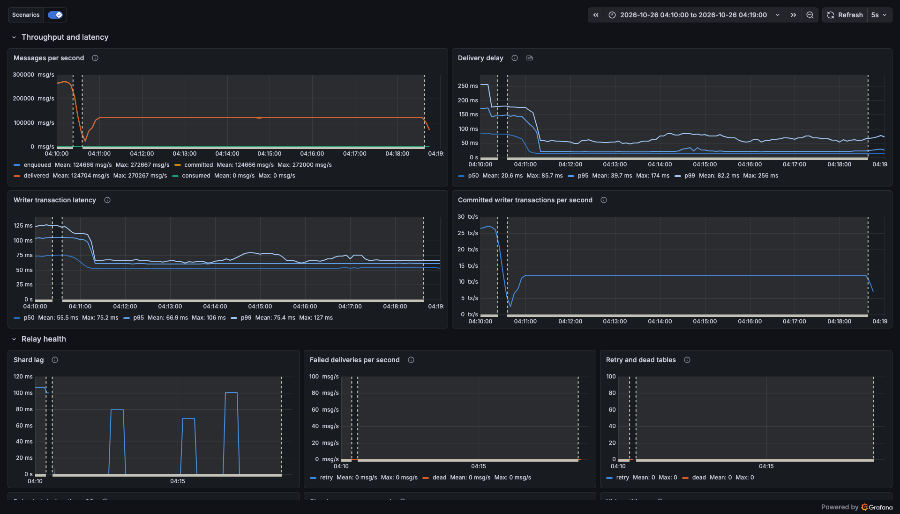
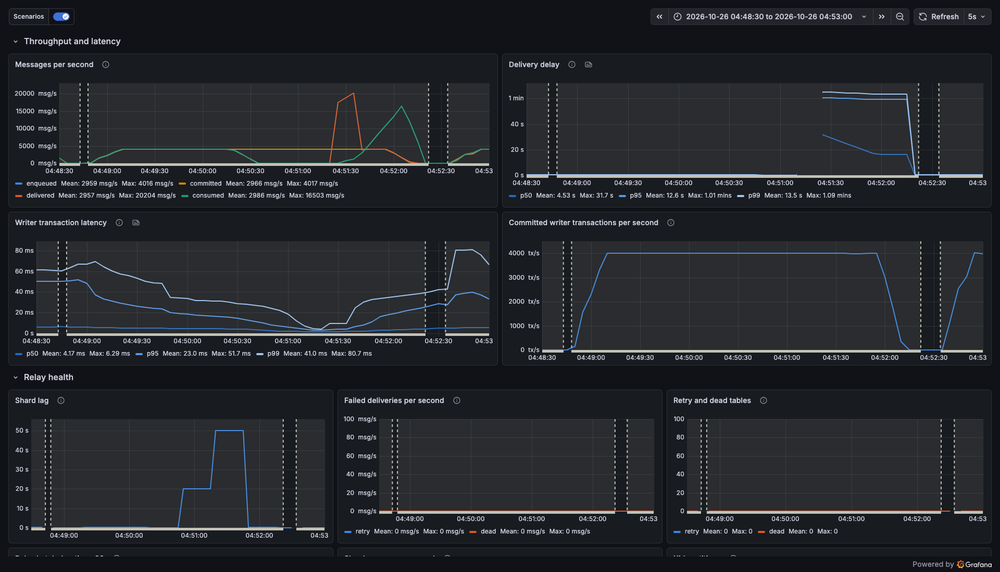
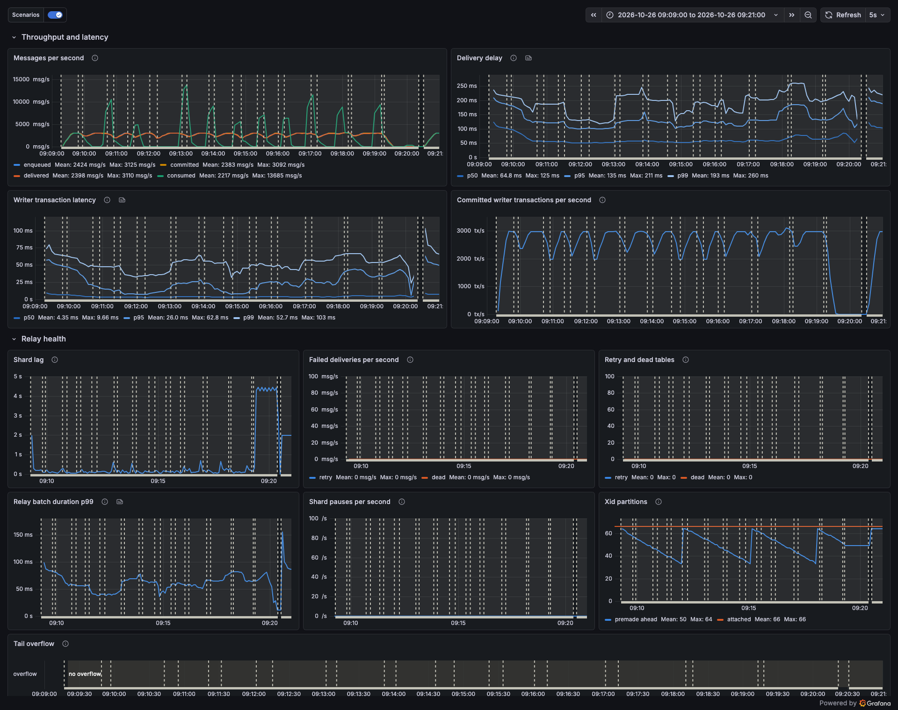
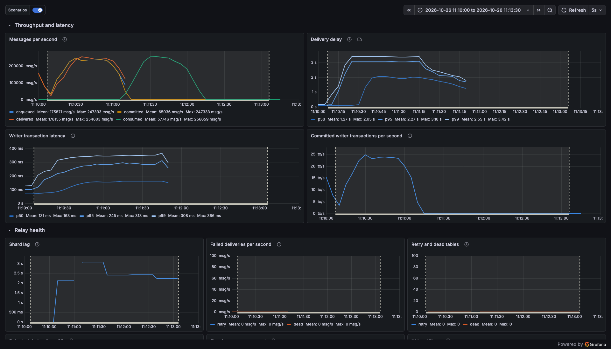

# Результаты бенчмарков

Сгенерировано `bench/scenarios/run-all.sh`, запуск 2026-10-26 00:32 UTC. Каждое число ниже взято из Prometheus
(опрос бенчмарк-приложения и postgres-exporter каждые 5 с) за указанное окно либо из `docker stats` и SQL. После прогона
текст был вручную приведён в соответствие с закоммиченными скриптами (после исправлений скриптов 2026-10-26); ни одно число
не менялось, кроме двух, помеченных ¹, а заметки в конце написаны вручную. Разделы consumer и «Стоимость для писателя»
собраны вручную по указанным в них прогонам (2026-10-26, 02:43 – 03:20 UTC, после того как inbox получил пакетный
accept): таблица consumer объединяет два прогона `consumer.sh`, а данные о стоимости для писателя получены
pgbench-скриптами из `bench/scenarios/writer-cost/`, которые `run-all.sh` не запускает.

## Стенд

- Машина: Apple M5 Pro, ядер: 18 (6 + 12), 48 ГБ RAM, macOS 27.0.1.
- Docker Desktop 29.8.2: ВМ с 18 CPU и 7.7 ГБ RAM.
- Postgres 16.15 (`postgres:16`), ограниченный **2 CPU и 4 ГБ** (`cpus: 2`, `mem_limit` = `memswap_limit` = 4g, без swap).
  Настройки: checkpoint_timeout = 5min, effective_io_concurrency = 1, fsync = on, full_page_writes = on, max_connections = 300, max_locks_per_transaction = 256, max_wal_size = 1GB, shared_buffers = 1GB, synchronous_commit = on, wal_buffers = 16MB.
  Всё остальное — значения образа по умолчанию; те из настроек выше, что от них отличаются, объяснены ниже.
- Kafka 3.9.1, один узел KRaft; топик `orders` с 12 партициями, пересоздаётся пустым для каждого прогона.
- Бенчмарк-приложение (`bench/`, Kotlin, блокирующий код, без корутин) на JVM хоста: Temurin-21.0.7+6, Kora 1.2.23, HikariCP 7.1.0, kafka-clients 3.9.2, postgresql 42.7.14. Сэмплирование трасс 1 %
  (`BENCH_TRACE_RATIO=0.01`). Продюсер Kafka: `linger.ms = 5`, `batch.size = 262144`, `compression.type = lz4`, acks=all, идемпотентный.
- Каждый прогон использует новую таблицу outbox (`OUTBOX_TABLE`), которая удаляется после прогона (и сохраняется, если сверка не прошла).

Настройки, отличающиеся от значений по умолчанию, и почему их задал бы и продакшен-деплой:

- Postgres: `shared_buffers = 1GB` (в образе по умолчанию 128 МБ; четверть RAM — обычный размер);
  `max_connections = 300` (по умолчанию 100; запас для пулов приложений); `max_locks_per_transaction = 256` (по
  умолчанию 64; нужно этой библиотеке для массовой отправки: `sendAll` из 10 000 различных ключей берёт 10 000
  advisory-блокировок, а общая таблица блокировок вмещает `max_locks_per_transaction × max_connections`); загружен
  `pg_stat_statements` (только для наблюдения, с `pg_stat_statements.track = all`, что засекает и запросы, вложенные
  в функции; большинство управляемых сервисов Postgres его загружают); `shm_size: 1g` (только для Docker: место под
  разделяемую память). Надёжность штатная: `synchronous_commit`, `fsync`, `full_page_writes` и autovacuum
  включены, таблицы журналируемые, `max_wal_size` и `checkpoint_timeout` по умолчанию.
- Библиотека (`outbox.*`): bulk задаёт шарды 1/2/4, `relay.batchSize = 20000` и `relay.idlePollInterval = 100ms`
  под транзакции по 10 000 сообщений (relay workers 4 — значение по умолчанию), а одна строка bulk запускает relay с
  настройками по умолчанию. Сценарии с одиночными сообщениями используют шарды 32 (по умолчанию), relay workers 8 (по
  умолчанию 4) и `batchSize = 2000` (по умолчанию 1000): больше шардов обрабатывается параллельно и меньше чтений на
  тик при тысячах сообщений в секунду. Всё остальное — значения библиотеки по умолчанию.
- Продюсер Kafka: `linger.ms = 5`, `batch.size = 262144`, `compression.type = lz4` — обычные настройки для
  пропускной способности; acks=all и идемпотентность навязывает библиотека. Сама Kafka — один брокер с replication
  factor 1, чего не бывает в продакшен-кластерах: `acks=all` здесь не ждёт ни одного follower.
- Бенчмарк-приложение: пул Hikari 48 (bulk) или писатели + 32 (одиночные сообщения), сэмплирование трасс 1 %; консьюмер
  бенча работает в 12 потоков (по одному на партицию) с `max.poll.records = 2000`.

Столбцы: закоммичено/записано = сообщения закоммиченных транзакций писателей; доставлено = записи, которые relay передал
обработчику с outcome «доставлено» (Kafka: подтверждено брокером); потреблено = впервые полученные записи, которые
консьюмер принял через inbox; задержка = от вставки строки (`created_at`) до outcome «доставлено»
(outbox.delivery.delay); CPU БД = среднее замеров `docker stats` контейнера Postgres, примерно раз в 6 с (200% = оба
CPU заняты). Скорости — это `increase()` Prometheus за окно, который экстраполирует к его границам; Δ очереди —
разность снятых счётчиков на границах окна, поэтому эти два значения могут расходиться на несколько процентов.
«Консьюмер всё выбрал за N с» — верхняя граница: сверка, которая засекает это время, опрашивает каждые 10 с и перед тем,
как принять результат, один раз его перепроверяет.

Графики: Grafana http://localhost:3000, дашборд **Outbox** (домашний). Каждый прогон — аннотация-интервал с тегом
`scenario` (слой «Scenarios»); чтобы его увидеть, выставьте диапазон времени на окно ниже (UTC).
Скриншоты этого дашборда в разделах ниже сняты в московском времени (UTC+3), а не в UTC; пунктирные линии на них —
аннотации сценариев и сбоев.

## bulk

2 потока-писателя × 10 000 сообщений на транзакцию (`sendAll`, различные случайные ключи), payload 100 байт
(`payloadBytes = 100`: JSON-значение, дополненное до 100 байт), 4 relay-воркера, `batchSize = 20000`,
`idlePollInterval = 100ms`, шардов 1, 2 и 4. Обработчик noop (считает и выбрасывает) или kafka (поверх добавляется
настоящий брокер). Консьюмер Kafka не запущен. Каждый прогон: новая таблица outbox, 60 с прогрева, затем окно
измерения 180 с (600 с для основного прогона с шардами 4 + noop, чтобы checkpoint-ы и autovacuum растущей
таблицы попали в окно). Записано = закоммиченные сообщения; доставлено = переданные
обработчику (noop: подсчитаны и выброшены; kafka: подтверждены брокером, acks=all); задержка = от вставки на стороне
коммита до outcome обработчика. Δ очереди = изменение (закоммичено − доставлено) за окно; выбрано за = время от остановки
писателей до момента, когда доставленные догнали закоммиченные. Последняя строка оставляет relay с настройками
библиотеки по умолчанию (workers 4, `batchSize = 1000`, `idlePollInterval = 200ms`) и шардами 4, как в основном
прогоне (по умолчанию в библиотеке 32): то, что получит пользователь без настройки relay.

| шарды | обработчик | записано msg/s | доставлено msg/s | задержка p50 | задержка p99 | транзакция писателя p50 | CPU БД (из 200%) | Δ очереди | выбрано за | окно (UTC) |
|---|---|---|---|---|---|---|---|---|---|---|
| 1 | noop | 273998 | 273427 | 0.078 s | 0.389 s | 0.075 s | 122% | 80000 | 1 s | 2026-10-26 00:33:46 – 00:36:46 |
| 2 | noop | 279541 | 279656 | 0.049 s | 0.112 s | 0.074 s | 126% | -20000 | 1 s | 2026-10-26 00:38:01 – 00:41:01 |
| 4 | noop | 259646 | 259663 | 0.036 s | 0.110 s | 0.078 s | 124% | 0 | 1 s | 2026-10-26 00:42:14 – 00:52:14 |
| 1 | kafka | 279770 | 202685 | 47.941 s | 67.766 s | 0.074 s | 119% | 14240000 | 71 s | 2026-10-26 00:53:29 – 00:56:29 |
| 2 | kafka | 273314 | 273143 | 0.065 s | 0.150 s | 0.073 s | 123% | 39920 | 1 s | 2026-10-26 00:58:54 – 01:01:54 |
| 4 | kafka | 263943 | 263829 | 0.051 s | 0.122 s | 0.076 s | 123% | 40000 | 1 s | 2026-10-26 01:03:08 – 01:06:08 |
| 4 | noop, relay по умолчанию | 271259 | 271259 | 0.086 s | 0.219 s | 0.074 s | 156% | -22000 | 1 s | 2026-10-26 01:07:21 – 01:10:21 |

### Условия измерения

- Postgres — штатный `postgres:16` с настройками из раздела «Стенд»; БД ограничена 2 CPU и 4 ГБ без swap.
- `cpus: 2` — это квота CFS: процессы Postgres могут выполняться на любом из 18 vCPU
  ВМ Docker Desktop (ядра Apple M5 Pro), но вместе получают не больше 2 CPU времени за период;
  это не машина с 2 vCPU. Современное ядро Apple вполне может быть быстрее облачного vCPU, поэтому на другом железе
  числа будут другими.
- Kafka здесь — один брокер с replication factor 1, поэтому `acks=all` не ждёт ни одного follower: строки kafka
  платят за надёжность меньше, чем на реплицированном кластере.
- Бенчмарк-приложение и БД делят один хост через Docker Desktop: сетевая задержка почти нулевая, а диск ВМ Docker
  Desktop на SSD Mac делает fsync дешёвым: `pg_test_fsync` на томе данных даёт 16291 fdatasync/s (одна запись
  8 кБ). Сетевой том обычно намного медленнее на каждый fsync. При 10 000 сообщений на коммит в bulk это почти не
  важно; сценарии с одним сообщением на транзакцию коммитят каждое сообщение и почувствуют это первыми.
- Relay также просыпается по коммиту (особенность дизайна: пост-коммит-хук приближает следующий тик); idle-опрос здесь
  100 мс.
- У каждого сообщения свой случайный ключ — худший случай для advisory-блокировок по ключам (10 000 блокировок на
  транзакцию).

## bulk-long-tx

Конфигурация bulk (шардов 4, noop), ограниченная до **120000 msg/s** (половина максимума bulk при шардах 4 и noop,
округлённая вниз до 10 000), с сессией, которая держит xid открытым 300 с (`begin; select pg_current_xact_id();
select pg_sleep(300)`, xid 13941763). snapshot xmin самого нового тика был равен этому xid в 29 из 30 замеров, снятых
каждые 10 с, пока транзакция была открыта. CPU БД, пока она была открыта: 45% из 200%. Дата 2026-10-26 (UTC).

| фаза | окно (UTC) | записано msg/s | доставлено msg/s | задержка p50 | задержка p99 | наибольший лаг шарда |
|---|---|---|---|---|---|---|
| до | 01:11:36 – 01:12:36 | 120000 | 120000 | 0.012 s | 0.053 s | 0.0 s |
| транзакция открыта | 01:12:36 – 01:17:38 | 120002 | 120002 | 0.013 s | 0.067 s | 0.1 s |
| после | 01:17:38 – 01:18:38 | 120011 | 120011 | 0.013 s | 0.066 s | 0.0 s |

p99 задержки по минутам, пока транзакция была открыта: 0.055 0.084 0.070 0.065 0.067 с.

*bulk-long-tx: 120 000 msg/s (шардов 4, noop), транзакция держит xid открытым с 04:12:36 до 04:17:38 по графику. Линия delivered ровная на ~120k весь прогон, p99 задержки доставки ~50–85 мс, лаг шардов не выше 0.1 с, retry и dead пусты. Прогон на более ранней версии кода, до финальных исправлений.*

Relay читает пакеты по снапшотам тиков, а не только строки ниже snapshot xmin, поэтому открытая транзакция, которая
удерживает xmin, не останавливает доставку того, что закоммичено после её начала.

## consumer (потолок консьюмера бенча, а не outbox)

Сценарии с одиночными сообщениями измеряют путь целиком, через консьюмер бенча: 12 потоков (по одному на партицию
`orders`), `max.poll.records = 2000`, одна транзакция на poll. Его потолок, когда он один на БД (заранее построенная
очередь выбирается без какой-либо другой нагрузки), до и после того, как inbox получил пакетный accept
(`Inbox.tryAcceptAll`: один INSERT на poll вместо одного round trip `tryAccept` на запись):

| консьюмер | потреблено msg/s | CPU БД (из 200%) | CPU БД на сообщение | вызовов INSERT в inbox | серверное время на INSERT | очередь | окно (UTC) |
|---|---|---|---|---|---|---|---|
| один `tryAccept` на запись | 26040 | 118% | ~45 µs | 1074668 | 0.013 ms | 2034889 (режим заказов, 300 s); осталось 723630 | 2026-10-26 01:24:25 – 01:25:05 |
| один `tryAcceptAll` на poll | **216792** | 201% | ~9.3 µs | 3977 (~1 690 строк в каждом) | 67.942 ms | 11070000 (bulk, 50 s); осталось 1793179 | 2026-10-26 02:54:47 – 02:55:18 |

Консьюмер с вызовом на каждую запись упирался в один JDBC round trip на запись: INSERT занимал 0.013 мс на сервере, но
каждый запрос стоил около 45 мкс CPU БД. Консьюмер с вызовом на poll вместо этого насыщает 2 CPU БД, по 9.3 мкс на
сообщение: в 8.3× быстрее. Его серверное время на INSERT включает ожидание CPU (12 потоков на 2 CPU).

Очередь для прогона с вызовом на poll строилась в режиме bulk: 4 писателя × 10 000 сообщений на транзакцию при 214000
msg/s (payload 300 байт, различные случайные ключи, `seq = 0`, поэтому проверка порядка по пользователю их пропускает),
затем `FILL=50 DRAIN=30 FILL_WRITERS=4 FILL_PER_TX=10000 bench/scenarios/consumer.sh`. Строить её в режиме заказов не
стали ради экономии времени, а не потому что это невозможно: при ~6.5k msg/s 30-секундное окно при ~217k msg/s требует
около 17 минут заполнения. Первую попытку (`FILL=450`, 2937871 сообщений в режиме заказов) консьюмер выбрал примерно
за 15 с, 1307531 из них — за один 5-секундный опрос 02:51:45 – 02:51:50 UTC (≈ 261k msg/s), ещё до открытия окна
измерения. Сверка: пропало 0 из 2034889 строк (прогон с вызовом на запись), 0 из 11070000 (прогон с вызовом на poll).

Пока строилась очередь для прогона с вызовом на запись, 64 неограниченных писателя сами по себе (режим заказов, relay в
Kafka, без консьюмера) закоммитили **6828 msg/s** при 203% CPU БД, p99 транзакции писателя 0.054 с (01:19:36 – 01:24:06
UTC): потолок транзакций БД для 1 сообщения на транзакцию на этом стенде, без вставок консьюмера. Первая попытка прогона
с вызовом на poll снова измерила тот же потолок: 6559 msg/s при 203% (02:44:31 – 02:51:31 UTC).

При параллельных писателях консьюмер делит с ними 2 CPU, поэтому там его скорость ниже. Сквозные разделы ниже (max,
ramp, kafka-outage, relay-crash, long-transaction, poison) прогонялись с консьюмером с вызовом на запись; их строки
«Потолок консьюмера» приводят его 26040 msg/s.

## max (без ограничения скорости)

30 с прогрева, затем окно 180 с. Два разных потолка:

- **Потолок транзакций БД** (1 сообщение на транзакцию: вставка заказа + upsert seq пользователя + `outbox.send` +
  вставка в inbox на каждое потреблённое сообщение, синхронный коммит, 2 CPU). Это стоимость коммита на каждое
  сообщение на этой БД, а не предел outbox: на каждое сообщение БД также выполняет бизнес-вставку, upsert seq и вставку
  консьюмера в inbox.
- **Пропускная способность outbox** (массовый `sendAll`, обработчик noop, без консьюмера): потолки постановки в
  очередь и relay самой библиотеки.

| нагрузка | закоммичено msg/s | доставлено msg/s | потреблено msg/s | задержка p50 | задержка p99 | транзакция писателя p99 | CPU БД (из 200%) | Δ очереди | окно (UTC) |
|---|---|---|---|---|---|---|---|---|---|
| 1 сообщение на транзакцию, писателей 64, kafka + консьюмер | 5650 | 5651 | 5343 | 0.208 s | 0.433 s | 0.063 s | 202% | 52 | 2026-10-26 01:26:26 – 01:29:27 |
| по 10000 сообщений на транзакцию, писателей 4, шардов 4, relay workers 4, noop, без консьюмера | 362571 | 362900 | – | 0.059 s | 0.133 s | 0.189 s | 191% | -22561 | 2026-10-26 01:30:34 – 01:33:34 |
| по 1000 сообщений на транзакцию, писателей 16, шардов 32, relay workers 8, noop, без консьюмера | 187614 | 187595 | – | 0.366 s | 0.694 s | 0.189 s | 200% | -20885 | 2026-10-26 01:34:19 – 01:37:19 |

Одиночные сообщения: консьюмер всё выбрал за 25 с после остановки писателей; закоммичено 1175673, доставлено 1175673, потреблено 1175673, дубликатов 0, нарушений порядка 0, неудавшихся транзакций писателей 0. Сверка (SQL, после
выборки): закоммиченных строк, не потреблённых и не dead: 0 из 511204 строк ещё в таблице: 664469 из 1175673 закоммиченных строк
были в партициях, которые обслуживание удалило после relay; счётчик потреблённых (1175673) равен числу закоммиченных,
значит, потреблены и они¹. Bulk, очередь при остановке
писателей: 4 × 10000: в пути 20000, выбрано за 1 с; 16 × 1000: в пути 37808, выбрано за 1 с; очередь в пределах нескольких транзакций означает, что relay успевал за писателями.

Потолок консьюмера: консьюмер бенча (12 потоков, один round trip INSERT в inbox на запись) один на базе выбирает 26040 msg/s (раздел consumer); при неограниченных писателях на тех же 2 CPU весь путь заказа потребил 5343 msg/s (раздел max). Скорость потребления и сквозное время ограничены этими значениями, а не relay.

*max, строка «по 10000 сообщений на транзакцию»: 4 писателя, шардов 4, relay workers 4, обработчик noop, без консьюмера. Линии committed и delivered совпадают на плато ~360–380k msg/s (362 900 в окне 04:30:34–04:33:34), p99 задержки доставки ~0.13 с, retry и dead пусты. Прогон на более ранней версии кода, до финальных исправлений.*

## ramp (1 сообщение на транзакцию)

Режим заказов: каждая транзакция вставляет заказ, берёт следующий `seq` пользователя из счётчика под блокировкой
строки и вызывает `outbox.send` (10 000 пользователей, payload 300 байт), писателей 64; обработчик Kafka;
консьюмер в 12 потоков дедуплицирует через inbox (одна вставка на сообщение, та же БД) и проверяет
порядок `seq` по пользователю; шардов 32, relay workers 8, batch 2000. Каждая ступень идёт около 128 с
(120 с, затем запросы окна до старта следующей ступени) и измеряется с 30-й по 120-ю секунду от её начала. Дата
2026-10-26 (UTC).

| цель msg/s | закоммичено msg/s | доставлено msg/s | потреблено msg/s | задержка p50 | задержка p99 | транзакция писателя p99 | CPU БД (из 200%) | окно (UTC) |
|---|---|---|---|---|---|---|---|---|
| 1000 | 1000 | 1000 | 1000 | 0.057 s | 0.137 s | 0.005 s | 103% | 01:38:03 – 01:39:33 |
| 5000 | 4999 | 5002 | 5014 | 0.135 s | 0.352 s | 0.053 s | 203% | 01:40:11 – 01:41:41 |
| 10000 | 5565 | 5565 | 5269 | 0.210 s | 0.431 s | 0.064 s | 202% | 01:42:18 – 01:43:48 |
| 20000 | 5664 | 5665 | 5412 | 0.209 s | 0.427 s | 0.063 s | 203% | 01:44:25 – 01:45:55 |
| 40000 | 5627 | 5632 | 5355 | 0.207 s | 0.439 s | 0.064 s | 203% | 01:46:33 – 01:48:03 |

После ramp консьюмер всё выбрал за 33 с после остановки писателей. Итого: закоммичено 2903331, доставлено 2903331, потреблено 2903331, дубликатов 0, нарушений порядка 0, неудавшихся транзакций писателей 0. Сверка (SQL, после выборки):
закоммиченных строк, не потреблённых и не dead: 0 из 2903331 строк.

Потолок консьюмера: консьюмер бенча (12 потоков, один round trip INSERT в inbox на запись) один на базе выбирает 26040 msg/s (раздел consumer); при неограниченных писателях на тех же 2 CPU весь путь заказа потребил 5343 msg/s (раздел max). Скорость потребления и сквозное время ограничены этими значениями, а не relay.

## kafka-outage

Режим заказов (1 сообщение на транзакцию, писателей 64), 4000 msg/s, обработчик Kafka, консьюмер с inbox;
шардов 32, relay workers 8. Kafka остановили (`docker stop kora-outbox-bench-kafka-1`) в 2026-10-26 01:50:19 UTC на 60 с и снова
запустили в 01:51:19; писатели всё это время продолжали коммитить. 4000 msg/s ниже ~5.1k msg/s, которые полный путь заказа выдержал в пробном прогоне 2026-10-26 (см. заметки; консьюмер тогда делал один round trip вставки в inbox на запись и делил 2 CPU с транзакциями писателей), но Postgres уже показывает ~200 % CPU при такой скорости: эти сценарии идут на загруженной базе. Скорость выбрана ниже этого потолка: 5k msg/s здесь уже на его уровне, а при 6k очередь консьюмера растёт.

| базовый p99 задержки | пик очереди | выбрано (очередь ≤ 1 с трафика) | p99 задержки от начала сбоя до выборки + 30 с | dead |
|---|---|---|---|---|
| 0.214 s | 251734 сообщений | через 6 с после запуска Kafka | 63.6 s | 0 |

Консьюмер всё выбрал за 10 с после остановки писателей¹. Итого: закоммичено 748590, доставлено 748590, потреблено 748590, дубликатов 28, нарушений порядка 0, неудавшихся транзакций писателей 0. Сверка (SQL, после выборки): закоммиченных строк,
не потреблённых и не dead: 0 из 748590 строк. Дубликат здесь — запись, которую Kafka сохранила, но ack на которую relay
не получил до сбоя; relay отправляет её повторно, и inbox отбрасывает вторую копию.

Потолок консьюмера: консьюмер бенча (12 потоков, один round trip INSERT в inbox на запись) один на базе выбирает 26040 msg/s (раздел consumer); при неограниченных писателях на тех же 2 CPU весь путь заказа потребил 5343 msg/s (раздел max). Скорость потребления и сквозное время ограничены этими значениями, а не relay.

*kafka-outage: 4 000 заказов/с, Kafka остановлена с 04:50:19 до 04:51:19 по графику. Писатели всё это время коммитят 4 000 tx/s, delivered падает до нуля, лаг шардов растёт до ~50 с, p99 задержки — до ~1 мин; после запуска Kafka relay выбирает отставание всплеском ~20k msg/s, failed, retry и dead — 0. Прогон на более ранней версии кода, до финальных исправлений.*

## relay-crash

Режим заказов (1 сообщение на транзакцию, писателей 64), 4000 msg/s, обработчик Kafka, консьюмер с inbox;
шардов 32, relay workers 8. JVM бенчмарка (писатели, relay и консьюмер) убили через `kill -9` в 2026-10-26 01:54:04 UTC
и через 10 с перезапустили на той же таблице outbox, с той же нагрузкой. Базовый p99 задержки до падения: 0.238 с.
4000 msg/s ниже ~5.1k msg/s, которые полный путь заказа выдержал в пробном прогоне 2026-10-26 (см. заметки; консьюмер тогда делал один round trip вставки в inbox на запись и делил 2 CPU с транзакциями писателей), но Postgres уже показывает ~200 % CPU при такой скорости: эти сценарии идут на загруженной базе. Скорость выбрана ниже этого потолка: 5k msg/s здесь уже на его уровне, а при 6k очередь консьюмера растёт.

| закоммичено, но не потреблено к падению | перезапуск → готовность | перезапуск → relay догнал | перезапуск → всё это потреблено |
|---|---|---|---|
| 623 | 1 s | 1 s | 37 s |

До падения: закоммичено 360071, доставлено 359534, потреблено 359477, дубликатов 0, нарушений порядка 0, неудавшихся транзакций писателей 0. После перезапуска (счётчики начинаются с 0): закоммичено 268770, доставлено 269342, потреблено 269393, дубликатов 32, нарушений порядка 0, неудавшихся транзакций писателей 0. Счётчики до падения прочитаны прямо перед убийством, поэтому 330 строк, закоммиченных в промежутке (и COMMIT-ы, шедшие в момент убийства), делают число сверенных строк (629 171) больше суммы двух закоммиченных счётчиков (628 841). Консьюмер всё выбрал за 14 с после
остановки писателей. Сверка (SQL, после выборки), по обоим прогонам: закоммиченных строк, не потреблённых и не dead:
0 из 629171 строк. «Relay догнал»: курсор каждого шарда дошёл до первого тика, сделанного после падения, то есть все
коммиты до падения переданы в Kafka. Сквозное время включает и ожидание, пока consumer group Kafka исключит убитых
консьюмеров (`session.timeout.ms`, по умолчанию 45 с). Дубликат — запись, которую убитый relay отправил, не закоммитив
курсор (или которую убитый консьюмер обработал, не закоммитив offset); inbox её отбрасывает. Проверка порядка у
консьюмера работает внутри одного процесса, поэтому покрывает перезапущенный прогон.

Потолок консьюмера: консьюмер бенча (12 потоков, один round trip INSERT в inbox на запись) один на базе выбирает 26040 msg/s (раздел consumer); при неограниченных писателях на тех же 2 CPU весь путь заказа потребил 5343 msg/s (раздел max). Скорость потребления и сквозное время ограничены этими значениями, а не relay.

## long-transaction

Режим заказов (1 сообщение на транзакцию, писателей 64), 4000 msg/s, обработчик Kafka, консьюмер с inbox;
шардов 32, relay workers 8. Сессия держала xid 23441624 открытым 600 с (`begin; select pg_current_xact_id(); select
pg_sleep(600)`); snapshot xmin самого нового тика был равен этому xid в 59 из 60 замеров, снятых каждые 10 с, пока она
была открыта. CPU БД, пока она была открыта: 202% из 200%. Дата 2026-10-26 (UTC). 4000 msg/s ниже ~5.1k msg/s, которые полный путь заказа выдержал в пробном прогоне 2026-10-26 (см. заметки; консьюмер тогда делал один round trip вставки в inbox на запись и делил 2 CPU с транзакциями писателей), но Postgres уже показывает ~200 % CPU при такой скорости: эти сценарии идут на загруженной базе. Скорость выбрана ниже этого потолка: 5k msg/s здесь уже на его уровне, а при 6k очередь консьюмера растёт.

| фаза | окно (UTC) | закоммичено msg/s | доставлено msg/s | потреблено msg/s | задержка p50 | задержка p99 | наибольший лаг шарда |
|---|---|---|---|---|---|---|---|
| до | 01:56:20 – 01:58:20 | 4000 | 4001 | 4001 | 0.096 s | 0.214 s | 0.3 s |
| транзакция открыта | 01:58:20 – 02:08:27 | 3803 | 3802 | 3794 | 0.200 s | 0.538 s | 0.6 s |
| после | 02:08:27 – 02:09:27 | 4002 | 4016 | 4144 | 0.104 s | 0.262 s | 0.5 s |

p99 задержки по минутам, пока транзакция была открыта: 0.220 0.290 0.348 0.439 0.510 0.531 0.535 0.578 0.610 0.609 с. Консьюмер всё выбрал за 19 с после остановки
писателей. Итого: закоммичено 3153029, доставлено 3153029, потреблено 3153029, дубликатов 0, нарушений порядка 0, неудавшихся транзакций писателей 0. Сверка (SQL, после выборки): закоммиченных строк, не потреблённых и не dead: 0 из 3153029 строк.

Потолок консьюмера: консьюмер бенча (12 потоков, один round trip INSERT в inbox на запись) один на базе выбирает 26040 msg/s (раздел consumer); при неограниченных писателях на тех же 2 CPU весь путь заказа потребил 5343 msg/s (раздел max). Скорость потребления и сквозное время ограничены этими значениями, а не relay.

## poison

Режим заказов (1 сообщение на транзакцию, писателей 64), 2000 msg/s, обработчик Kafka, консьюмер с inbox;
шардов 32, relay workers 8. В 2026-10-26 02:11:43 UTC `POST /poison?count=100` закоммитил 100 сообщений размером
`max.request.size` продюсера + 1 КБ (~1 МБ каждое, различные ключи, 2 с на все). Kafka отвергает их на
стороне клиента как постоянные сбои.

| фаза | окно (UTC) | закоммичено msg/s | доставлено msg/s | потреблено msg/s | задержка p50 | задержка p99 |
|---|---|---|---|---|---|---|
| до | 02:10:43 – 02:11:43 | 2000 | 2000 | 2000 | 0.062 s | 0.124 s |
| после | 02:11:45 – 02:13:15 | 2000 | 2000 | 2000 | 0.063 s | 0.128 s |

dead-таблица: 100 строк (gauge `outbox.dead.size` 100), retry-таблица: 0 строк. Консьюмер всё
выбрал за 13 с после остановки писателей. Итого: закоммичено 363371, доставлено 363371, потреблено 363371, дубликатов 0, нарушений порядка 0, неудавшихся транзакций писателей 0. Сверка (SQL, после выборки): закоммиченных строк, не потреблённых
и не dead: 0 из 363471 строк (в строках есть 100 poison-сообщений, а в счётчике писателей их нет).

Потолок консьюмера: консьюмер бенча (12 потоков, один round trip INSERT в inbox на запись) один на базе выбирает 26040 msg/s (раздел consumer); при неограниченных писателях на тех же 2 CPU весь путь заказа потребил 5343 msg/s (раздел max). Скорость потребления и сквозное время ограничены этими значениями, а не relay.

## Найденные узкие места (история: измерено 2026-10-25, до этого прогона)

Этот раздел — фиксированный текст в `run-all.sh`, а не результат этого прогона. **Охват пакета relay** (исправлено в
исправлении «ограничить пакеты relay объёмом данных»). Отставший relay объединял до `maxTicksPerBatch` (100)
тиков в один пакет — около 1.35M строк при скоростях bulk. Каждое чтение чанка этого пакета по 20 000 строк заново
сканировало множество кандидатов, поэтому чтения замедлялись по мере роста очереди, а растущая очередь делала следующий
пакет ещё больше: спираль смерти. После исправления целевой тик выбирается по верхней отметке id, которую записывает
каждый тик (`max_id`), поэтому один пакет охватывает около `batchSize × shards` id. Конфигурация bulk, шардов 1, noop,
2026-10-25 (UTC); «до» — прерванный прогон на старом коде (аннотация «BEFORE relay fix»), «после» — 240-секундный
проверочный прогон с исправлением.

| | до (23:06–23:11) | после (23:22:43–23:26:45) |
|---|---|---|
| записано msg/s, по минутам | 270k, 273k, 266k, 235k | 254k, 259k, 269k, 265k |
| доставлено msg/s, по минутам | 101k (первые 20 s), затем 44k, 15k, 4.7k, 3.6k | 254k, 259k, 267k, 266k |
| p99 задержки доставки, по минутам | 40 s, 90 s, 159 s, 206 s, 274 s | 0.26 s, 0.21 s, 0.54 s, 0.26 s |
| очередь при остановке писателей | 58.5M сообщений | выбрана через 1 s после остановки писателей |
| чтение чанка пакета (pg_stat_statements) | в среднем 1 785 ms, 95 вызовов за 180 s | в среднем 8.8 ms, 6 416 вызовов за 240 s |

Источники: Prometheus (`rate(...[1m])`, `histogram_quantile` за 60 с) и `pg_stat_statements` (до: 180 с начиная с
23:07:17; после: весь прогон). Строки bulk выше получены на текущем коде.

## Стоимость для писателя (pgbench: наша постановка в очередь против обычной вставки)

Насколько дороже для транзакции писателя наша постановка в очередь, чем обычная вставка без блокировок и партиций.
`pgbench` 16.15 внутри контейнера Postgres (те же 2 CPU), `-M prepared`, с надёжной записью: журналируемые таблицы,
`synchronous_commit = on`. Наш вариант: ровно те запросы, которые выполняет `PgOutbox`, в таблицу outbox, созданную
библиотекой (identity `id`, партиции-диапазоны по xid8, заранее созданные библиотекой, индекс `(shard, xid)`; relay не
работает). Базовая таблица (варианты `plain_*`): `(id bigserial primary key, xid xid8 not null default
pg_current_xact_id(), topic text, key text, payload bytea, headers bytea, created_at timestamptz default now())` с
индексом по `xid`. Перед каждым прогоном обе таблицы очищались с `CHECKPOINT`, а в конце удалялись. Сообщения: топик
`orders`, заголовки 70 байт; по 1 на транзакцию: ключ `u1..u10000`, payload 300 байт; по 10 000 на транзакцию:
случайные UUID-ключи, payload 100 байт. CPU БД — счётчик cgroup контейнера за прогон; в него входит и сам pgbench (тот
же контейнер, те же CPU). Дата 2026-10-26 (UTC); каждый прогон — аннотация Grafana с тегом `writer-cost`. Как
воспроизвести: `bench/scenarios/writer-cost/writer-cost.sh all` (генератор `gen.py` пишет запросы, `run.sh` запускает
один pgbench). Сгенерированные запросы совпадают с выполнявшимися в этих прогонах, кроме двух литералов: базовая таблица
теперь называется `bench_wc_plain` (в прогонах у неё было другое имя), а фиксированный `message_id` теперь
`01930000-0000-7000-8000-000000000000` (в прогонах был другой UUIDv7); варианты `_direct` называют партицию, в которой
лежит текущий xid (тогда `bench_wc_x33554432`).

**1 сообщение на транзакцию**, 32 клиента, 60 с:

| вариант | запрос | msg/s (= tps) | средняя задержка | CPU БД (из 200%) | окно (UTC) |
|---|---|---|---|---|---|
| наш | `insert … select … from (select pg_advisory_xact_lock(ns, keyHash)) l` | 6155 | 5.199 ms | 200% | 03:05:09 – 03:06:10 |
| обычная вставка | `insert … values (…)` | 6878 | 4.653 ms | 200% | 03:06:17 – 03:07:17 |

Наш вариант: на 10.5% меньше сообщений в секунду. Разложение всё равно сделано: без блокировки 6032 msg/s (03:15:59 –
03:16:59), без блокировки и прямо в партицию 6190 msg/s (03:17:22 – 03:18:22), повторный прогон обычной вставки 6993
msg/s (03:18:30 – 03:19:30). Ни блокировка, ни маршрутизация по партициям здесь ничего измеримого не стоят, а наш запрос
вставки на сервере дешевле, чем у обычной вставки (0.024–0.027 мс против 0.033 мс; 576–582 против 606 байт WAL).
Оставшиеся ~10% лежат вне времени выполнения запросов; дальше это не изолировалось.

**10 000 сообщений на транзакцию** (`sendAll`), 2 клиента, 60 с:

| вариант | запросы | tx/s | msg/s | средняя задержка транзакции | CPU БД (из 200%) | окно (UTC) |
|---|---|---|---|---|---|---|
| наш | отсортированный запрос блокировок по различным ключам + одна вставка через unnest | 52.43 | 524258 | 38.149 ms | 183% | 03:07:33 – 03:08:33 |
| обычная вставка | одна вставка через unnest | 67.21 | 672058 | 29.759 ms | 174% | 03:08:35 – 03:09:35 |

pgbench не умеет привязывать массивы, поэтому каждый скрипт строит свои массивы на сервере, с новыми случайными ключами и
хешами блокировок в каждой транзакции. Эта работа, измеренная отдельно и вычтенная, стоит 6.711 мс на транзакцию для
нашего варианта (ключи, шарды, хеши блокировок) и 5.107 мс для обычной вставки (ключи) (03:09:37 – 03:10:37). Чистое
время: 31.4 мс против 24.7 мс на 10 000 сообщений, наш вариант **на 27.5% медленнее** (без вычета: на 22% меньше msg/s).
Разложение, 2 клиента × 30 с на вариант, pg_stat_statements по каждому запросу (03:11:11 – 03:15:32 UTC):

| на транзакцию из 10 000 сообщений | наш | обычная вставка |
|---|---|---|
| вся транзакция, средняя задержка | 36.582 ms (54.7 tx/s) | 28.141 ms (71.1 tx/s) |
| запрос вставки, серверное время | 24.545 ms | 24.385 ms |
| — без построения его массивов (5.9 ms у нашего, 5.0 ms у обычной вставки) | ~18.6 ms | ~19.4 ms |
| WAL на сообщение | 397 B | 429 B |
| запрос блокировок, серверное время (0.64 ms из них — построение массива хешей) | 5.221 ms | – |
| остаток транзакции (round trip-ы, коммит) | 6.8 ms | 3.8 ms |
| наш без запроса блокировок | 28.703 ms (69.7 tx/s); остаток 4.0 ms | |
| наш без блокировки, прямо в партицию (без маршрутизации) | вставка 25.165 ms (67.9 tx/s) | |

Куда уходят лишние ~8.4 мс нашего варианта на 10 000 сообщений:

- **Advisory-блокировки по ключам: ~7.4 мс** (~0.74 мкс на различный ключ): ~4.6 мс, чтобы взять 10 000
  отсортированных блокировок, ~2.8 мс, чтобы освободить их при коммите (остаток транзакции — 6.8 мс с ними и 4.0 мс без
  них).
- nextval: ничего лишнего; оба варианта берут одно значение последовательности на строку (identity против bigserial).
- Маршрутизация по партициям: ничего измеримого (24.70 мс с маршрутизацией против 25.17 мс прямо в партицию).
- Индексы: в нашу пользу. У нас один индекс `(shard, xid)`, у базовой таблицы — первичный ключ и индекс по xid: на 7%
  меньше WAL на сообщение и примерно на 4% меньше чистого времени вставки.
- Оставшаяся ~1 мс: построение наших массивов на сервере стоит в сумме на ~1.6 мс больше (хеши блокировок, шарды и
  преобразование ключа в bytea; библиотека строит их на клиенте, так что это артефакт pgbench) за вычетом нашей более
  дешёвой вставки (~0.8 мс).

Что дают дополнительные шаги:

- **Advisory-блокировка по ключу**, взятая до того, как identity назначит строке id: для каждой пары (topic, key)
  порядок id совпадает с порядком коммитов, поэтому relay, читая в порядке id, доставляет сообщения каждого ключа в
  порядке коммитов. Стоит ~0.74 мкс на различный ключ в массовых транзакциях и ничего измеримого при одном сообщении на
  транзакцию. Массовой отправке с множеством различных ключей нужен увеличенный `max_locks_per_transaction` (пункт 6
  ниже).
- **Партиции-диапазоны по xid8**: пройденная relay партиция удаляется целиком, без DELETE и без vacuum горячей таблицы.
  Маршрутизация ничего измеримого не стоит.
- **Столбец `xid`, читаемый через тики relay** (снапшоты тиков), а не партиционирование: чтение пакета берёт ровно
  транзакции, закоммиченные между двумя снапшотами, поэтому долго открытая транзакция не задерживает более поздние
  коммиты (bulk-long-tx). В базовой таблице тоже есть столбец xid8; разница в том, как его читают.
- **Столбец `shard` и индекс `(shard, xid)`**: шарды обрабатываются параллельно несколькими воркерами, каждый ключ
  остаётся в одном шарде. Этот индекс заменяет два индекса базовой таблицы одним.
- **`message_id`** (UUIDv7): id, по которому потребители дедуплицируют через inbox.

## Заметки (написаны вручную после прогона)

**Исправления.** ¹ Два числа исправлены вручную после прогона; скрипты с тех пор исправлены. kafka-outage выводил время
выборки relay в предложении про консьюмер (переиспользованная переменная); по 5-секундным опросам Prometheus потреблено
сравнялось с закоммиченным (748 590) в пределах 10 с после остановки писателей в 01:51:55. В max глобальный счётчик xid
во время прогона с одиночными сообщениями пересёк границу партиции (16 777 216), обслуживание удалило полностью
пройденную партицию, и SQL-проверка охватила 511 204 из 1 175 673 закоммиченных строк; остальное покрывают счётчики
(закоммичено = доставлено = потреблено, 0 дубликатов). Теперь скрипт проверяет это сам: частичная проверка проходит,
только если счётчик потреблённых равен числу закоммиченных, а иначе проваливается и сохраняет таблицу.

**Что ограничивает bulk.** Два потока-писателя, а не БД: одна транзакция из 10 000 сообщений занимает 73–78 мс (p50
транзакции писателя), а Postgres использовал 119–126% из своих 200% (156% с relay по умолчанию). В основном прогоне
(pg_stat_statements за его 600-секундное окно) вставка 10 000 строк занимала 19.2 мс, а 10 000 advisory-блокировок по
ключам — 6.3 мс на транзакцию; чтение чанка relay — 3.0 мс. С 4 писателями та же схема дала 362.6k msg/s при 191%
(max).

**Ограничения и открытые вопросы.**

1. bulk, шардов 1 + Kafka: доставлено 202.7k msg/s, но меньше записанных 279.8k. Очередь выросла на 14.2M сообщений за
   180-секундное окно, p99 задержки дошёл до 68 с, а выборка заняла 71 с после остановки писателей: при такой нагрузке
   режим не установился, а установившаяся скорость одного шарда с Kafka не измерялась. Один шард обрабатывается одним
   воркером, по одному пакету за раз: 3 339 пакетов за 180-секундное окно (18.5/с), в среднем 51.0 мс каждый, так что
   воркер был занят 94% времени, ~10.9k строк на пакет (средние по сумме и числу длительностей пакетов; медиана
   гистограммы показывает ~67 мс только из-за интерполяции внутри бакета). Чтения чанков занимали в среднем 14.5 мс
   серверного времени на вызов (3 352 вызова); остальное раскладывает профиль JFR ниже. Бюджет объёма
   (`batchSize × shards` = 20 000 id) держит пакет в пределах примерно одного тика (11–13k строк). Шарды 2 и 4 успевают.
   Профилировано JFR 2026-10-26 (прогон 02:58:24 – 03:01:24 UTC, запись 02:58:44 – 02:59:44; за прогон доставлено 180.9k
   из записанных 271.3k, во время записи 172.7k/с. Вне записи это ≈ 185k/с, всё ещё на ~9% ниже 202.7k выше: запись
   объясняет примерно пятую часть недостачи, а остальное — разброс между прогонами или состояние БД — не
   изолировалось). На пакет — 60.2 мс на ~10.9k строк (950 пакетов в записи): чтение пакета 31.6 мс (52%; ~19.6 мс из
   них — выполнение на сервере), вызов обработчика Kafka 16.9 мс (28%: 8.3 мс ожидания ack, 8.6 мс работы клиента Kafka
   в вызывающем потоке, ~1.9 мс из которых приходится на библиотеку), CPU потока relay ~7.6 мс (~6.4 мс — работа
   библиотеки на каждую запись: span-ы доставки, заголовки трассировки, копии записей, метрики), остальные запросы и
   коммит ~4.5 мс. Работа библиотеки на каждую запись занимает ~14% времени воркера, по всего 734 сэмплам выполнения за
   60 с (верхняя граница 15.6%, если считать всё CPU потока relay работой библиотеки); если убрать её целиком, разрыв не
   закроется. Один воркер обрабатывает шард последовательно (чтение, отправка, ack, коммит); конвейеризация внутри шарда
   потребовала бы изменения дизайна, так что один шард остаётся ниже этой нагрузки. Используйте шардов ≥ 2.
2. long-transaction (режим заказов, 4k msg/s): остановки нет (доставлено = закоммичено, 0 пропавших), но p99 задержки
   рос каждую минуту, пока транзакция была открыта, 0.22 → 0.61 с (0.21 с до, 0.26 с после), а закоммичено упало до
   3.8k msg/s при 202% CPU БД. Диагностический повторный прогон (02:15–02:30 UTC, аннотация «diagnostic
   long-transaction», pg_stat_statements каждые 2 мин) показывает, куда ушло время. При закреплённом xmin upsert
   `user_seq` бенчмарка (4k обновлений/с на 10 000 строк) замедлился с 0.025 до 0.510 мс на вызов по мере того, как
   копились 1.4–1.9M мёртвых версий, а все остальные запросы замедлились в 2–4 раза на насыщенных CPU: вставка заказа
   0.034 → 0.128 мс, вставка в outbox 0.028 → 0.097 мс, чтение чанка relay примерно в 2.2 раза на строку, поиск курсора
   0.165 → 0.395 мс. Таблица курсоров библиотеки через 10 мин держала 115k мёртвых строк. Bulk-long-tx, без обновлений
   бизнес-таблиц, остался ровным (p99 0.053 → 0.067 с). Рост — в основном эффект базы целиком, но собственные запросы
   outbox от него не защищены.
3. 1 сообщение на транзакцию: потолок коммитов только писателей 6.8k msg/s, 5.65k закоммичено и 5.34k потреблено с
   консьюмером (max).
4. max bulk с 16 писателями × 1 000 сообщений на 32 шардах: 187.6k msg/s при 200% CPU БД, против 362.6k для 4 × 10 000
   на 4 шардах. Транзакции меньшего размера чаще платят за коммит и round trip блокировок.
5. Самой медленной частью каждого сквозного числа был консьюмер бенча, а не relay: один round trip `inbox.tryAccept` на
   запись ограничивал его 26.0k msg/s, когда он один на БД (0.013 мс серверного времени на вставку, 118% CPU БД).
   Исправлено пакетным accept (`Inbox.tryAcceptAll`, один INSERT на poll): 216.8k msg/s, когда он один на БД, при 201%
   CPU БД (раздел consumer). Сквозные сценарии с ним не перезапускались.
6. Массовой отправке нужен увеличенный `max_locks_per_transaction` (одна advisory-блокировка на каждый различный ключ в
   транзакции): шаг деплоя, который нужно документировать.
7. Железо: БД получает 2 CPU квоты CFS на ядрах Apple M5 Pro, которые вполне могут быть быстрее в расчёте на ядро, чем
   облачный хост с 2 CPU, а Kafka — один брокер. На другом железе числа будут другими.

**Другие наблюдения.**

- В режиме заказов Postgres показывает около 200% CPU начиная с 4k msg/s (и 103% на ступени ramp 1k), распределённых
  по ~88 клиентским backend-ам (64 писателя, 12 потоков консьюмера, коммитящих раз на poll, relay-воркеры, обслуживание).
  Autovacuum `orders` (18M строк) и одной партиции inbox закончился в 01:46 и 01:47 UTC, так что, вероятно, шёл во
  время первых ступеней ramp; это не изолировалось.
- Бизнес-таблицы `orders` и `inbox` между сценариями не очищаются (`orders` дошла до ~25M строк), поэтому более поздние
  сценарии идут на бизнес-таблицах большего размера, чем ранние.
- Квантили задержки берутся из бакетов гистограммы Micrometer с интерполяцией внутри бакета.
- Два пробных прогона вне run-all подкрепляют числа, приведённые выше (логи приложения в
  `bench/build/scenarios/probes-2026-10-26/`, не закоммичены). Режим заказов без ограничения с 64, а затем со 128
  писателями закоммитил 6 353 и 6 359 msg/s, оба раза при 201% CPU БД (2026-10-25 23:39–23:42 UTC): число писателей
  потолок не двигает. Полный путь заказа с 12 потоками консьюмера: при цели 5k закоммичено 5 024 и потреблено 5 115,
  лаг консьюмера сокращался; при цели 6k закоммичено 5 200 и потреблено 4 927, лаг рос (2026-10-26 00:15–00:20 UTC):
  это те ~5.1k msg/s, на которые ссылается примечание о скорости.

## Хаос и soak

Написано `bench/scenarios/chaos-*.sh`, в две части на двух коммитах библиотеки:

- **Часть 1** (промежуточная версия библиотеки, до части исправлений), 2026-10-26 05:00–05:49 UTC: kill,
  pg-restart, pg-pause, kafka-restart, small-pool и slow-handler.
- **Часть 2** (со всеми исправлениями, включая подбор осиротевших партиций и scope-ы консьюмеров
  inbox), 2026-10-26 06:09–07:38 UTC: partition-churn, снова kill (регрессия на финальном коде) и 60-минутный soak.
  Перед частью 2 таблица `inbox` бенчмарка в формате до scope-ов была удалена: библиотека отказывается стартовать на
  inbox без столбца `consumer`.
- **Диагностический soak** (финальный код), 2026-10-26 08:17–09:19 UTC: soak из части 2 ещё раз с
  теми же настройками, плюс снимки `DIAG=1` каждые 10 мин (`bench/scenarios/soak-diag.sh`), чтобы объяснить хвост
  задержки части 2. Inbox сначала удалили, так что прогон начался с такой же маленькой базы.

Каждый прогон прошёл сверку (ниже). Автоматическая проверка ровности soak из части 2 не прошла только по p99 задержки
доставки. Диагностический повтор её прошёл, а заметки в конце относят хвост части 2 к остановкам сброса на диск хоста, а
не к библиотеке.

Каждый прогон сверяет бизнес-таблицы с inbox на SQL после того, как консьюмер всё выбрал:

- **потеряно** (lost): закоммиченные заказы, для `message_id` которых нет строки в inbox;
- **фантомы** (phantom): id откаченных транзакций (1 % заказов), для которых строка в inbox есть;
- **нарушения порядка**: на SQL по `bench_consumed` и по счётчикам консьюмера;
- **необъяснённые** (unexplained): строки inbox этого прогона, которые не являются ни потреблённым заказом, ни
  закоммиченным bulk-сообщением;
- **dead-строки**.

Всё должно быть равно 0. Дубликаты подсчитываются. Методика, столбцы CSV и правила безопасности — в
`bench/README.md` («Хаос и soak»).

## chaos: kill

Режим заказов, 3 экземпляра × 1000 msg/s в течение 900 с; каждые 20–60 с `kill -9` случайного экземпляра, перезапуск через 5–15 с. Экземпляров: 3, на таблице outbox `bench_chaos_kill` (у каждого шардов 32, relay workers 8), один топик Kafka
`orders` (12 партиций) и одна consumer group (потоков консьюмера на экземпляр: 4); 1 % заказов
откатываются после отправки. Прогон 2026-10-26 05:00:41 – 05:15:42 UTC, затем выборка. Замеры каждые 30 с:
`bench/build/scenarios/chaos-kill.csv`.

Сбои (UTC):
- 05:01:07 kill -9 bench-3 (pid 78456)
- 05:01:15 bench-3 перезапущен
- 05:01:39 kill -9 bench-3 (pid 79574)
- 05:01:54 bench-3 перезапущен
- 05:02:20 kill -9 bench-3 (pid 80939)
- 05:02:26 bench-3 перезапущен
- 05:02:57 kill -9 bench-3 (pid 81849)
- 05:03:04 bench-3 перезапущен
- 05:04:01 kill -9 bench-3 (pid 82952)
- 05:04:12 bench-3 перезапущен
- 05:04:34 kill -9 bench-1 (pid 78341)
- 05:04:46 bench-1 перезапущен
- 05:05:16 kill -9 bench-1 (pid 85777)
- 05:05:27 bench-1 перезапущен
- 05:05:59 kill -9 bench-1 (pid 87064)
- 05:06:12 bench-1 перезапущен
- 05:06:53 kill -9 bench-3 (pid 84842)
- 05:07:04 bench-3 перезапущен
- 05:07:39 kill -9 bench-2 (pid 78415)
- 05:07:50 bench-2 перезапущен
- 05:08:20 kill -9 bench-1 (pid 88942)
- 05:08:30 bench-1 перезапущен
- 05:09:10 kill -9 bench-2 (pid 91863)
- 05:09:24 bench-2 перезапущен
- 05:10:02 kill -9 bench-2 (pid 95695)
- 05:10:16 bench-2 перезапущен
- 05:11:02 kill -9 bench-1 (pid 93685)
- 05:11:16 bench-1 перезапущен
- 05:11:58 kill -9 bench-2 (pid 97264)
- 05:12:07 bench-2 перезапущен
- 05:13:01 kill -9 bench-2 (pid 766)
- 05:13:16 bench-2 перезапущен
- 05:13:38 kill -9 bench-1 (pid 99254)
- 05:13:55 bench-1 перезапущен
- 05:14:48 kill -9 bench-1 (pid 3960)
- 05:14:57 bench-1 перезапущен

Сверка (SQL по бизнес-таблицам; консьюмер всё выбрал за 44 с после остановки): закоммичено заказов 2465656, **потеряно 0**; откачено 25026, **фантомов 0**; нарушений порядка **0** по SQL на 2465656 впервые полученных сообщениях заказов, **0** по счётчикам консьюмера; строк inbox этого прогона 2465656, закоммичено bulk-сообщений 0, **необъяснённых 0**; dead **0** (ожидалось 0); дубликатов 685 (0.03 % от 2465008 потреблённых, по счётчикам).
Наибольший лаг relay (возраст тика под курсором самого медленного шарда, замер каждые 5 с): 2.9 с в 05:00:42.

Проверки:
- пройдена: ни один шард relay не стоял 60 с и дольше: наибольший лаг relay 2.9 с
- пройдена: `kill -9`: 18 раз

| показатель (после первой минуты) | мин | макс | первое | последнее | наклон в час |
|---|---|---|---|---|---|
| instances_up | 2 | 3 | 2 | 3 | 0.00801 |
| committed | 167 364 | 2 465 335 | 167 364 | 2 465 335 | 9 736 210 |
| consumed | 90 195 | 2 465 008 | 90 195 | 2 465 008 | 9 959 587 |
| duplicates | 7 | 685 | 7 | 685 | 3 722 |
| order_violations | 0 | 0 | 0 | 0 | 0 |
| failed_tx | 0 | 0 | 0 | 0 | 0 |
| rolled_back | 1 723 | 25 023 | 1 723 | 25 023 | 98 754 |
| relay_lag_s | 0.1 | 1.4 | 0.1 | 1.1 | 1.32 |
| group_lag | 0 | 182 198 | 79 083 | 0 | -196 866 |
| retry_rows | 0 | 0 | 0 | 0 | 0 |
| dead_rows | 0 | 0 | 0 | 0 | 0 |
| tick_rows | 8 | 150 | 36 | 30 | 493 |
| cursor_rows | 64 | 4 603 | 1 090 | 64 | 13 898 |
| tick_bytes | 245 760 | 294 912 | 262 144 | 245 760 | -24 819 |
| cursor_bytes | 1 974 272 | 3 825 664 | 1 974 272 | 2 670 592 | 1 710 666 |
| retry_bytes | 32 768 | 32 768 | 32 768 | 32 768 | 0 |
| outbox_bytes | 88 981 504 | 1 271 431 168 | 88 981 504 | 1 271 431 168 | 5 011 519 572 |
| partitions | 66 | 66 | 66 | 66 | 0 |
| pending_detach | 0 | 0 | 0 | 0 | 0 |
| db_connections | 54 | 88 | 58 | 88 | 16.8 |
| delay_p99_s | 0.133 | 0.332 | 0.196 | 0.223 | 0.175 |
| old_gen_1 | 11 917 616 | 69 748 224 | 46 466 464 | 43 370 496 | 25 291 878 |
| live_data_1 | 0 | 62 298 136 | 0 | 43 370 496 | 171 527 362 |
| old_gen_2 | 38 467 616 | 74 251 296 | 44 349 840 | 46 408 392 | -5 658 |
| live_data_2 | 0 | 71 654 144 | 0 | 0 | 49 866 574 |
| old_gen_3 | 8 619 776 | 68 299 984 | 41 562 520 | 51 764 128 | 36 499 755 |
| live_data_3 | 0 | 63 524 344 | 0 | 0 | -87 957 966 |

## chaos: pg-restart

Режим заказов, 3 экземпляра × 1000 msg/s в течение 300 с; `docker restart kora-outbox-bench-postgres-1` на 120-й секунде. Экземпляров: 3, на таблице outbox `bench_chaos_pg_restart` (у каждого шардов 32, relay workers 8), один топик Kafka
`orders` (12 партиций) и одна consumer group (потоков консьюмера на экземпляр: 4); 1 % заказов
откатываются после отправки. Прогон 2026-10-26 05:16:39 – 05:21:43 UTC, затем выборка. Замеры каждые 30 с:
`bench/build/scenarios/chaos-pg-restart.csv`.

Сбои (UTC):
- 05:18:39 docker restart kora-outbox-bench-postgres-1
- 05:18:40 kora-outbox-bench-postgres-1 перезапущен

Сверка (SQL по бизнес-таблицам; консьюмер всё выбрал за 43 с после остановки): закоммичено заказов 900536, **потеряно 0**; откачено 9157, **фантомов 0**; нарушений порядка **0** по SQL на 900536 впервые полученных сообщениях заказов, **0** по счётчикам консьюмера; строк inbox этого прогона 900536, закоммичено bulk-сообщений 0, **необъяснённых 0**; dead **0** (ожидалось 0); дубликатов 62 (0.01 % от 900535 потреблённых, по счётчикам).
Наибольший лаг relay (возраст тика под курсором самого медленного шарда, замер каждые 5 с): 2.9 с в 05:16:39.

Проверки:
- пройдена: каждый экземпляр — тот же процесс, что был запущен в начале, и коммитил в последние 20 с нагрузки; кластер за это время доставил 67621 и потребил 67600 сообщений

| показатель (после первой минуты) | мин | макс | первое | последнее | наклон в час |
|---|---|---|---|---|---|
| instances_up | 3 | 3 | 3 | 3 | 0 |
| committed | 177 705 | 900 529 | 177 705 | 900 529 | 9 785 254 |
| consumed | 177 347 | 900 535 | 177 347 | 900 535 | 9 789 298 |
| duplicates | 0 | 62 | 0 | 62 | 901 |
| order_violations | 0 | 0 | 0 | 0 | 0 |
| failed_tx | 0 | 48 | 0 | 48 | 531 |
| rolled_back | 1 805 | 9 157 | 1 805 | 9 157 | 99 968 |
| relay_lag_s | 0.1 | 3.4 | 0.2 | 3.4 | 21.7 |
| group_lag | 0 | 1 573 | 27 | 0 | -5 359 |
| retry_rows | 0 | 0 | 0 | 0 | 0 |
| dead_rows | 0 | 0 | 0 | 0 | 0 |
| tick_rows | 5 | 92 | 11 | 92 | 608 |
| cursor_rows | 54 | 878 | 255 | 128 | 795 |
| tick_bytes | 262 144 | 303 104 | 262 144 | 303 104 | 533 114 |
| cursor_bytes | 1 957 888 | 4 292 608 | 1 957 888 | 2 785 280 | 13 279 554 |
| retry_bytes | 32 768 | 32 768 | 32 768 | 32 768 | 0 |
| outbox_bytes | 95 158 272 | 469 450 752 | 95 158 272 | 469 450 752 | 5 062 427 353 |
| partitions | 66 | 66 | 66 | 66 | 0 |
| pending_detach | 0 | 0 | 0 | 0 | 0 |
| db_connections | 15 | 89 | 89 | 89 | 256 |
| delay_p99_s | 0.176 | 0.197 | 0.192 | 0.194 | 0.0214 |
| old_gen_1 | 45 340 488 | 52 833 120 | 45 340 488 | 52 833 120 | 112 393 217 |
| live_data_1 | 0 | 0 | 0 | 0 | 0 |
| old_gen_2 | 44 347 520 | 51 508 432 | 44 347 520 | 51 508 432 | 105 361 847 |
| live_data_2 | 0 | 0 | 0 | 0 | 0 |
| old_gen_3 | 44 002 368 | 51 627 216 | 44 002 368 | 51 627 216 | 116 211 196 |
| live_data_3 | 0 | 0 | 0 | 0 | 0 |

## chaos: pg-pause

Режим заказов, 3 экземпляра × 1000 msg/s в течение 300 с; `docker pause kora-outbox-bench-postgres-1` на 30 с, начиная с 120-й секунды. Экземпляров: 3, на таблице outbox `bench_chaos_pg_pause` (у каждого шардов 32, relay workers 8), один топик Kafka
`orders` (12 партиций) и одна consumer group (потоков консьюмера на экземпляр: 4); 1 % заказов
откатываются после отправки. Прогон 2026-10-26 05:22:37 – 05:27:38 UTC, затем выборка. Замеры каждые 30 с:
`bench/build/scenarios/chaos-pg-pause.csv`.

Сбои (UTC):
- 05:24:37 docker pause kora-outbox-bench-postgres-1
- 05:25:07 docker unpause kora-outbox-bench-postgres-1

Сверка (SQL по бизнес-таблицам; консьюмер всё выбрал за 42 с после остановки): закоммичено заказов 804987, **потеряно 0**; откачено 8065, **фантомов 0**; нарушений порядка **0** по SQL на 804987 впервые полученных сообщениях заказов, **0** по счётчикам консьюмера; строк inbox этого прогона 804987, закоммичено bulk-сообщений 0, **необъяснённых 0**; dead **0** (ожидалось 0); дубликатов 0 (0.00 % от 804987 потреблённых, по счётчикам).
Наибольший лаг relay (возраст тика под курсором самого медленного шарда, замер каждые 5 с): 30.3 с в 05:25:07.

Проверки:
- пройдена: каждый экземпляр — тот же процесс, что был запущен в начале, и коммитил в последние 20 с нагрузки; кластер за это время доставил 59737 и потребил 59950 сообщений

| показатель (после первой минуты) | мин | макс | первое | последнее | наклон в час |
|---|---|---|---|---|---|
| instances_up | 3 | 3 | 3 | 3 | 0 |
| committed | 178 086 | 804 987 | 178 086 | 804 987 | 8 657 984 |
| consumed | 177 613 | 804 987 | 177 613 | 804 987 | 8 664 189 |
| duplicates | 0 | 0 | 0 | 0 | 0 |
| order_violations | 0 | 0 | 0 | 0 | 0 |
| failed_tx | 0 | 0 | 0 | 0 | 0 |
| rolled_back | 1 739 | 8 065 | 1 739 | 8 065 | 87 453 |
| relay_lag_s | 0.1 | 2.9 | 0.1 | 2.9 | 26.8 |
| group_lag | 0 | 291 | 86 | 0 | -2 069 |
| retry_rows | 0 | 0 | 0 | 0 | 0 |
| dead_rows | 0 | 0 | 0 | 0 | 0 |
| tick_rows | 2 | 39 | 11 | 39 | 271 |
| cursor_rows | 62 | 9 888 | 263 | 64 | -12 253 |
| tick_bytes | 253 952 | 319 488 | 278 528 | 253 952 | -410 549 |
| cursor_bytes | 2 301 952 | 4 227 072 | 2 301 952 | 3 522 560 | 11 872 209 |
| retry_bytes | 32 768 | 32 768 | 32 768 | 32 768 | 0 |
| outbox_bytes | 95 264 768 | 420 675 584 | 95 264 768 | 420 675 584 | 4 488 733 113 |
| partitions | 66 | 66 | 66 | 66 | 0 |
| pending_detach | 0 | 0 | 0 | 0 | 0 |
| db_connections | 89 | 91 | 89 | 91 | 26 |
| delay_p99_s | 0.145 | 0.213 | 0.176 | 0.213 | 0.269 |
| old_gen_1 | 45 975 016 | 48 124 768 | 45 975 016 | 48 124 768 | 24 007 747 |
| live_data_1 | 0 | 0 | 0 | 0 | 0 |
| old_gen_2 | 44 571 768 | 45 842 200 | 44 571 768 | 45 842 200 | 14 729 695 |
| live_data_2 | 0 | 0 | 0 | 0 | 0 |
| old_gen_3 | 45 456 416 | 46 724 232 | 45 456 416 | 46 724 232 | 15 490 000 |
| live_data_3 | 0 | 0 | 0 | 0 | 0 |

## chaos: kafka-restart

Режим заказов, 3 экземпляра × 1000 msg/s в течение 300 с; `docker restart kora-outbox-bench-kafka-1` на 120-й секунде. Экземпляров: 3, на таблице outbox `bench_chaos_kafka_restart` (у каждого шардов 32, relay workers 8), один топик Kafka
`orders` (12 партиций) и одна consumer group (потоков консьюмера на экземпляр: 4); 1 % заказов
откатываются после отправки. Прогон 2026-10-26 05:28:32 – 05:33:35 UTC, затем выборка. Замеры каждые 30 с:
`bench/build/scenarios/chaos-kafka-restart.csv`.

Сбои (UTC):
- 05:30:32 docker restart kora-outbox-bench-kafka-1
- 05:30:34 kora-outbox-bench-kafka-1 перезапущен

Сверка (SQL по бизнес-таблицам; консьюмер всё выбрал за 41 с после остановки): закоммичено заказов 898090, **потеряно 0**; откачено 9112, **фантомов 0**; нарушений порядка **0** по SQL на 898090 впервые полученных сообщениях заказов, **0** по счётчикам консьюмера; строк inbox этого прогона 898090, закоммичено bulk-сообщений 0, **необъяснённых 0**; dead **0** (ожидалось 0); дубликатов 0 (0.00 % от 898090 потреблённых, по счётчикам).
Наибольший лаг relay (возраст тика под курсором самого медленного шарда, замер каждые 5 с): 2.9 с в 05:28:32.

Проверки:
- пройдена: каждый экземпляр — тот же процесс, что был запущен в начале, и коммитил в последние 20 с нагрузки; кластер за это время доставил 59518 и потребил 59441 сообщений

| показатель (после первой минуты) | мин | макс | первое | последнее | наклон в час |
|---|---|---|---|---|---|
| instances_up | 3 | 3 | 3 | 3 | 0 |
| committed | 177 663 | 898 090 | 177 663 | 898 090 | 9 832 779 |
| consumed | 177 181 | 898 090 | 177 181 | 898 090 | 9 851 938 |
| duplicates | 0 | 0 | 0 | 0 | 0 |
| order_violations | 0 | 0 | 0 | 0 | 0 |
| failed_tx | 0 | 0 | 0 | 0 | 0 |
| rolled_back | 1 819 | 9 112 | 1 819 | 9 112 | 99 383 |
| relay_lag_s | 0.1 | 2.7 | 0.2 | 2.7 | 17.7 |
| group_lag | 0 | 2 280 | 127 | 0 | -9 650 |
| retry_rows | 0 | 0 | 0 | 0 | 0 |
| dead_rows | 0 | 0 | 0 | 0 | 0 |
| tick_rows | 10 | 88 | 10 | 88 | 710 |
| cursor_rows | 128 | 1 263 | 205 | 128 | 4 736 |
| tick_bytes | 319 488 | 458 752 | 409 600 | 319 488 | -1 447 684 |
| cursor_bytes | 2 555 904 | 4 276 224 | 2 555 904 | 3 792 896 | 13 709 708 |
| retry_bytes | 32 768 | 32 768 | 32 768 | 32 768 | 0 |
| outbox_bytes | 95 756 288 | 468 189 184 | 95 756 288 | 468 189 184 | 5 081 651 858 |
| partitions | 66 | 66 | 66 | 66 | 0 |
| pending_detach | 0 | 0 | 0 | 0 | 0 |
| db_connections | 89 | 89 | 89 | 89 | 0 |
| delay_p99_s | 0.18 | 0.218 | 0.201 | 0.2 | -0.0416 |
| old_gen_1 | 44 920 120 | 48 770 160 | 44 920 120 | 48 770 160 | 44 528 247 |
| live_data_1 | 0 | 0 | 0 | 0 | 0 |
| old_gen_2 | 44 263 808 | 47 227 320 | 44 263 808 | 47 227 320 | 39 214 520 |
| live_data_2 | 0 | 0 | 0 | 0 | 0 |
| old_gen_3 | 47 074 456 | 49 956 768 | 49 735 120 | 48 787 328 | -5 406 995 |
| live_data_3 | 0 | 47 074 456 | 0 | 46 875 080 | 298 681 889 |

## chaos: small-pool

Режим заказов, 1 экземпляр, писатели (32) запрашивают 3000 msg/s в течение 300 с при `DB_POOL_SIZE=12` (писателям, 8 relay-воркерам и 12 потокам консьюмера нужно 52). Экземпляров: 1, на таблице outbox `bench_chaos_small_pool` (у каждого шардов 32, relay workers 8), один топик Kafka
`orders` (12 партиций) и одна consumer group (потоков консьюмера на экземпляр: 12); 1 % заказов
откатываются после отправки. Прогон 2026-10-26 05:35:32 – 05:40:32 UTC, затем выборка. Замеры каждые 30 с:
`bench/build/scenarios/chaos-small-pool.csv`.

Сбои (UTC):
- нет

Сверка (SQL по бизнес-таблицам; консьюмер всё выбрал за 35 с после остановки): закоммичено заказов 726316, **потеряно 0**; откачено 7302, **фантомов 0**; нарушений порядка **0** по SQL на 726316 впервые полученных сообщениях заказов, **0** по счётчикам консьюмера; строк inbox этого прогона 726316, закоммичено bulk-сообщений 0, **необъяснённых 0**; dead **0** (ожидалось 0); дубликатов 0 (0.00 % от 726316 потреблённых, по счётчикам).
Наибольший лаг relay (возраст тика под курсором самого медленного шарда, замер каждые 5 с): 3.3 с в 05:40:51.

Проверки:
- пройдена: ни одного 30-секундного замера без коммитов или потребления (остановок: 0); закоммичено 2440 msg/s из запрошенных 3000, неудавшихся транзакций писателей 0

| показатель (после первой минуты) | мин | макс | первое | последнее | наклон в час |
|---|---|---|---|---|---|
| instances_up | 1 | 1 | 1 | 1 | 0 |
| committed | 144 305 | 726 316 | 144 305 | 726 316 | 8 033 365 |
| consumed | 143 761 | 726 316 | 143 761 | 726 316 | 8 038 667 |
| duplicates | 0 | 0 | 0 | 0 | 0 |
| order_violations | 0 | 0 | 0 | 0 | 0 |
| failed_tx | 0 | 0 | 0 | 0 | 0 |
| rolled_back | 1 504 | 7 302 | 1 504 | 7 302 | 80 092 |
| relay_lag_s | 0.1 | 1.3 | 0.1 | 0.1 | 5.98 |
| group_lag | 0 | 750 | 266 | 0 | -5 418 |
| retry_rows | 0 | 0 | 0 | 0 | 0 |
| dead_rows | 0 | 0 | 0 | 0 | 0 |
| tick_rows | 3 | 537 | 7 | 25 | -855 |
| cursor_rows | 32 | 16 683 | 164 | 32 | -33 198 |
| tick_bytes | 245 760 | 311 296 | 278 528 | 245 760 | -731 661 |
| cursor_bytes | 3 555 328 | 5 038 080 | 3 555 328 | 4 014 080 | 6 977 687 |
| retry_bytes | 32 768 | 32 768 | 32 768 | 32 768 | 0 |
| outbox_bytes | 76 513 280 | 375 603 200 | 76 513 280 | 375 603 200 | 4 129 545 653 |
| partitions | 66 | 66 | 66 | 66 | 0 |
| pending_detach | 0 | 0 | 0 | 0 | 0 |
| db_connections | 14 | 14 | 14 | 14 | 0 |
| delay_p99_s | 0.127 | 0.15 | 0.133 | 0.138 | 0.0542 |
| old_gen_1 | 50 045 016 | 59 353 712 | 50 045 016 | 59 353 712 | 125 760 784 |
| live_data_1 | 42 477 648 | 42 477 648 | 42 477 648 | 42 477 648 | 0 |

## chaos: slow-handler

Режим заказов, 1 экземпляр, 600 msg/s в течение 300 с; обработчик Kafka спит 20 мс на каждую запись перед каждым пакетом, `batchSize = 1000`, `batchTimeout = 30 s` (значения по умолчанию). Экземпляров: 1, на таблице outbox `bench_chaos_slow_handler` (у каждого шардов 32, relay workers 8), один топик Kafka
`orders` (12 партиций) и одна consumer group (потоков консьюмера на экземпляр: 12); 1 % заказов
откатываются после отправки. Прогон 2026-10-26 05:41:14 – 05:46:14 UTC, затем выборка. Замеры каждые 30 с:
`bench/build/scenarios/chaos-slow-handler.csv`.

Сбои (UTC):
- нет

Сверка (SQL по бизнес-таблицам; консьюмер всё выбрал за 167 с после остановки): закоммичено заказов 178080, **потеряно 0**; откачено 1853, **фантомов 0**; нарушений порядка **0** по SQL на 178080 впервые полученных сообщениях заказов, **0** по счётчикам консьюмера; строк inbox этого прогона 178080, закоммичено bulk-сообщений 0, **необъяснённых 0**; dead **0** (ожидалось 0); дубликатов 0 (0.00 % от 178080 потреблённых, по счётчикам).
Наибольший лаг relay (возраст тика под курсором самого медленного шарда, замер каждые 5 с): 204.0 с в 05:48:33.

Проверки:
- пройдена: дубликатов 0 из 178080 потреблённых (допустимо 5 %)

| показатель (после первой минуты) | мин | макс | первое | последнее | наклон в час |
|---|---|---|---|---|---|
| instances_up | 1 | 1 | 1 | 1 | 0 |
| committed | 35 792 | 178 080 | 35 792 | 178 080 | 1 327 176 |
| consumed | 22 892 | 178 080 | 22 892 | 178 080 | 1 408 039 |
| duplicates | 0 | 0 | 0 | 0 | 0 |
| order_violations | 0 | 0 | 0 | 0 | 0 |
| failed_tx | 0 | 0 | 0 | 0 | 0 |
| rolled_back | 349 | 1 853 | 349 | 1 853 | 13 981 |
| relay_lag_s | 4.8 | 204 | 30.8 | 4.8 | 831 |
| group_lag | 0 | 0 | 0 | 0 | 0 |
| retry_rows | 0 | 0 | 0 | 0 | 0 |
| dead_rows | 0 | 0 | 0 | 0 | 0 |
| tick_rows | 11 | 137 | 11 | 137 | 506 |
| cursor_rows | 32 | 159 | 34 | 159 | 508 |
| tick_bytes | 32 768 | 131 072 | 32 768 | 131 072 | 411 274 |
| cursor_bytes | 147 456 | 147 456 | 147 456 | 147 456 | 0 |
| retry_bytes | 32 768 | 32 768 | 32 768 | 32 768 | 0 |
| outbox_bytes | 20 013 056 | 93 814 784 | 20 013 056 | 93 814 784 | 687 099 973 |
| partitions | 66 | 66 | 66 | 66 | 0 |
| pending_detach | 0 | 0 | 0 | 0 | 0 |
| db_connections | 30 | 30 | 30 | 30 | 0 |
| delay_p99_s | 22.9 | 182 | 22.9 | 160 | 1 366 |
| old_gen_1 | 34 032 736 | 57 847 144 | 34 032 736 | 40 797 888 | 70 438 520 |
| live_data_1 | 0 | 44 837 200 | 0 | 40 797 888 | 255 568 310 |

## chaos: partition-churn

Режим заказов, 3 экземпляра × 1000 msg/s в течение 600 с при `xidsPerPartition = 20000` и `maintenanceInterval = 2s`; каждые 20–60 с `kill -9` экземпляра, выполняющего DDL партиций (такого ждут до 30 с, иначе берут случайный экземпляр), перезапуск через 5–15 с. Экземпляров: 3, на таблице outbox `bench_chaos_churn` (у каждого шардов 32, relay workers 8), один топик Kafka
`orders` (12 партиций) и одна consumer group (потоков консьюмера на экземпляр: 4); 1 % заказов
откатываются после отправки. Прогон 2026-10-26 06:09:17 – 06:19:18 UTC, затем выборка. Замеры каждые 30 с:
`bench/build/scenarios/chaos-partition-churn.csv`.

Сбои (UTC):
- 06:09:49 kill -9 bench-2 (pid 97549): идёт DDL обслуживания: alter table bench_chaos_churn detach partition bench_chaos_churn_x48040000 concurrently
- 06:09:57 bench-2 перезапущен
- 06:10:43 kill -9 bench-1 (pid 97499): идёт DDL обслуживания: alter table bench_chaos_churn detach partition bench_chaos_churn_x48240000 concurrently
- 06:10:55 bench-1 перезапущен
- 06:11:21 kill -9 bench-1 (pid 1652): идёт DDL обслуживания: alter table bench_chaos_churn detach partition bench_chaos_churn_x48380000 concurrently
- 06:11:32 bench-1 перезапущен
- 06:12:02 kill -9 bench-3 (pid 97626): идёт DDL обслуживания: create table bench_chaos_churn_x49220000 (like bench_chaos_churn including defaults)
- 06:12:16 bench-3 перезапущен
- 06:13:02 kill -9 bench-1 (pid 2703): идёт DDL обслуживания: alter table bench_chaos_churn detach partition bench_chaos_churn_x48720000 concurrently
- 06:13:11 bench-1 перезапущен
- 06:13:52 kill -9 bench-1 (pid 5890): идёт DDL обслуживания: alter table bench_chaos_churn detach partition bench_chaos_churn_x48900000 concurrently
- 06:14:02 bench-1 перезапущен
- 06:14:36 kill -9 bench-1 (pid 7313): идёт DDL обслуживания: alter table bench_chaos_churn detach partition bench_chaos_churn_x49060000 concurrently
- 06:14:52 bench-1 перезапущен
- 06:15:22 kill -9 bench-2 (pid 99279): идёт DDL обслуживания: alter table bench_chaos_churn detach partition bench_chaos_churn_x49220000 concurrently
- 06:15:34 bench-2 перезапущен
- 06:16:01 kill -9 bench-1 (pid 8948): идёт DDL обслуживания: alter table bench_chaos_churn detach partition bench_chaos_churn_x49360000 concurrently
- 06:16:12 bench-1 перезапущен
- 06:17:02 kill -9 bench-1 (pid 11809): идёт DDL обслуживания: alter table bench_chaos_churn detach partition bench_chaos_churn_x49580000 concurrently
- 06:17:13 bench-1 перезапущен
- 06:18:11 kill -9 bench-3 (pid 3590): идёт DDL обслуживания: alter table bench_chaos_churn detach partition bench_chaos_churn_x49840000 concurrently
- 06:18:17 bench-3 перезапущен
- 06:19:13 kill -9 bench-1 (pid 13823): идёт DDL обслуживания: alter table bench_chaos_churn detach partition bench_chaos_churn_x50080000 concurrently
- 06:19:18 bench-1 перезапущен

Сверка (SQL по бизнес-таблицам; консьюмер всё выбрал за 61 с после остановки): закоммичено заказов 1660344, **потеряно 0**; откачено 16554, **фантомов 0**; нарушений порядка **0** по SQL на 1660344 впервые полученных сообщениях заказов, **0** по счётчикам консьюмера; строк inbox этого прогона 1660344, закоммичено bulk-сообщений 0, **необъяснённых 0**; dead **0** (ожидалось 0); дубликатов 116 (0.01 % от 1660287 потреблённых, по счётчикам).
Наибольший лаг relay (возраст тика под курсором самого медленного шарда, замер каждые 5 с; на простаивающем шарде до ~5 с): 4.3 с в 06:19:43.

Проверки:
- пройдена: убийств во время DDL партиций этой таблицы: 12 (нужно 5)
- пройдена: партиций создано 160, удалено 108 (логи экземпляров); в замерах присоединено не больше 66 (граница 128)
- пройдена: после выборки: незавершённых detach 0, оставшихся отсоединённых диапазонов и хвостов 0; подобрано диапазонов, осиротевших из-за убийства между detach и drop: 6 (логи экземпляров)
- пройдена: gauge outbox.partitions.orphaned после выборки: bench-1 0.0, bench-2 0.0, bench-3 0.0

*partition-churn (финальный код): 3 инстанса по 1 000 заказов/с, `xidsPerPartition = 20000`, `maintenanceInterval = 2s`, 12 `kill -9` инстанса, выполнявшего DDL партиций (пары пунктиров — убийство и рестарт). Панель Xid partitions: premade ahead — пила от 64 вниз примерно до половины и расширение обратно до 64; Tail overflow — no overflow на всём прогоне; пауз шардов, failed, retry и dead нет, лаг шардов под нагрузкой не выше ~0.5 с.*

| показатель (после первой минуты) | мин | макс | первое | последнее | наклон в час |
|---|---|---|---|---|---|
| instances_up | 2 | 3 | 3 | 3 | 3.07 |
| committed | 177 613 | 1 660 255 | 177 613 | 1 660 255 | 9 395 827 |
| consumed | 110 412 | 1 660 287 | 110 412 | 1 660 287 | 9 864 177 |
| duplicates | 0 | 116 | 0 | 116 | 730 |
| order_violations | 0 | 0 | 0 | 0 | 0 |
| failed_tx | 0 | 0 | 0 | 0 | 0 |
| rolled_back | 1 761 | 16 553 | 1 761 | 16 553 | 93 022 |
| relay_lag_s | 0.1 | 2.4 | 0.1 | 1.9 | 9.16 |
| group_lag | 0 | 258 270 | 69 933 | 0 | -541 561 |
| retry_rows | 0 | 0 | 0 | 0 | 0 |
| dead_rows | 0 | 0 | 0 | 0 | 0 |
| tick_rows | 2 | 30 | 2 | 10 | 17 |
| cursor_rows | 32 | 925 | 41 | 32 | -639 |
| tick_bytes | 303 104 | 393 216 | 303 104 | 344 064 | 82 902 |
| cursor_bytes | 1 474 560 | 2 949 120 | 1 474 560 | 2 514 944 | 4 268 056 |
| retry_bytes | 32 768 | 32 768 | 32 768 | 32 768 | 0 |
| outbox_bytes | 1 622 016 | 10 911 744 | 6 676 480 | 2 424 832 | -1 612 883 |
| partitions | 37 | 64 | 53 | 51 | 18.6 |
| pending_detach | 0 | 0 | 0 | 0 | 0 |
| db_connections | 60 | 90 | 85 | 71 | 33.6 |
| delay_p99_s | 0.109 | 0.345 | 0.131 | 0.196 | 0.231 |
| old_gen_1 | 11 902 480 | 75 858 560 | 45 203 512 | 24 792 000 | 12 608 377 |
| live_data_1 | 0 | 57 955 088 | 0 | 0 | 59 622 107 |
| old_gen_2 | 38 958 768 | 76 928 168 | 42 408 288 | 73 213 488 | 147 276 699 |
| live_data_2 | 0 | 63 116 344 | 0 | 63 116 344 | 231 426 889 |
| old_gen_3 | 37 230 056 | 83 645 512 | 48 754 336 | 63 182 576 | 40 470 330 |
| live_data_3 | 0 | 62 522 736 | 0 | 40 553 256 | -38 024 271 |

## chaos: kill (часть 2: повтор на версии со всеми исправлениями)

Режим заказов, 3 экземпляра × 1000 msg/s в течение 900 с; каждые 20–60 с `kill -9` случайного экземпляра, перезапуск через 5–15 с. Экземпляров: 3, на таблице outbox `bench_chaos_kill` (у каждого шардов 32, relay workers 8), один топик Kafka
`orders` (12 партиций) и одна consumer group (потоков консьюмера на экземпляр: 4); 1 % заказов
откатываются после отправки. Прогон 2026-10-26 06:20:31 – 06:35:31 UTC, затем выборка. Замеры каждые 30 с:
`bench/build/scenarios/chaos-kill.csv`.

Сбои (UTC):
- 06:21:04 kill -9 bench-1 (pid 20036)
- 06:21:21 bench-1 перезапущен
- 06:22:04 kill -9 bench-3 (pid 20147)
- 06:22:13 bench-3 перезапущен
- 06:22:52 kill -9 bench-3 (pid 23287)
- 06:23:08 bench-3 перезапущен
- 06:23:36 kill -9 bench-3 (pid 25186)
- 06:23:44 bench-3 перезапущен
- 06:24:05 kill -9 bench-3 (pid 26651)
- 06:24:11 bench-3 перезапущен
- 06:24:49 kill -9 bench-2 (pid 20111)
- 06:24:57 bench-2 перезапущен
- 06:25:37 kill -9 bench-2 (pid 28923)
- 06:25:43 bench-2 перезапущен
- 06:26:06 kill -9 bench-1 (pid 21559)
- 06:26:16 bench-1 перезапущен
- 06:26:38 kill -9 bench-3 (pid 27503)
- 06:26:52 bench-3 перезапущен
- 06:27:48 kill -9 bench-3 (pid 32268)
- 06:28:00 bench-3 перезапущен
- 06:28:42 kill -9 bench-3 (pid 34594)
- 06:28:55 bench-3 перезапущен
- 06:29:53 kill -9 bench-2 (pid 30442)
- 06:30:01 bench-2 перезапущен
- 06:30:23 kill -9 bench-3 (pid 36241)
- 06:30:35 bench-3 перезапущен
- 06:31:00 kill -9 bench-2 (pid 38746)
- 06:31:09 bench-2 перезапущен
- 06:31:46 kill -9 bench-1 (pid 31273)
- 06:31:55 bench-1 перезапущен
- 06:32:43 kill -9 bench-3 (pid 39792)
- 06:32:53 bench-3 перезапущен
- 06:33:40 kill -9 bench-2 (pid 41028)
- 06:33:51 bench-2 перезапущен
- 06:34:22 kill -9 bench-3 (pid 43956)
- 06:34:29 bench-3 перезапущен
- 06:34:50 kill -9 bench-2 (pid 45786)
- 06:34:57 bench-2 перезапущен

Сверка (SQL по бизнес-таблицам; консьюмер всё выбрал за 51 с после остановки): закоммичено заказов 2476828, **потеряно 0**; откачено 24927, **фантомов 0**; нарушений порядка **0** по SQL на 2476828 впервые полученных сообщениях заказов, **0** по счётчикам консьюмера; строк inbox этого прогона 2476828, закоммичено bulk-сообщений 0, **необъяснённых 0**; dead **0** (ожидалось 0); дубликатов 214 (0.01 % от 2476582 потреблённых, по счётчикам).
Наибольший лаг relay (возраст тика под курсором самого медленного шарда, замер каждые 5 с; на простаивающем шарде до ~5 с): 4.2 с в 06:35:55.

Проверки:
- пройдена: ни один шард relay не стоял 60 с и дольше: наибольший лаг relay 4.2 с
- пройдена: `kill -9`: 19 раз

*chaos: kill, часть 2 (финальный код): 3 инстанса по 1 000 заказов/с, 19 `kill -9` случайного инстанса за 15 мин (пары пунктиров — убийство и рестарт). Коммиты проседают при каждом убийстве и восстанавливаются, всплески consumed — консьюмеры выбирают накопившееся, p99 задержки доставки 0.1–0.25 с, failed, retry и dead — 0.*

| показатель (после первой минуты) | мин | макс | первое | последнее | наклон в час |
|---|---|---|---|---|---|
| instances_up | 2 | 3 | 3 | 3 | 0.24 |
| committed | 161 347 | 2 476 507 | 161 347 | 2 476 507 | 9 727 132 |
| consumed | 122 567 | 2 476 582 | 122 567 | 2 476 582 | 9 661 349 |
| duplicates | 11 | 214 | 11 | 214 | 760 |
| order_violations | 0 | 0 | 0 | 0 | 0 |
| failed_tx | 0 | 0 | 0 | 0 | 0 |
| rolled_back | 1 666 | 24 926 | 1 666 | 24 926 | 97 499 |
| relay_lag_s | 0.1 | 3.9 | 0.2 | 3.9 | 4.86 |
| group_lag | 0 | 254 832 | 42 287 | 0 | 62 859 |
| retry_rows | 0 | 0 | 0 | 0 | 0 |
| dead_rows | 0 | 0 | 0 | 0 | 0 |
| tick_rows | 9 | 279 | 11 | 144 | 311 |
| cursor_rows | 96 | 8 769 | 331 | 192 | 5 366 |
| tick_bytes | 360 448 | 516 096 | 401 408 | 368 640 | -624 640 |
| cursor_bytes | 2 809 856 | 4 710 400 | 2 809 856 | 4 096 000 | 1 129 597 |
| retry_bytes | 32 768 | 32 768 | 32 768 | 32 768 | 0 |
| outbox_bytes | 17 047 552 | 1 214 382 080 | 17 047 552 | 1 214 382 080 | 5 018 580 688 |
| partitions | 65 | 65 | 65 | 65 | 0 |
| pending_detach | 0 | 0 | 0 | 0 | 0 |
| db_connections | 55 | 89 | 83 | 87 | 2.18 |
| delay_p99_s | 0.11 | 0.276 | 0.147 | 0.218 | -0.0515 |
| old_gen_1 | 39 035 776 | 74 580 528 | 40 041 992 | 73 310 896 | 19 071 467 |
| live_data_1 | 0 | 65 428 656 | 0 | 65 428 656 | 290 865 741 |
| old_gen_2 | 33 816 592 | 69 524 128 | 45 024 928 | 54 738 888 | 26 137 569 |
| live_data_2 | 0 | 56 249 376 | 0 | 54 738 888 | 191 759 341 |
| old_gen_3 | 26 770 960 | 72 127 000 | 44 044 336 | 59 629 696 | 48 671 974 |
| live_data_3 | 0 | 70 115 440 | 0 | 59 629 696 | 160 949 922 |

## chaos: soak (часть 2)

Soak: bench-1 в режиме заказов, 2000 msg/s; bench-2 в режиме bulk, 20000 msg/s (писатели × сообщения на транзакцию: 2 × 1000); 3600 с, `xidsPerPartition = 1000000`. Экземпляров: 2, на таблице outbox `bench_chaos_soak` (у каждого шардов 32, relay workers 8), один топик Kafka
`orders` (12 партиций) и одна consumer group (потоков консьюмера на экземпляр: 6); 1 % заказов
откатываются после отправки. Прогон 2026-10-26 06:36:35 – 07:36:35 UTC, затем выборка. Замеры каждые 30 с:
`bench/build/scenarios/chaos-soak.csv`.

Сбои (UTC):
- нет

Сверка (SQL по бизнес-таблицам; консьюмер всё выбрал за 73 с после остановки): закоммичено заказов 7045905, **потеряно 0**; откачено 71083, **фантомов 0**; нарушений порядка **0** по SQL на 7045905 впервые полученных сообщениях заказов, **0** по счётчикам консьюмера; строк inbox этого прогона 78914905, закоммичено bulk-сообщений 71869000, **необъяснённых 0**; dead **0** (ожидалось 0); дубликатов 0 (0.00 % от 78914905 потреблённых, по счётчикам).
Наибольший лаг relay (возраст тика под курсором самого медленного шарда, замер каждые 5 с; на простаивающем шарде до ~5 с): 3.1 с в 07:37:13.

Проверки:
- **НЕ ПРОЙДЕНА**: ровно на последней трети прогона относительно средней (строки и байты tick/cursor/retry, партиции, pending detach, соединения с БД, old gen и live data по экземплярам, p99 задержки, лаг relay): delay_p99_s 1.567 > 1.313

| показатель (после первой минуты) | мин | макс | первое | последнее | наклон в час |
|---|---|---|---|---|---|
| instances_up | 2 | 2 | 2 | 2 | 0 |
| committed | 1 330 763 | 78 914 905 | 1 330 763 | 78 914 905 | 78 738 910 |
| consumed | 1 328 015 | 78 914 905 | 1 328 015 | 78 914 905 | 78 739 969 |
| duplicates | 0 | 0 | 0 | 0 | 0 |
| order_violations | 0 | 0 | 0 | 0 | 0 |
| failed_tx | 0 | 0 | 0 | 0 | 0 |
| rolled_back | 1 237 | 71 083 | 1 237 | 71 083 | 70 957 |
| relay_lag_s | 0.1 | 3.3 | 0.2 | 1 | 0.166 |
| group_lag | 0 | 10 653 | 398 | 0 | 106 |
| retry_rows | 0 | 0 | 0 | 0 | 0 |
| dead_rows | 0 | 0 | 0 | 0 | 0 |
| tick_rows | 5 | 497 | 21 | 55 | 29.9 |
| cursor_rows | 82 | 15 555 | 575 | 96 | 579 |
| tick_bytes | 327 680 | 450 560 | 401 408 | 327 680 | -42 379 |
| cursor_bytes | 2 375 680 | 4 726 784 | 3 211 264 | 2 375 680 | -265 991 |
| retry_bytes | 32 768 | 32 768 | 32 768 | 32 768 | 0 |
| outbox_bytes | 156 925 952 | 2 903 941 120 | 704 552 960 | 1 441 136 640 | 141 688 269 |
| partitions | 50 | 66 | 66 | 50 | -16.1 |
| pending_detach | 0 | 0 | 0 | 0 | 0 |
| db_connections | 47 | 52 | 49 | 49 | -0.763 |
| delay_p99_s | 0.132 | 1.57 | 0.142 | 0.34 | 0.291 |
| old_gen_1 | 52 990 776 | 117 334 672 | 52 990 776 | 81 579 016 | 24 956 648 |
| live_data_1 | 0 | 62 464 000 | 0 | 62 337 216 | 64 049 178 |
| old_gen_2 | 48 704 488 | 132 996 216 | 48 704 488 | 109 749 392 | 43 699 149 |
| live_data_2 | 0 | 68 024 056 | 0 | 68 024 056 | 82 502 461 |

## chaos: soak (диагностический повтор на финальной версии)

Soak: bench-1 в режиме заказов, 2000 msg/s; bench-2 в режиме bulk, 20000 msg/s (писатели × сообщения на транзакцию: 2 × 1000); 3600 с, `xidsPerPartition = 1000000`. Экземпляров: 2, на таблице outbox `bench_chaos_soak` (у каждого шардов 32, relay workers 8), один топик Kafka
`orders` (12 партиций) и одна consumer group (потоков консьюмера на экземпляр: 6); 1 % заказов
откатываются после отправки. Прогон 2026-10-26 08:17:29 – 09:17:29 UTC, затем выборка. Замеры каждые 30 с:
`bench/build/scenarios/chaos-soak.csv`.

Сбои (UTC):
- нет

Сверка (SQL по бизнес-таблицам; консьюмер всё выбрал за 71 с после остановки): закоммичено заказов 7123985, **потеряно 0**; откачено 71938, **фантомов 0**; нарушений порядка **0** по SQL на 7123985 впервые полученных сообщениях заказов, **0** по счётчикам консьюмера; строк inbox этого прогона 79124985, закоммичено bulk-сообщений 72001000, **необъяснённых 0**; dead **0** (ожидалось 0); дубликатов 0 (0.00 % от 79124985 потреблённых, по счётчикам).
Наибольший лаг relay (возраст тика под курсором самого медленного шарда, замер каждые 5 с; на простаивающем шарде до ~5 с): 2.6 с в 09:18:07.

Проверки:
- пройдена: ровно на последней трети прогона относительно средней (строки и байты tick/cursor/retry, партиции, pending detach, соединения с БД, old gen и live data по экземплярам, p99 задержки, лаг relay)

*Диагностический повтор soak на финальной версии: 1 ч, 2 000 заказов/с и 20 000 bulk-сообщений/с на двух инстансах. committed, delivered и consumed идут одной ровной линией ~22k msg/s весь час, p99 задержки доставки ~0.15–0.2 с без роста к концу, лаг шардов в основном ниже 0.5 с (два всплеска ~1.4 с), retry и dead пусты.*

| показатель (после первой минуты) | мин | макс | первое | последнее | наклон в час |
|---|---|---|---|---|---|
| instances_up | 2 | 2 | 2 | 2 | 0 |
| committed | 1 322 047 | 79 124 985 | 1 322 047 | 79 124 985 | 78 992 183 |
| consumed | 1 319 392 | 79 124 985 | 1 319 392 | 79 124 985 | 78 992 610 |
| duplicates | 0 | 0 | 0 | 0 | 0 |
| order_violations | 0 | 0 | 0 | 0 | 0 |
| failed_tx | 0 | 0 | 0 | 0 | 0 |
| rolled_back | 1 190 | 71 938 | 1 190 | 71 938 | 71 814 |
| relay_lag_s | 0.1 | 4.4 | 0.2 | 4.4 | 0.333 |
| group_lag | 0 | 2 047 | 920 | 0 | 92.6 |
| retry_rows | 0 | 0 | 0 | 0 | 0 |
| dead_rows | 0 | 0 | 0 | 0 | 0 |
| tick_rows | 3 | 487 | 14 | 47 | 374 |
| cursor_rows | 64 | 15 283 | 406 | 64 | 11 232 |
| tick_bytes | 360 448 | 434 176 | 368 640 | 417 792 | 54 767 |
| cursor_bytes | 3 203 072 | 6 848 512 | 3 203 072 | 4 268 032 | 21 250 |
| retry_bytes | 32 768 | 32 768 | 32 768 | 32 768 | 0 |
| outbox_bytes | 61 194 240 | 3 079 970 816 | 699 981 824 | 1 566 679 040 | 393 058 597 |
| partitions | 51 | 66 | 66 | 51 | -15.1 |
| pending_detach | 0 | 0 | 0 | 0 | 0 |
| db_connections | 47 | 51 | 49 | 49 | -0.805 |
| delay_p99_s | 0.133 | 0.226 | 0.133 | 0.153 | 0.00598 |
| old_gen_1 | 55 074 944 | 116 945 352 | 55 074 944 | 93 283 504 | 23 360 532 |
| live_data_1 | 0 | 64 762 592 | 0 | 64 762 592 | 65 742 087 |
| old_gen_2 | 52 567 504 | 167 087 120 | 52 567 504 | 110 790 832 | 32 527 192 |
| live_data_2 | 46 519 472 | 69 508 696 | 46 519 472 | 69 508 696 | 27 913 987 |

Диагностика (`soak-diag.sh`, таблицы `bench_diag_*`): окно — промежуток между соседними снимками, в минутах нагрузки.

| окно | checkpoints timed / requested | буферы от checkpoint / bgwriter / backends | checkpoint write / sync, с | WAL, МБ | WAL full-page images | WAL buffers full | БД в конце, ГБ | inbox, ГБ | outbox, ГБ | orders + bench_consumed, ГБ |
|---|---|---|---|---|---|---|---|---|---|---|
| 0–10 | 0 / 21 | 1360514 / 57272 / 1205753 | 605 / 2.0 | 11366 | 39934 | 0 | 4.3 | 1.5 | 2.3 | 0.2 |
| 10–20 | 0 / 22 | 1466138 / 39619 / 1199247 | 545 / 2.0 | 11397 | 46132 | 0 | 4.9 | 3.0 | 1.2 | 0.4 |
| 20–30 | 0 / 22 | 1348628 / 35323 / 1319852 | 547 / 2.7 | 11367 | 40845 | 0 | 8.0 | 4.5 | 2.6 | 0.6 |
| 30–40 | 0 / 22 | 1378455 / 34372 / 1318011 | 542 / 2.1 | 11451 | 51683 | 0 | 8.3 | 6.0 | 1.2 | 0.8 |
| 40–50 | 0 / 22 | 1432888 / 41328 / 1267239 | 543 / 2.0 | 11457 | 51288 | 0 | 11.4 | 7.5 | 2.6 | 1.0 |
| 50–60 | 0 / 21 | 1432742 / 47245 / 1214003 | 524 / 1.9 | 11308 | 34080 | 0 | 12.1 | 9.0 | 1.6 | 1.2 |

Чтения и записи по типу backend (pg_stat_io, блоки relation, по окнам; времени нет: track_io_timing выключен):

| окно | client backends: reads / writes / extends | checkpointer writes | bgwriter writes | autovacuum reads / writes |
|---|---|---|---|---|
| 0–10 | 2160 / 60255 / 1057855 | 1360514 | 57272 | 583400 / 93401 |
| 10–20 | 4984 / 46888 / 1055234 | 1466138 | 39619 | 630298 / 104015 |
| 20–30 | 4295 / 43316 / 1058032 | 1348614 | 35323 | 739267 / 226156 |
| 30–40 | 10830 / 27009 / 1056938 | 1378455 | 34372 | 635157 / 241516 |
| 40–50 | 7768 / 36024 / 1058121 | 1432873 | 41328 | 690885 / 180802 |
| 50–60 | 1567 / 34740 / 1055723 | 1432742 | 47245 | 635496 / 129581 |

Relay и писатели по окнам (Prometheus):

| окно | закоммичено, msg/s | задержка p50 / p99 / max, с | пакет relay p99 / max, с | лаг шарда max, с | транзакция писателя p99 / max, с | транзакций писателя > 0.5 с |
|---|---|---|---|---|---|---|
| 0–10 | 21982 | 0.070 / 0.155 / 0.363 | 0.051 / 0.298 | 0.6 | 0.040 / 0.160 | 0 |
| 10–19 | 21980 | 0.071 / 0.162 / 0.353 | 0.052 / 0.120 | 0.5 | 0.042 / 0.157 | 0 |
| 19–29 | 21977 | 0.080 / 0.174 / 0.412 | 0.055 / 0.194 | 0.5 | 0.045 / 0.182 | 0 |
| 29–40 | 21975 | 0.079 / 0.174 / 0.390 | 0.055 / 0.192 | 1.4 | 0.044 / 0.175 | 0 |
| 40–50 | 21979 | 0.076 / 0.171 / 0.570 | 0.054 / 0.258 | 1.4 | 0.043 / 0.361 | 0 |
| 50–59 | 21980 | 0.071 / 0.156 / 0.570 | 0.051 / 0.258 | 0.4 | 0.041 / 0.361 | 0 |

Wait events по окнам, доля замеров активных сессий (замер каждые 3 с; CPU — без ожидания):

| ожидание | 0–10 | 10–20 | 20–30 | 30–40 | 40–50 | 50–60 |
|---|---|---|---|---|---|---|
| client backend LWLock:WALWrite | 47.3 | 45.5 | 44.0 | 39.1 | 51.8 | 47.2 |
| client backend Client:ClientRead | 14.5 | 14.1 | 14.4 | 19.3 | 11.4 | 13.9 |
| client backend CPU | 10.8 | 12.7 | 14.2 | 13.9 | 11.0 | 12.0 |
| checkpointer Timeout:CheckpointWriteDelay | 10.6 | 11.2 | 10.9 | 10.6 | 10.2 | 10.5 |
| client backend IO:WALSync | 8.8 | 8.9 | 8.3 | 8.2 | 7.6 | 8.6 |
| autovacuum worker Timeout:VacuumDelay | 4.3 | 3.7 | 3.9 | 4.1 | 3.6 | 3.9 |
| client backend LWLock:BufferContent | 0.7 | 0.3 | 0.6 | 0.9 | 0.9 | 0.7 |
| walwriter LWLock:WALWrite | 0.4 | 0.8 | 0.7 | 0.4 | 0.5 | 0.4 |
| autovacuum worker IO:DataFileRead | 0.3 | 0.6 | 0.6 | 0.3 | 0.4 | 0.5 |
| client backend LWLock:LockManager | 0.4 | 0.2 | 0.3 | 0.4 | 0.5 | 0.2 |
| autovacuum worker Timeout:VacuumTruncate | 0.1 | 0.3 | 0.4 | 0.4 | 0.4 | 0.3 |
| client backend LWLock:WALInsert | 0.1 | 0.6 | 0.1 | 0.9 | 0.1 | 0.1 |

Ожидания client backend по запросам (весь прогон, 12 самых частых пар запрос / ожидание, доля замеров client backend):

| запрос (первые 60 символов) | ожидание | доля |
|---|---|---|
| COMMIT | LWLock:WALWrite | 55.0 % |
| COMMIT | IO:WALSync | 10.1 % |
| COMMIT | Client:ClientRead | 5.7 % |
| COMMIT | CPU | 4.6 % |
| select o.id, o.message_id, o.topic, o.key, o.payload, o.head | CPU | 2.5 % |
| insert into bench_chaos_soak (shard, message_id, topic, key, | CPU | 2.1 % |
| insert into inbox (message_id, consumer) select u.id, $1 fro | CPU | 2.1 % |
| insert into user_seq(user_id, n) values ($1, 1) on conflict  | Client:ClientRead | 2.0 % |
| insert into inbox (message_id, consumer) select u.id, $1 fro | Client:ClientRead | 1.9 % |
| insert into bench_chaos_soak (shard, message_id, topic, key, | Client:ClientRead | 1.5 % |
| select c.* from generate_series(0, $1 - 1) s cross join late | CPU | 1.0 % |
| insert into orders(id, user_id, amount, message_id) values ( | Client:ClientRead | 0.9 % |

Среднее время выполнения по окнам (мс на вызов, по приращениям pg_stat_statements) для 14 запросов с наибольшим
суммарным временем за прогон (вложенные запросы учтены: `pg_stat_statements.track = all`):

| запрос | всего, с | 0–10 | 10–20 | 20–30 | 30–40 | 40–50 | 50–60 |
|---|---|---|---|---|---|---|---|
| insert into inbox (message_id, consumer) select u.id, $1 from unnest($2::uuid[]) with ordi | 1062 | – | 0.184 | 0.222 | 0.222 | 0.202 | 0.194 |
| insert into user_seq(user_id, n) values ($1, $2) on conflict (user_id) do update set n = u | 364 | 0.049 | 0.049 | 0.053 | 0.053 | 0.052 | 0.049 |
| select o.id, o.message_id, o.topic, o.key, o.payload, o.headers, o.created_at, $9 as block | 304 | 0.170 | 0.164 | 0.197 | 0.191 | 0.185 | 0.163 |
| insert into bench_chaos_soak (shard, message_id, topic, key, payload, headers) select u.sh | 281 | 3.608 | 3.774 | 4.292 | 4.051 | 4.030 | 3.662 |
| insert into bench_chaos_soak (shard, message_id, topic, key, payload, headers) select $1,  | 227 | 0.031 | 0.030 | 0.033 | 0.034 | 0.033 | 0.029 |
| select c.* from generate_series($2, $1 - $3) s cross join lateral (select shard, tick_id,  | 186 | 0.183 | 0.177 | 0.194 | 0.191 | 0.187 | 0.180 |
| insert into orders(id, user_id, amount, message_id) values ($1, $2, $3, $4) | 101 | 0.013 | 0.013 | 0.016 | 0.015 | 0.014 | 0.014 |
| insert into bench_consumed(message_id, user_id, seq) select m, u, s from unnest($1::uuid[] | 62 | 0.016 | 0.017 | 0.017 | 0.018 | 0.018 | 0.016 |
| select pg_advisory_xact_lock($1, $2) | 56 | 0.424 | 0.495 | 0.564 | 0.541 | 0.504 | 0.452 |
| insert into bench_chaos_soak_cursor (shard, tick_id, target_tick_id, last_id, paused_until | 48 | – | 0.033 | 0.035 | 0.035 | 0.036 | 0.031 |
| select shard, tick_id, target_tick_id, last_id, paused_until, failures, retry_due_at from  | 46 | 0.014 | 0.013 | 0.015 | 0.015 | 0.014 | 0.013 |
| select count(*) from (select pg_advisory_xact_lock($1, h) from (select distinct unnest($2: | 46 | 0.620 | 0.643 | 0.653 | 0.665 | 0.648 | 0.592 |
| select pg_try_advisory_xact_lock($1, $2) | 24 | 0.005 | 0.004 | 0.005 | 0.006 | 0.005 | 0.005 |
| select id, snapshot::text, created_at, max_id from bench_chaos_soak_tick where id = $1 | 21 | 0.011 | 0.011 | 0.013 | 0.013 | 0.012 | 0.013 |

## Заметки о хаосе и soak (написаны вручную после прогона)

**Ровность soak в части 2.** Автоматическая проверка soak сравнивает последнюю треть часа со средней. Она не прошла
только по `delay_p99_s`: одно 30-секундное окно дошло до 1.567 с при пределе 1.313 с. Всё остальное ровное. По
10-минутным окнам, из `bench/build/scenarios/chaos-soak.csv`:

| минуты | нижняя граница old gen bench-1 / bench-2 (МБ) | live data bench-1 / bench-2 (МБ) | соединения с БД | строк тиков, max | строк курсоров, max | строк retry, max | tick / cursor / retry, МБ, max | партиции | outbox, МБ, max | p99 задержки, медиана / max (с) |
|---|---|---|---|---|---|---|---|---|---|---|
| 0–10 | 51 / 46 | 0 / 0 | 49–51 | 497 | 15555 | 0 | 0.43 / 4.44 / 0.03 | 66→64 | 2473 | 0.140 / 0.176 |
| 10–20 | 58 / 58 | 58 / 57 | 48–52 | 483 | 14687 | 0 | 0.35 / 4.51 / 0.03 | 63→61 | 2729 | 0.146 / 0.174 |
| 20–30 | 75 / 63 | 58 / 57 | 47–51 | 450 | 14005 | 0 | 0.34 / 4.51 / 0.03 | 61→58 | 2654 | 0.152 / 0.580 |
| 30–40 | 60 / 91 | 60 / 57 | 48–51 | 414 | 12997 | 0 | 0.34 / 4.51 / 0.03 | 58→55 | 2769 | 0.155 / 0.816 |
| 40–50 | 77 / 65 | 60 / 65 | 48–51 | 392 | 12359 | 0 | 0.34 / 4.36 / 0.03 | 55→53 | 2604 | 0.171 / 0.692 |
| 50–60 | 61 / 78 | 60 / 65 | 47–51 | 357 | 11203 | 0 | 0.33 / 4.34 / 0.03 | 53→50 | 2646 | 0.335 / 1.567 |

Как читать ровные столбцы:

- **Строки тиков и курсоров** — пила, которую каждый запуск обслуживания сбрасывает раз в 30 с. Например, тики шли
  10 → ~480 → 10 в 06:52:08 и 06:52:38. 30-секундные замеры CSV смещаются по фазе относительно этого цикла, поэтому
  отдельный замер может оказаться в любой точке зубца.
- **Партиций** становится примерно на 16 в час меньше, по мере того как удаляются пройденные диапазоны по 1M xid.
  Расширение premake добавляет 32, когда остаётся 32 диапазона.
- **Размер outbox** — пила из целых диапазонов, 0.3–2.9 ГБ.

**Хвост задержки растёт, relay — нет.** По 10-минутным окнам (Prometheus):

| | первые 10 мин | последние 10 мин |
|---|---|---|
| задержка p50 | 65 ms | 69 ms |
| длительность пакета relay p99 | 47 ms | 48 ms |
| лаг relay | ≤ 0.2 s | ≤ 0.2 s |
| закоммичено / доставлено | 21 982 / 21 981 msg/s | 21 917 / 21 915 msg/s |
| задержка p99 | 0.15 s | 0.37 s |
| задержка max | 0.28 s | около 2 s |

Задержка считается от вставки строки, поэтому включает собственный коммит писателя. Писатели останавливались:

- самая длинная транзакция писателя занимала 0.15–0.25 с в первые 20 минут и 1.8–2.5 с после;
- начиная с 20-й минуты 50–90 транзакций писателей за 10 мин длились дольше 0.5 с, а до этого — 0;
- самые большие времена запросов (pg_stat_statements): 3.2 с у собственного `insert into orders` бенчмарка, в котором
  нет кода библиотеки, 2.1 с у массовой вставки в outbox и 1.4 с у upsert `user_seq`.

**Атрибуция.** Диагностический повтор на финальной версии (раздел «chaos: soak (диагностический повтор на финальной версии)») шёл с
теми же настройками и с тем же ростом данных. Его таблицы охватывают каждые 10 мин.

- **Хвост не вернулся.** p99 задержки по окнам держался на 0.155–0.174 с, а самая длинная задержка была не больше
  0.57 с. Самая длинная транзакция писателя — не больше 0.36 с, и ни одна не заняла больше 0.5 с. Остальное было как и
  раньше: база выросла 4.3 → 12.1 ГБ (inbox 9.0 ГБ), и в каждом окне было 21–22 запрошенных checkpoint-а и около 11.4 ГБ
  WAL.
- **Ни один запрос библиотеки со временем не деградирует.** Средние по окнам:

  | запрос | среднее по окну |
  |---|---|
  | массовая вставка `sendAll` | 3.6–4.3 ms |
  | одиночная отправка | 0.03 ms |
  | чтение пакета relay | 0.16–0.20 ms |
  | чтение курсора | 0.18–0.19 ms |
  | блокировки ключей | 0.42–0.56 ms и 0.59–0.67 ms |
  | вставка в inbox | 0.18–0.22 ms |

  Каждый заканчивает час там же, где начал.
- **Нагрузка упирается в коммиты, и это постоянно.** `COMMIT` в ожидании `LWLock:WALWrite` даёт 55 % замеров client
  backend, а в ожидании `IO:WALSync` — 10 %. По окнам это 39–52 % и 8–9 %, без тренда.
- **В soak части 2 Postgres останавливался эпизодами:**

  | | soak части 2 | повтор |
  |---|---|---|
  | самый медленный fsync checkpoint | 1.0 s в 07:04:17 и 2.16 s в 07:07:33 (один файл 2.09 s) | 0.089 s |
  | опрос postgres-exporter | 0.73–1.50 s в 07:05:50, 07:07:55, 07:28:05 и 07:36:30 | ≤ 0.21 s |
  | таймауты блокировки тика (1 s) | 36, всплесками в 07:05, 07:07 (16), 07:28, 07:30 и 07:36 (14) | 0 |

  Таймаут блокировки тика означает, что собственный коммит тика остановился дольше чем на 1 с; воркеры, ждавшие
  блокировку, пропустили этот тик, как и задумано.
- **Ни Docker, ни JVM не останавливались.** В опросах Prometheus не было пропусков, а паузы GC в JVM в обоих прогонах
  держались на уровне 13 мс или меньше, так что остановки были в сбросах Postgres на диск.

**Вывод: окружение.** Периодические остановки fsync на диске ВМ Docker Desktop останавливали каждый коммит, включая
собственный `insert into orders` бенчмарка. Ни один запрос библиотеки со временем не деградировал.

У эпизодов в 07:28 и 07:36 нет медленного sync checkpoint-а. Время fsync WAL при `track_wal_io_timing = off` не
записывается, поэтому эти два эпизода отнесены к той же причине по той же сигнатуре (медленные опросы exporter,
таймауты блокировки тика, остановки писателей), а не измерены напрямую.

## Повторная проверка производительности на финальном коде

Числа bulk и consumer выше измерены 2026-10-26 между 00:33 и 02:55 UTC, до исправлений, вошедших в финальный
код. Они перезапущены на финальной версии с теми же конфигурациями, между 07:51 и 08:12 UTC:

- bulk: `RUNS="4:noop 4:kafka 1:kafka 4:noop:defaults" HEADLINE=180 bench/scenarios/bulk.sh`, каждое окно 180 с;
- consumer: `FILL=50 DRAIN=30 FILL_WRITERS=4 FILL_PER_TX=10000 bench/scenarios/consumer.sh`.

Старый основной прогон с шардами 4 + noop использовал окно 600 с, поэтому эта строка сравнивается ещё и по первым 180 с
старого окна, по данным Prometheus.

| прогон | до: доставлено msg/s | после: доставлено msg/s | Δ доставлено | записано до → после | задержка p50 до → после | задержка p99 до → после | CPU БД до → после |
|---|---|---|---|---|---|---|---|
| шардов 4, noop (старое окно 600 s) | 259 663 | 252 914 | −2.6 % | 259 646 → 252 857 | 36 → 43 ms | 110 → 115 ms | 124 % → 117 % |
| шардов 4, noop (первые 180 s старого окна) | 263 713 | 252 914 | **−4.1 %** | | 38.6 → 43.2 ms (**+12 %**) | 109.6 → 115.0 ms (+4.9 %) | |
| шардов 4, kafka | 263 829 | 253 427 | **−3.9 %** | 263 943 → 253 541 | 50.5 → 53.0 ms (+5.0 %) | 122.2 → 128.6 ms (**+5.2 %**) | 123 % → 118 % |
| шардов 1, kafka (очередь растёт в обоих) | 202 685 | 199 200 | −1.7 % | 279 770 → 289 657 | 47.9 → 51.6 s | 67.8 → 89.0 s | 119 % → 121 % |
| шардов 4, noop, relay с настройками библиотеки по умолчанию | 271 259 | 287 051 | +5.8 % | 271 259 → 287 200 | 85.6 → 87.1 ms | 218.6 → 172.4 ms | 156 % → 165 % |
| потолок консьюмера (пакетный inbox, один на БД) | потреблено 216 792 | потреблено 246 684 | +13.8 % | | | | 201 % → 199 % |

*bulk на финальном коде: 2 писателя × 10 000 сообщений на транзакцию, шардов 4, без консьюмера; слева обработчик noop, справа Kafka. committed и delivered совпадают на ~250k msg/s (252 914 и 253 427 в окнах по 180 с), p99 задержки доставки ~0.12–0.13 с, retry и dead пусты.*

*consumer на финальном коде: сначала ~50 с заполнения очереди (4 писателя × 10 000 сообщений на транзакцию, relay в Kafka, консьюмер выключен: committed и delivered), затем приложение перезапущено только с консьюмером, и он один на базе выбирает очередь через `tryAcceptAll` (consumed, пик ~257k msg/s, в окне 246 684 msg/s). Задержка доставки и лаг шардов при заполнении доходят до ~3 с; retry и dead пусты.*

Выводы:

- **Ни одна пропускная способность не упала больше чем на 5 %.** Самые большие падения — шарды 4 + noop, −4.1 % на
  сопоставимых 180-секундных окнах (−2.6 % относительно числа для окна 600 с, приведённого выше), и шарды 4 + kafka,
  −3.9 %.
- **Регрессии задержки выше 5 % на настроенном relay bulk.** При шардах 4 + noop p50 задержки вырос на 12 %. При шардах
  4 + kafka p99 задержки вырос на 5.2 %, а p99 пакета relay — 98 → 106 мс (+8 %).
- **Relay теперь выполняет меньше пакетов, но крупнее.** Prometheus, те же 180-секундные окна, до → после:

  | | пакетов relay/с | строк на пакет | пакет p50 | пакет p99 |
  |---|---|---|---|---|
  | шарды 4 + noop | 58.9 → 49.5 (−16 %) | около 4 480 → 5 110 | 25.4 → 27.9 ms | 61.8 → 64.8 ms |
  | шарды 4 + kafka | 56.8 → 49.7 (−12.5 %) | | 42.7 → 44.0 ms | 98.4 → 106.2 ms |

  p50 транзакции писателей не изменился (78 → 79 мс; 76 → 78 мс), так что время ушло не на стороне писателей. Какое из
  изменений relay (адаптивный лимит основного прохода, правила стоимости простоя для дописывания курсоров и тиков, SQL
  между цепочкой вызовов обработчика) сдвинуло ритм пакетов, в этом прогоне не изолировалось.
- **шарды 1 + kafka** доставили на 1.7 % меньше, а писатели записали на 3.5 % больше, так что очередь росла быстрее
  (16.48M против 14.24M за окно). Её числа задержки следуют за очередью и как задержка несопоставимы.
- **Relay с настройками библиотеки по умолчанию** улучшился: +5.8 % доставлено, p99 −21 %.
- **Потолок консьюмера** вырос на 13.8 %: серверное время на INSERT в inbox 67.9 → 60.1 мс, 4 349 INSERT-ов примерно по
  1 700 строк. Сюда входит и новый ключ `(message_id, consumer)`. Сверка: пропало 0 из 12 060 000 строк.

## Задержка при малой нагрузке и число шардов

Режим заказов (одно сообщение на транзакцию), обработчик Kafka и консьюмер бенча (12 потоков), один экземпляр. Relay на
настройках библиотеки по умолчанию (workers 4, `batchSize = 1000`, `minTickInterval = 50ms`,
`idlePollInterval = 200ms`), меняется только `outbox.shards`. На каждый прогон: новая таблица outbox и пустой топик,
30 с прогрева, затем окно 180 с. Задержка: от вставки строки до ack Kafka (гистограмма
`outbox.delivery.delay`). Пакет relay: один вызов обработчика с чтением и записью курсора
(`outbox.batch.duration`). Запросы relay в секунду: `pg_stat_statements` за окно; чтение пакета, тики и курсоры
отдельно, «все» — все запросы БД, включая писателей, консьюмер и postgres-exporter. xid/с: прирост счётчика транзакций
кластера. CPU БД: среднее по `docker stats` (200 % = оба CPU).

**До и после шагов только по шардам с новыми строками.** До — прежняя версия: каждый новый тик делал
кандидатом каждый отставший шард, и relay шагал по всем. После — текущая версия: тик записывает, в каких шардах появились
строки с прошлого тика, и relay шагает только по ним, а по шарду без новых строк — раз в 5 с (сдвинуть курсор для
обслуживания). Оба прогона на этом стенде 2026-10-26 скриптом `bench/scenarios/low-load.sh`. В «после» запрос
кандидатов читает и тики, и курсоры, поэтому учтён и в столбце «тики /с», и в «курсоры /с»; один такой запрос на проход
воркера, как прежнее чтение курсоров.

| msg/s | шарды | сборка | доставлено msg/s | задержка p50 / p95 / p99 | пакет relay p50 / p99, пакетов/с | CPU БД | чтение пакета /с | тики /с | курсоры /с | все запросы /с | xid/с | окно (UTC) |
|---|---|---|---|---|---|---|---|---|---|---|---|---|
| 100 | 1 | до | 100 | 0.031 / 0.079 / 0.104 s | 0.009 / 0.012 s, 17.7 | 10 % | 17.7 | 210.9 | 191.0 | 1381.8 | 217 | 10:00:05 – 10:03:05 |
| 100 | 1 | после | 100 | 0.032 / 0.084 / 0.106 s | 0.009 / 0.011 s, 17.4 | 12 % | 17.4 | 365.7 | 190.3 | 1416.8 | 215 | 11:37:42 – 11:40:42 |
| 100 | 32 | до | 100 | 0.042 / 0.096 / 0.121 s | 0.008 / 0.011 s, 92.3 | 46 % | 574.0 | 1354.9 | 857.4 | 7348.3 | 309 | 10:03:48 – 10:06:48 |
| 100 | 32 | после | 100 | 0.034 / 0.091 / 0.110 s | 0.009 / 0.011 s, 91.9 | 22 % | 91.9 | 590.9 | 379.4 | 2378.2 | 302 | 11:41:25 – 11:44:25 |
| 100 | 128 | до | 100 | 0.082 / 0.144 / 0.171 s | 0.008 / 0.010 s, 99.1 | 112 % | 1591.2 | 3256.6 | 1753.1 | 17109.1 | 311 | 10:07:31 – 10:10:31 |
| 100 | 128 | после | 100 | 0.036 / 0.095 / 0.113 s | 0.009 / 0.011 s, 99.9 | 34 % | 99.9 | 606.7 | 396.1 | 2496.0 | 312 | 11:45:08 – 11:48:08 |
| 1000 | 1 | до | 1000 | 0.036 / 0.094 / 0.108 s | 0.009 / 0.011 s, 15.1 | 23 % | 15.0 | 194.9 | 175.0 | 5177.9 | 1203 | 10:11:13 – 10:14:14 |
| 1000 | 1 | после | 1000 | 0.037 / 0.097 / 0.109 s | 0.009 / 0.013 s, 14.4 | 29 % | 14.3 | 330.8 | 169.8 | 5181.0 | 1194 | 11:48:50 – 11:51:51 |
| 1000 | 32 | до | 1000 | 0.075 / 0.129 / 0.150 s | 0.008 / 0.011 s, 388.2 | 75 % | 433.3 | 944.9 | 903.2 | 11962.8 | 2279 | 10:14:56 – 10:17:56 |
| 1000 | 32 | после | 1000 | 0.078 / 0.133 / 0.154 s | 0.009 / 0.012 s, 379.3 | 81 % | 381.0 | 908.7 | 841.3 | 11345.4 | 2253 | 11:52:33 – 11:55:33 |

CPU БД в этой паре таблиц сравнивает прогоны, разнесённые на 1,5 часа, а за день база стенда растёт (заказы, inbox
консьюмера), и тот же код к вечеру тратит больше: bulk на коде «до» дал 261 086 msg/s в 10:20 и 234 959 в 12:17. Поэтому
сборки сравнены ещё и вперемешку, прогон за прогоном (окно 120 с, остальное как выше):

| msg/s | шарды | до: CPU БД, задержка p50 / p99, все запросы /с | после: то же | окна до / после (UTC) |
|---|---|---|---|---|
| 100 | 1 | 11 %, 31 / 105 ms, 1386; 10 %, 32 / 105 ms, 1368 | 11 %, 31 / 105 ms, 1416; 10 %, 31 / 104 ms, 1406 | 12:25:53, 12:42:08 / 12:34:01, 12:50:17 (+120 с) |
| 1000 | 1 | 26 %, 37 / 109 ms, 5198; 26 %, 37 / 109 ms, 5189 | 26 %, 38 / 109 ms, 5203; 26 %, 37 / 109 ms, 5225 | 12:28:35, 12:44:52 / 12:36:44, 12:52:59 |
| 100 | 32 | 45 %, 42 / 120 ms, 7326; 46 %, 42 / 122 ms, 7275 | 20 %, 35 / 111 ms, 2374; 20 %, 34 / 109 ms, 2381 | 12:31:18, 12:47:34 / 12:39:26, 12:55:41 |
| 1000 | 32 | 83 %, 76 / 153 ms, 11835 (окно 150 с) | 81 %, 77 / 153 ms, 11361 (окно 150 с, промежуточная сборка¹) | 11:26:00 – 11:28:31 / 11:22:38 – 11:25:08 |

¹ Промежуточная сборка — без последнего ускорения записи тика (0,16 мс на тик в bulk; до него план мог читать все
строки между тиками), остальное как в текущей версии.

Проверка на высокой нагрузке: bulk, шарды 4, обработчик noop, окна по 180 с, вперемешку: до — 249 830 msg/s
(12:07:38 – 12:10:38) и 234 959 (12:17:12 – 12:20:12), после — 249 256 (12:12:25 – 12:15:25) и 253 656 (12:22:00 –
12:25:00); задержка p50 / p99 36 / 115 и 32 / 120 мс против 35 / 118 и 37 / 113 мс, CPU БД 122 / 118 % против 121 / 121 %.
Подряд, до и после (10:19 – 10:27 и 11:57 – 12:05 UTC): noop 261 086 → 240 054 msg/s, kafka 250 859 → 243 084 msg/s,
p99 111 → 113 и 112 → 127 мс; разница этой пары — тот же дрейф стенда, вперемешку её нет.

Выводы (написаны вручную по таблицам выше):

- **32 шарда при 100 msg/s стоят почти как один.** Задержка p50 / p99 42 / 121 → 34 / 110 мс (у одного шарда 31 / 105 мс),
  CPU БД 46 % → 20–22 %, все запросы 7 348 → 2 378 в секунду, чтений пакета 574 → 92 в секунду, и все 92 непустые. При
  128 шардах задержка 82 / 171 → 36 / 113 мс, CPU 112 % → 34 %, запросы 17 109 → 2 496 в секунду: число шардов почти
  перестало влиять.
- **Что осталось от разницы с одним шардом.** 32 шарда против одного: CPU 20 % против 10–11 %, запросов 2 378 против
  1 411 (1,7×). Это шаги с данными: 100 msg/s при ~20 тиках в секунду — около 5 сообщений на тик, и они ложатся в ~5
  разных шардов, а шаг по каждому — отдельная транзакция (~12 запросов и коммит). У одного шарда это один шаг на тик (17
  в секунду), у 32 шардов — 92 в секунду. Холостых шагов больше нет.
- **На одном шарде и при 1 000 msg/s ничего не поменялось.** Вперемешку CPU, задержка и запросы совпадают в пределах
  разброса (1 шард: 10–11 % и 26 %; 1 000 msg/s на 32 шардах: 83 % против 81 %). При 1 000 msg/s почти каждый шард
  получает строки почти каждый тик, так что сэкономить там нечего: чтений пакета 433 → 381 в секунду.
- **Новая работа на тик и на проход.** Запись тика проверяет каждый шард одним-двумя обращениями к индексу
  `(shard, xid)`: 0,1–0,3 мс на тик при 1 000 msg/s и 0,16 мс в bulk. Запрос кандидатов (курсоры, тики после курсора)
  заменил прежнее чтение курсоров и стоит 0,14 мс при 32 шардах.
- **Высокая нагрузка не пострадала.** Parity вперемешку: до 249 830 и 234 959 msg/s, после 249 256 и 253 656 msg/s.
- **xid/с не выросли:** холостой relay тратит 11,4 xid/с в обеих сборках (`OutboxRelayIT.idleRelayConsumesFewTransactionIds`),
  под нагрузкой столбец xid/с совпадает.

## Requeue: проверка регрессии без requeue

Сборка до requeue (`1e2d595`) против ветки с `Outcome.requeue` (код библиотеки `29fad26`). Обработчики бенча
никогда не отвечают `requeue`: проверяется только, что путь без requeue не стал дороже. Relay на настройках
библиотеки по умолчанию, переданных явно (`OUTBOX_RELAY_WORKERS=4 OUTBOX_RELAY_BATCH_SIZE=1000`). Сборки чередуются:
до, после, до, после. Команды:

- `RUNS="4:noop:defaults 32:kafka:defaults" WARMUP=30 HEADLINE=90 STEADY=60 bench/scenarios/bulk.sh`, окно 60 с;
- `RUNS="1000:32" WARMUP=20 STEADY=60 bench/scenarios/low-load.sh`, окно 60 с;
- повтор насыщенного случая: `RUNS="4:noop:defaults" WARMUP=30 bench/scenarios/bulk.sh`, три пары, окно 180 с.

Хост в это время делили с другим агентом, который гонял Testcontainers-тесты (load average хоста 2–12 при 18 vCPU
ВМ Docker). БД ограничена 2 CPU, но её процессы конкурируют за ядра с этими тестами, поэтому разброс между прогонами
одной сборки здесь больше обычного. Load average приведён на начало каждого прогона.

| сборка | окно (UTC) | load | сценарий | записано msg/s | доставлено msg/s | задержка p50 / p99 | CPU БД |
|---|---|---|---|---|---|---|---|
| до | 01:48:09 – 01:49:09 | 2.1 | bulk, шардов 4, noop | 305 813 | 288 431 | 3.5 / 5.7 s | 193 % |
| после | 01:54:51 – 01:55:51 | 7.9 | bulk, шардов 4, noop | 301 995 | 277 541 | 6.1 / 8.5 s | 192 % |
| до | 02:01:41 – 02:02:41 | 5.5 | bulk, шардов 4, noop | 312 915 | 299 283 | 1.2 / 3.5 s | 193 % |
| после | 02:08:24 – 02:09:24 | 7.9 | bulk, шардов 4, noop | 297 273 | 257 800 | 7.5 / 9.9 s | 194 % |
| до | 02:30:21 – 02:33:21 | 3.3 | bulk, шардов 4, noop, 180 с | 303 659 | 280 819 | 12.3 / 22.4 s | 196 % |
| после | 02:34:49 – 02:37:49 | 10.1 | bulk, шардов 4, noop, 180 с | 293 657 | 220 584 | 21.7 / 50.5 s | 188 % |
| до | 02:39:49 – 02:42:49 | 8.9 | bulk, шардов 4, noop, 180 с | 283 140 | 214 626 | 20.9 / 45.3 s | 188 % |
| после | 02:44:48 – 02:47:48 | 8.5 | bulk, шардов 4, noop, 180 с | 295 829 | 236 758 | 22.5 / 40.3 s | 194 % |
| до | 02:49:39 – 02:52:39 | 9.7 | bulk, шардов 4, noop, 180 с | 280 173 | 208 367 | 17.2 / 56.1 s | 186 % |
| после | 02:54:46 – 02:57:46 | 11.7 | bulk, шардов 4, noop, 180 с | 276 173 | 219 093 | 23.1 / 45.1 s | 188 % |
| до | 01:49:56 – 01:50:56 | 2.1 | bulk, шардов 32, kafka | 329 636 | 161 140 | 28.6 / 44.9 s | 162 % |
| после | 01:56:41 – 01:57:41 | 7.9 | bulk, шардов 32, kafka | 338 715 | 169 705 | 30.7 / 45.4 s | 165 % |
| до | 02:03:28 – 02:04:28 | 5.5 | bulk, шардов 32, kafka | 335 091 | 170 595 | 29.1 / 45.3 s | 161 % |
| после | 02:10:14 – 02:11:14 | 7.9 | bulk, шардов 32, kafka | 308 364 | 153 958 | 31.3 / 50.0 s | 161 % |

Во всех строках bulk писатели записывают больше, чем relay успевает доставить, очередь растёт за окно, поэтому
задержка здесь следует за очередью и как задержка несопоставима. Сравнивать нужно столбец «доставлено».

Малая нагрузка, 1000 msg/s, шардов 32 (низ таблицы: запросы relay в секунду из `pg_stat_statements`):

| сборка | окно (UTC) | задержка p50 / p95 / p99 | пакет relay p50 / p99, пакетов/с | CPU БД | чтение пакета /с | тики /с | курсоры /с | xid/с |
|---|---|---|---|---|---|---|---|---|
| до | 01:52:35 – 01:53:35 | 0.081 / 0.145 / 0.170 s | 0.009 / 0.013 s, 363.4 | 76 % | 364.5 | 881.6 | 803.4 | 2241 |
| после | 01:59:27 – 02:00:27 | 0.072 / 0.125 / 0.142 s | 0.008 / 0.011 s, 398.7 | 68 % | 401.6 | 973.2 | 885.5 | 2287 |
| до | 02:06:09 – 02:07:09 | 0.077 / 0.133 / 0.154 s | 0.009 / 0.012 s, 378.6 | 72 % | 382.7 | 929.3 | 846.1 | 2261 |
| после | 02:12:51 – 02:13:51 | 0.073 / 0.127 / 0.145 s | 0.009 / 0.011 s, 394.6 | 69 % | 397.8 | 968.7 | 878.5 | 2276 |

Выводы:

- **Регрессии, которую можно приписать requeue, не видно.** Насыщенный bulk (шардов 4, noop) в соседних парах даёт
  от −21 % до +14 % в пользу то одной, то другой сборки, и разница следует за load хоста, а не за сборкой: в
  повторе с окнами 180 с ветка в среднем доставила 225 478 msg/s, сборка до 234 604 msg/s, а без первого
  прогона (единственного на почти свободном хосте) 211 497 msg/s. Запросы писателей, которые ветка не меняет, в окнах
  ветки замедлялись так же, как чтение пакета (например, вставка 18.9 → 20.3 мс, advisory-блокировки 4.8 → 5.7 мс в
  паре 02:01 / 02:08), то есть медленнее становилась сама БД. Регрессию меньше ~5 % на этом загруженном хосте
  исключить нельзя.
- **Набор запросов на шаг не изменился.** На малой нагрузке курсоров на пакет 2.21 до и 2.22 после, чтений пакета на
  пакет 1.00 и 1.01. Шаг шарда без отложенных записей (`parked_due_at` пуст) не обращается к `<base>_parked`, и это
  закреплено тестами (`ShardProcessorIT.stepsOfAShardWithoutParkedRowsLeaveTheParkedTableAlone`, для основного и
  retry-прохода). Лишнее — один `min(due_at)` по пустой таблице раз в `maintenanceInterval` на шард и столбец
  `parked_due_at` (null) в строке курсора.
- **Задержка при малой нагрузке и шардов 32 не хуже:** p99 0.142 и 0.145 с после против 0.170 и 0.154 с до, пакет
  relay p99 11 мс против 12–13 мс. Kafka-строки bulk ограничены брокером (161–171k msg/s в обеих сборках).

## Стоимость числа шардов

Базовая линия до работы над шардами: код коммита `574601d` (поведение библиотеки как на `1e2d595`), запуск
2026-10-26 22:44 UTC, шарды 32, 1024 и повтор 32. Окна укорочены (прогрев 30 с, окно 90 с), чтобы уложить замер в
час; второй прогон 32 шардов даёт разброс между прогонами. Во время замера на той же машине шли интеграционные тесты
других задач (Testcontainers), поэтому окончательное сравнение старого и нового кода делается прогонами вперемешку в
одних условиях (раздел появится после работы над шардами).

Библиотека на настройках по умолчанию (relay workers 4, `batchSize = 1000`, `minTickInterval = 50ms`,
`idlePollInterval = 200ms`, партиции по умолчанию), меняется только `outbox.shards`. Каждый прогон: новая
таблица outbox, 30 с прогрева, затем окно 90 с. Сначала тихие прогоны: фон, затем простой для всех
чисел шардов, чтобы окно простоя не шло сразу после нагрузки (autovacuum, очистка после удаления таблиц и full-page
writes нагрузочного прогона попали бы в него); затем для каждого числа шардов bulk и малая нагрузка 100 и 1000 msg/s.
xid/с — прирост следующего xid кластера (транзакции с записью), WAL B/с — прирост `pg_current_wal_lsn()`,
коммитов/с — прирост `pg_stat_database.xact_commit` базы (вместе с читающими транзакциями, postgres-exporter
включён). CPU БД — среднее по `docker stats` (200 % = оба CPU).

### Простой

Приложение запущено без нагрузки и без консьюмера: relay делает тики и шаги шардов вхолостую. Первая строка — фон стенда
при остановленном приложении (postgres-exporter и сам Postgres), измерена один раз.

| шарды | xid/с | WAL B/с | коммитов/с | окно (UTC) |
|---|---|---|---|---|
| фон: приложение остановлено | 0.1 | 9254 | 6.5 | 22:44:50 – 22:46:20 |
| 32 | 11.3 | 4890 | 99.2 | 22:46:51 – 22:48:21 |
| 1024 | 209.6 | 66645 | 288.8 | 22:48:54 – 22:50:24 |
| 32 | 11.4 | 4168 | 92.2 | 22:50:56 – 22:52:26 |

### bulk

2 писателя × 10 000 сообщений на транзакцию, payload 100 байт, обработчик noop, без консьюмера. WAL на сообщение —
прирост WAL за окно, делённый на прирост `outbox_messages_delivered_total` за то же окно. Размеры — в конце окна,
`pg_total_relation_size`: партиции таблицы и служебные таблицы (tick, cursor, retry, dead). Размер партиций растёт с
числом записанных сообщений, поэтому рядом он поделён на число хранимых сообщений (`bench_messages_sent_total` в
конце окна: обслуживание за прогон не удаляет ни одной партиции, в каждой 16M xid).

| шарды | записано msg/s | доставлено msg/s | задержка p50 / p99 | Δ очереди | CPU БД | WAL B/сообщение | пакетов relay/с | партиции МБ | партиции B/сообщение | служебные МБ | окно (UTC) |
|---|---|---|---|---|---|---|---|---|---|---|---|
| 32 | 315765 | 316332 | 0.187 / 0.531 s | -27433 | 177 % | 406 | 475.8 | 11271.5 | 317 | 4.6 | 22:52:59 – 22:54:29 |
| 1024 | 238703 | 237637 | 2.123 / 3.883 s | -83210 | 188 % | 418 | 552.1 | 9047.6 | 322 | 5.5 | 22:59:35 – 23:01:05 |
| 32 | 327055 | 326423 | 0.159 / 0.516 s | 42446 | 174 % | 406 | 480.7 | 11590.6 | 317 | 4.5 | 23:06:10 – 23:07:40 |

### Малая нагрузка

Режим заказов (одно сообщение на транзакцию), 8 писателей, обработчик Kafka, консьюмер бенча (12 потоков), как в
`low-load.sh`. Задержка — от вставки строки до ack Kafka (`outbox.delivery.delay`).

| msg/s | шарды | доставлено msg/s | задержка p50 / p95 / p99 | пакетов relay/с | CPU БД | WAL B/с | окно (UTC) |
|---|---|---|---|---|---|---|---|
| 100 | 32 | 100 | 0.048 / 0.108 / 0.125 s | 89.1 | 17 % | 162922 | 22:55:12 – 22:56:42 |
| 1000 | 32 | 1000 | 0.083 / 0.149 / 0.177 s | 358.1 | 73 % | 1397727 | 22:57:25 – 22:58:55 |
| 100 | 1024 | 100 | 0.075 / 0.138 / 0.155 s | 256.6 | 124 % | 218758 | 23:01:48 – 23:03:18 |
| 1000 | 1024 | 1000 | 2.441 / 4.154 / 5.289 s | 373.3 | 73 % | 1426705 | 23:04:00 – 23:05:30 |
| 100 | 32 | 100 | 0.044 / 0.107 / 0.125 s | 89.9 | 16 % | 163071 | 23:08:23 – 23:09:53 |
| 1000 | 32 | 1000 | 0.074 / 0.127 / 0.146 s | 394.6 | 67 % | 1459355 | 23:10:35 – 23:12:05 |

### consumer (потолок консьюмера бенча, а не outbox)

Один прогон `consumer.sh` при 32 шардах и relay на настройках библиотеки (`OUTBOX_RELAY_WORKERS=4`,
`OUTBOX_RELAY_BATCH_SIZE=1000`), `FILL=50 DRAIN=30 FILL_WRITERS=4 FILL_PER_TX=10000`.

Сценарии с одиночными сообщениями измеряют путь целиком, через консьюмер бенча: 12 потоков (по одному на
партицию `orders`), `max.poll.records = 2000`, одна транзакция на poll, один INSERT `inbox.tryAcceptAll` на poll
для всех его записей. Его потолок на БД без другой нагрузки: очередь из 14510000 сообщений построена за 50 с при
выключенном консьюмере, затем её выбрал один консьюмер. Окно 2026-10-26 23:16:42 – 23:17:13 UTC, очередь,
оставшаяся после него: 3436692.

| потреблено msg/s | CPU БД (из 200%) | вызовов INSERT в inbox | серверное время на INSERT |
|---|---|---|---|
| **264037** | 196% | 4902 | 55.837 ms |

Очередь построили писатели × сообщения на транзакцию: 4 × 10000 (payload 300 байт, различные случайные ключи, `seq = 0`, поэтому проверка порядка у консьюмера их пропускает), закоммичено 276018 msg/s.

При параллельных писателях консьюмер делит с ними 2 CPU, поэтому там его скорость ниже: это видно в столбцах
«потреблено» ниже. Сверка этого прогона: 0 из 14510000 строк.

### Тик

`TickCostBenchmark` (`./gradlew :outbox:test -Pbenchmark --tests '*TickCostBenchmark'`), 50 раундов на строку. В таблице
сначала 1 000 000 строк по всем шардам; в раунде E соединений держат xid, делается тик P, E транзакций коммитятся, затем
измеряется тик C. «Проба» — только запрос тика, который ищет шарды с новыми строками (он только читает, поэтому fsync на
него не влияет), «тик» — весь `Ticks.make` с коммитом. noRows: завершившиеся транзакции не писали в outbox (худший
случай: вторая проба идёт по каждой паре шард × xid), withRows: каждая вставила одну строку. На стенде
`max_connections = 300`, поэтому там вместо 400 открылось 285 соединений; строки с E = 400 взяты из Testcontainers
(Postgres 16, `fsync=off`, на пробу не влияет).

| шарды | E | вариант | проба p50 / p99, мс (Testcontainers) | тик p50 / p99, мс (Testcontainers) | проба p50 / p99, мс (стенд, E ≤ 285) |
|---|---|---|---|---|---|
| 32 | 0 | noRows | 0.196 / 0.243 | 0.874 / 1.127 | 0.242 / 0.361 |
| 32 | 100 | noRows | 1.864 / 2.116 | 2.519 / 3.162 | 1.961 / 2.078 |
| 32 | 400 | noRows | 6.930 / 7.188 | 7.532 / 8.024 | 5.182 / 5.521 |
| 32 | 400 | withRows | 1.021 / 1.222 | 1.612 / 2.134 | 0.991 / 1.096 |
| 1024 | 0 | noRows | 0.816 / 0.856 | 1.597 / 1.688 | 0.884 / 0.959 |
| 1024 | 100 | noRows | 53.151 / 55.545 | 53.873 / 57.866 | 54.264 / 55.777 |
| 1024 | 400 | noRows | 209.302 / 224.938 | 209.491 / 224.246 | 152.304 / 154.727 |
| 1024 | 400 | withRows | 174.877 / 187.089 | 175.635 / 189.361 | 133.468 / 136.926 |

Выводы (написаны вручную): при 1024 шардах сегодняшний код хуже по всем пунктам критериев. bulk доставляет на 25 %
меньше (238 703 против 315 765 – 327 055 msg/s) с задержкой p50 2,1 с вместо 0,16 – 0,19 с; при 1 000 msg/s p50
задержки 2,4 с вместо 0,07 – 0,08 с; при 100 msg/s CPU БД 124 % вместо 16 – 17 %; простой стоит 210 xid/с и 67 кБ WAL
в секунду вместо 11 xid/с и 4 – 5 кБ/с; проба тика при 400 завершившихся транзакциях занимает 209 мс вместо 6,9 мс
(растёт как шарды × транзакции). Разброс между двумя прогонами 32 шардов: bulk 3,5 %, p50 задержки малой нагрузки до
11 %, WAL простоя 15 %.

### Тик после битовых наборов

Тик хранит шарды с новыми строками битовой строкой `dirty bit varying` (бит на шард, 128 байт при 1024 шардах вместо
до 2 КБ `smallint[]`), а вторая проба идёт не по каждому завершившемуся xid, а одним диапазоном на кластер
завершившихся xid (новый кластер там, где разрыв между соседними xid больше 1024). `TickCostBenchmark`, 50 раундов на
строку, Testcontainers (Postgres 16, `fsync=off`); «до» — код коммита `6271269`, «после» — этот коммит, прогоны подряд
2026-10-27 00:27 – 00:29 UTC на той же машине, где параллельно шли тесты других задач.

| шарды | E | вариант | проба p50 / p99, мс: до | после | тик p50 / p99, мс: до | после |
|---|---|---|---|---|---|---|
| 32 | 0 | noRows | 0.219 / 0.462 | 0.188 / 0.233 | 0.963 / 1.473 | 0.856 / 1.040 |
| 32 | 0 | withRows | 0.218 / 0.336 | 0.201 / 0.287 | 0.987 / 1.462 | 0.901 / 1.064 |
| 32 | 100 | noRows | 1.874 / 2.024 | 0.335 / 0.383 | 2.559 / 3.352 | 0.969 / 1.384 |
| 32 | 100 | withRows | 0.822 / 1.061 | 0.357 / 0.401 | 1.405 / 4.125 | 0.940 / 1.116 |
| 32 | 400 | noRows | 6.949 / 7.260 | 0.546 / 0.586 | 7.506 / 8.147 | 1.082 / 1.182 |
| 32 | 400 | withRows | 1.043 / 1.188 | 0.646 / 1.112 | 1.568 / 1.824 | 1.209 / 3.099 |
| 1024 | 0 | noRows | 0.813 / 0.880 | 1.106 / 1.376 | 1.606 / 1.794 | 1.942 / 3.645 |
| 1024 | 0 | withRows | 0.835 / 1.161 | 0.950 / 1.305 | 1.651 / 1.968 | 1.733 / 3.366 |
| 1024 | 100 | noRows | 52.977 / 62.594 | 1.841 / 2.126 | 53.807 / 67.231 | 2.395 / 2.596 |
| 1024 | 100 | withRows | 51.047 / 59.815 | 1.910 / 2.132 | 52.156 / 62.322 | 2.411 / 2.917 |
| 1024 | 400 | noRows | 210.630 / 246.527 | 3.826 / 4.431 | 211.346 / 300.886 | 4.169 / 7.011 |
| 1024 | 400 | withRows | 173.819 / 184.235 | 4.464 / 5.732 | 174.394 / 181.064 | 4.726 / 5.533 |

Проба при 1024 шардах и 400 завершившихся транзакциях — 3,8 / 4,4 мс против 6,9 / 7,2 мс у 32 шардов на старом коде
(базовая линия выше): цель выполнена; при 32 шардах и E = 400 проба быстрее в 13 раз. Строки с E = 0 сравнивались
отдельно, потому что разница в них меньше разброса: два чередующихся прогона по 200 раундов при 32 шардах дали p50
пробы noRows 0.186 и 0.192 мс до и 0.198 и 0.227 мс после, а тот же запрос в pgbench на сервере (generic plan, без
сети, медианы чередующихся прогонов) — 0.112 – 0.120 мс до и 0.123 – 0.131 мс после: построение кластеров стоит
около 0,01 мс на тик и при пустом E. При 1024 шардах и E = 0 серверное время до и после совпадает (0.780 и
0.783 мс); 1.106 мс в таблице — разброс прогона (в двух других прогонах после: 0.848 и 0.886 мс).

Эта раскладка — лучший случай кластерной пробы: в noRows и withRows завершившиеся xid идут подряд, поэтому в
диапазон кластера не попадает ни одной строки закоммиченных транзакций.

Плохой случай — вариант `interleaved` (K задаёт `bench.interleavedRows`). E транзакций берут xid по одной, а между
соседними xid из E до тика P коммитится транзакция из K строк outbox по всем шардам. Сами E ничего не пишут. Строки
этих транзакций видны в P, но лежат внутри диапазона кластера, поэтому шард без строк E просматривает свою часть
диапазона целиком: при E = 400 и K = 1000 это 399 000 строк на всех шардах. Строки остаются в таблице, так что к
концу строки E = 400, K = 1000 в ней около 16 млн строк, и следующие строки идут уже на большей таблице.

Первый замер кода `d773f1d` дал 600 – 720 мс на пробу при E = 400, K = 1000, и при 32, и при 1024 шардах. Причин две,
обе исправлены в коде пробы:

- Снимок P с 400 xid Postgres хранит сжатым (pglz, 1322 байта), а `pg_visible_in_snapshot(o.xid, p.snapshot)`
  распаковывал его заново на каждой просмотренной строке. Теперь проба один раз в начале запроса пропускает снимок
  через text. Заодно при 1024 шардах и E = 400 исчезла распаковка в первой ветке на каждом шарде (noRows: 4,0 → 2,5 мс).
- Даже без распаковки диапазон тратит около 0,26 мкс на каждую такую строку: строки свежие, страницы не all-visible,
  поэтому на каждую нужен heap fetch. При 32 шардах 400 000 строк (66 мс в pgbench) дороже, чем 400 × 32 точечных
  проб (9 мс). Теперь кластер режется там, где между соседними xid по оценке больше `SPLIT_ROWS = 3` строк на шард.
  Число строк на xid проба берёт по двум последним тикам: прирост `max_id`, делённый на прирост xmax. Промежуток шире
  1024 xid режется, как и раньше.

Testcontainers, 30 раундов на строку, 2026-10-27 03:20 – 03:35 UTC, прогоны друг за другом на той же машине.
«На каждый xid» — код `6271269` с пробой на каждую пару шард × xid, «кластеры» — `d773f1d`, «после» — этот коммит.

| шарды | E | K | проба p50 / p99, мс: на каждый xid | кластеры | после | тик p50 / p99, мс: после |
|---|---|---|---|---|---|---|
| 32 | 100 | 1 | 1.988 / 2.342 | 0.363 / 0.470 | 0.392 / 0.472 | 1.079 / 2.316 |
| 32 | 100 | 1000 | 2.291 / 2.697 | 13.782 / 17.543 | 2.533 / 2.831 | 3.185 / 3.960 |
| 32 | 400 | 1 | 7.520 / 8.507 | 1.192 / 1.603 | 0.638 / 0.683 | 1.184 / 1.598 |
| 32 | 400 | 1000 | 8.595 / 9.387 | 654.107 / 697.318 | 9.174 / 10.479 | 9.553 / 11.229 |
| 256 | 100 | 1 | — | — | 0.745 / 0.871 | 1.285 / 1.683 |
| 256 | 100 | 1000 | — | — | 17.902 / 20.917 | 16.218 / 20.150 |
| 256 | 400 | 1 | — | — | 1.117 / 1.227 | 1.500 / 1.638 |
| 256 | 400 | 1000 | — | — | 85.172 / 91.743 | 84.845 / 90.743 |
| 1024 | 100 | 1 | 52.581 / 53.539 | 2.010 / 2.315 | 2.004 / 2.270 | 2.338 / 3.231 |
| 1024 | 100 | 1000 | 58.538 / 61.375 | 20.125 / 24.138 | 19.523 / 20.372 | 19.395 / 21.283 |
| 1024 | 400 | 1 | 222.426 / 230.102 | 4.732 / 5.431 | 2.632 / 2.791 | 2.747 / 3.629 |
| 1024 | 400 | 1000 | 265.558 / 273.627 | 647.484 / 693.203 | 77.397 / 83.161 | 77.202 / 81.188 |

Лучший случай после правки, те же прогоны (до — `d773f1d`):

| шарды | E | вариант | проба p50 / p99, мс: до | после |
|---|---|---|---|---|
| 32 | 0 | noRows | 0.205 / 0.240 | 0.218 / 0.324 |
| 32 | 0 | withRows | 0.205 / 0.326 | 0.225 / 0.320 |
| 32 | 100 | noRows | 0.343 / 0.509 | 0.363 / 0.420 |
| 32 | 100 | withRows | 0.361 / 0.396 | 0.408 / 0.523 |
| 32 | 400 | noRows | 0.579 / 0.638 | 0.565 / 0.633 |
| 32 | 400 | withRows | 0.660 / 0.728 | 0.586 / 0.622 |
| 1024 | 0 | noRows | 0.938 / 1.203 | 0.861 / 1.123 |
| 1024 | 0 | withRows | 0.928 / 1.351 | 0.845 / 1.197 |
| 1024 | 100 | noRows | 1.854 / 2.273 | 1.870 / 2.179 |
| 1024 | 100 | withRows | 1.967 / 2.239 | 1.940 / 2.161 |
| 1024 | 400 | noRows | 4.003 / 5.330 | 2.521 / 2.706 |
| 1024 | 400 | withRows | 4.801 / 5.751 | 2.756 / 3.075 |

Выводы (написаны вручную):

- При 32 шардах плохой случай снова не хуже пробы на каждый xid, кроме одной строки. При E = 400, K = 1000 —
  9,2 против 8,6 – 11,1 мс в двух прогонах старого кода. При E = 100, K = 1000 — 2,43 – 2,54 мс в пяти прогонах
  против 2,22 – 2,29 мс: точечная проба теперь идёт диапазоном `[x, x]`, а не равенством, и это около 50 нс на
  пару шард × xid. Отдельная ветка с равенством для кластеров из одного xid возвращает эти 0,2 мс, но добавляет
  0,014 мс к каждому тику при пустом E, поэтому её нет.
- Строки K = 1 и лучший случай при 1024 шардах укладываются в планку (проба 32 шардов при E = 400 на старом коде,
  6,93 / 7,19 мс): p50 не больше 2,8 мс, p99 не больше 3,1 мс.
- Строки K = 1000 при 256 и 1024 шардах планку не проходят: около 18 – 20 мс при E = 100 и 77 – 85 мс при E = 400.
  Правилом кластеров это не исправить. Диапазон стоит 0,2 – 0,26 мкс на каждую закоммиченную строку внутри него при
  любом числе шардов, а проба на каждый xid — шарды × E проб. При 1024 шардах и E = 400 первое — 77 мс,
  второе — 266 мс. B-дерево по (shard, xid) в Postgres 16 не пропускает строки по списку xid без нового спуска на
  каждый xid: тот же запрос с `xid = any(...)` вместо диапазона в лабораторном замере занял 339 мс. В Postgres 17,
  где такой поиск умеет идти по листу, — 18 мс, тоже выше планки.
- Цена правки в лучшем случае видна только на сервере (pgbench, generic plan, медианы чередующихся прогонов): при
  32 шардах подзапрос к двум последним тикам добавляет 0,006 мс к тику при пустом E (0.130 → 0.136 мс). При E = 100
  подряд добавляется около 0,012 мс: 0,004 мс на проход снимка P через text и 0,008 мс на сам подзапрос.

### Тик с пределом пробы

Проба сначала оценивает свою вторую ветку: 0,8 мкс на шард за каждый кластер и 0,26 мкс на каждую строку, которая
по оценке лежит внутри диапазонов кластеров (строк на xid — по двум последним тикам, как и для разреза кластеров).
Если оценка больше 4 мс (`Ticks.PROBE_BUDGET_MICROS`), проба не сканирует ни одной ветки, и тик C получает
`dirty = NULL`, то есть все шарды. Пока число строк на xid неизвестно (меньше двух тиков с `max_id`), оценки и
предела нет. Решает тот же запрос: при сработавшем пределе CASE не запускает подзапрос со сканами. Заодно проверка
«P моложе интервала» берёт строку P, которую запрос уже прочитал, а не читает таблицу тиков ещё раз. Поэтому при
пустом E проба не дороже, чем на `0ebc974` (pgbench на сервере, 32 шарда, медианы: 0,130 мс у `d773f1d`,
0,140 мс у `0ebc974`, 0,135 мс после).

Куда уходит стоимость: тик с `dirty = NULL` заставляет relay пройти все шарды, то есть один такой проход, какой
старый код платил на каждом тике. Строки внутри диапазонов кластеров появляются только под тяжёлой нагрузкой, а под
ней первая ветка и так помечает почти все шарды; relay читает эти строки параллельно, а не тик последовательно под
своей блокировкой.

Testcontainers, 30 раундов на строку, четыре пары чередующихся прогонов 2026-10-27 04:18 – 04:41 UTC (параллельно
на машине шли сборки другой задачи). В таблице медианы p50 и p99 по четырём прогонам; «все шарды» — в скольких
раундах C получил `dirty = NULL`.

| шарды | E | вариант | проба p50 / p99, мс: `0ebc974` | после | тик p50 / p99, мс: после | все шарды |
|---|---|---|---|---|---|---|
| 32 | 0 | noRows | 0.213 / 0.273 | 0.220 / 0.279 | 1.000 / 1.267 | 0/120 |
| 32 | 0 | withRows | 0.204 / 0.276 | 0.206 / 0.293 | 0.891 / 1.080 | 0/120 |
| 32 | 100 | noRows | 0.373 / 0.516 | 0.366 / 0.460 | 1.012 / 1.328 | 0/120 |
| 32 | 100 | withRows | 0.387 / 0.439 | 0.386 / 0.523 | 1.013 / 1.646 | 0/120 |
| 32 | 100 | interleaved, K = 1 | 0.384 / 0.489 | 0.394 / 0.483 | 1.010 / 1.261 | 0/120 |
| 32 | 100 | interleaved, K = 1000 | 2.506 / 2.958 | 2.539 / 2.976 | 3.306 / 4.342 | 0/120 |
| 32 | 400 | noRows | 0.565 / 0.646 | 0.602 / 0.736 | 1.273 / 1.917 | 0/120 |
| 32 | 400 | withRows | 0.594 / 0.645 | 0.613 / 0.713 | 1.159 / 2.005 | 0/120 |
| 32 | 400 | interleaved, K = 1 | 0.656 / 0.827 | 0.657 / 0.746 | 1.243 / 1.625 | 0/120 |
| 32 | 400 | interleaved, K = 1000 | 9.190 / 9.604 | 0.493 / 0.579 | 1.273 / 1.647 | 120/120 |
| 256 | 0 | noRows | 0.360 / 0.412 | 0.389 / 0.506 | 1.215 / 1.573 | 0/120 |
| 256 | 0 | withRows | 0.361 / 0.393 | 0.366 / 0.430 | 1.163 / 1.346 | 0/120 |
| 256 | 100 | noRows | 0.718 / 0.865 | 0.710 / 0.857 | 1.417 / 1.524 | 0/120 |
| 256 | 100 | withRows | 0.760 / 0.881 | 0.762 / 0.854 | 1.408 / 1.526 | 0/120 |
| 256 | 100 | interleaved, K = 1 | 0.750 / 0.895 | 0.758 / 0.891 | 1.302 / 1.738 | 0/120 |
| 256 | 100 | interleaved, K = 1000 | 18.245 / 21.801 | 0.302 / 0.386 | 1.123 / 1.543 | 120/120 |
| 256 | 400 | noRows | 1.049 / 1.202 | 1.075 / 1.436 | 1.467 / 2.106 | 0/120 |
| 256 | 400 | withRows | 1.148 / 1.242 | 1.177 / 1.313 | 1.597 / 2.145 | 0/120 |
| 256 | 400 | interleaved, K = 1 | 1.119 / 1.210 | 1.156 / 1.303 | 1.576 / 2.107 | 0/120 |
| 256 | 400 | interleaved, K = 1000 | 86.280 / 96.387 | 0.474 / 0.582 | 1.285 / 2.166 | 120/120 |
| 1024 | 0 | noRows | 1.080 / 1.735 | 0.857 / 1.163 | 1.641 / 1.962 | 0/120 |
| 1024 | 0 | withRows | 0.905 / 1.174 | 0.857 / 0.923 | 1.658 / 1.774 | 0/120 |
| 1024 | 100 | noRows | 1.966 / 2.737 | 1.909 / 2.215 | 2.446 / 2.987 | 0/120 |
| 1024 | 100 | withRows | 1.980 / 2.303 | 1.968 / 2.381 | 2.500 / 3.279 | 0/120 |
| 1024 | 100 | interleaved, K = 1 | 2.030 / 2.497 | 2.018 / 2.241 | 2.314 / 2.787 | 0/120 |
| 1024 | 100 | interleaved, K = 1000 | 20.119 / 23.881 | 0.316 / 0.418 | 1.146 / 1.381 | 120/120 |
| 1024 | 400 | noRows | 2.591 / 4.308 | 2.718 / 3.577 | 3.086 / 4.431 | 0/120 |
| 1024 | 400 | withRows | 2.776 / 3.366 | 2.901 / 3.414 | 3.216 / 5.111 | 0/120 |
| 1024 | 400 | interleaved, K = 1 | 2.673 / 2.849 | 2.812 / 3.480 | 3.024 / 4.431 | 0/120 |
| 1024 | 400 | interleaved, K = 1000 | 79.166 / 88.877 | 0.478 / 0.634 | 1.272 / 2.037 | 120/120 |

Выводы (написаны вручную):

- При 1024 шардах все строки укладываются в планку 6,93 / 7,19 мс. Худшая — E = 400, K = 1: 2,81 / 3,48 мс, предел
  там не срабатывает. Строки K = 1000 при 256 и 1024 шардах и строка E = 400, K = 1000 при 32 шардах идут с
  пределом: 0,3 – 0,5 мс вместо 9 – 86 мс.
- При 32 шардах и E = 100, K = 1000 оценка (2,6 мс) ниже предела, и проба идёт как раньше: 2,5 мс.
- Лучший случай при E = 400 стал дороже на 0,01 – 0,03 мс (медианы +2 – 7 %; на сервере +0,014 мс, около 35 нс
  оценки на каждый завершившийся xid). Это в пределах разброса прогонов `0ebc974`: при 32 шардах в noRows
  0,552 – 0,609 мс. При E = 0 и E = 100 разницы нет.
- У самого предела (scratch-Postgres 16, 1024 шарда, свежие строки, pgbench): при оценке 3,9 мс проба заняла
  5,1 мс; 4 кластера по 100 xid (оценка 3,3 мс) — 3,4 мс; 5 кластеров (4,1 мс) — предел, 0,4 мс.
